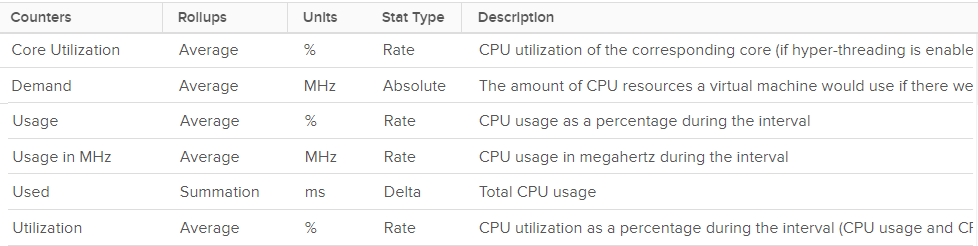
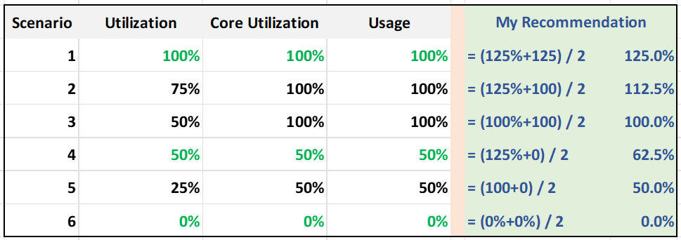
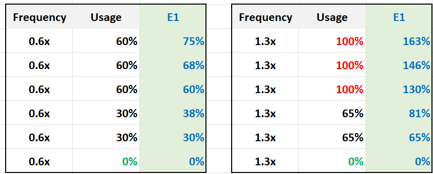

# ESXi CPU consumption metrics compared

## The set
- vSphere Client: 6 ESXi CPU consumption counters: Core Utilization (%), Demand (MHz), Usage (%), Usage (MHz), Used (ms), Utilization (%). Plus 1 for reservation.


## Same host, three answers
- Example: Thread Utilization about 47-55%, Core Utilization about 70%, Usage (%) flat at 100% (older capped version).
- Same pattern, different sensitivity.
- Usage (%) is double Thread Utilization: Usage follows cores, not threads, and includes frequency.
- Usage flat while Thread Utilization moves: the cap, and Hyper-Threading adds only 1.25x per core.
- Core Utilization sits in the middle: it counts a core as busy with 1 or 2 threads.
- High load: Thread Utilization 80% → 90%; Core Utilization approaches 100%, the absolute limit; Usage (%) above 100% (Turbo vs base frequency).

## Rollup over 6 scenarios
| Scenario | Threads running | Utilization | Core Utilization | Usage | Proposed value |
|---|---|---|---|---|---|
| 1 | all 4 | 100% | 100% | 100% | (125% + 125%) / 2 = 125% |
| 2 | 2 on core 1, 1 on core 2 | 75% | 100% | 100% | (125% + 100%) / 2 = 112.5% |
| 3 | 1 per core | 50% | 100% | 100% | (100% + 100%) / 2 = 100% |
| 4 | 2 on core 1 | 50% | 50% | 50% | (125% + 0%) / 2 = 62.5% |
| 5 | 1 on core 1 | 25% | 50% | 50% | (100% + 0%) / 2 = 50% |
| 6 | none | 0% | 0% | 0% | 0% |



- 6 scenarios give fewer than 6 distinct values. The cause is Hyper-Threading.
- Scenario 1: Usage is 100%, though each thread shows 50% Used. Each core has 20,000 ms, not 40,000 ms. Same behaviour as Core Utilization.
- Scenario 3: Utilization shows 50% with both cores busy. Hyper-Threading delivers 1.25x, so 80% is the better reading.
- Scenario 5: Utilization again too low.
- The proposed value shows the 1.25x Hyper-Threading bonus: 125% for a fully busy core. Each thread still pays a 37.5% penalty.

## With power management
- Frequency 0.6x: Usage 60%, 60%, 60%, 30%, 30%, 0% for scenarios 1-6. Proposed value: 75%, 68%, 60%, 38%, 30%, 0%.
- Frequency 1.3x: Usage 100%, 100%, 100%, 65%, 65%, 0% (capped at 100% on older releases; current releases are not capped). Proposed value: 163%, 146%, 130%, 81%, 65%, 0%.
- Demand is not capped.


## Sensitivity
| Metric | Behaviour |
|---|---|
| Utilization (Thread) | Shows 50% when the better reading is 80%. |
| Core Utilization | Reaches 100% when the better reading is 80%. |
| Usage, Used, Consumed | Essentially the same. Frequency-driven: under-report at low load (power saving), over-report at high load (Turbo). |
| Demand | Higher than Usage. |

## Purpose decides
- Performance (VM-centric): give VMs the best resource, without Hyper-Threading sharing.
- Capacity (ESXi-centric): use all resources, including Hyper-Threading.
- See `vsphere/technology/cpu/health-check/host-cpu-capacity-headroom`.

## Traps
- "Usage (%) 100% means the host is full" → check Core and Thread Utilization.
- "Thread Utilization 50% means half the capacity is left" → all cores can be busy.

## Metadata
```yaml
id: vsphere/technology/cpu/metrics/comparisons/host-consumption-metrics
retriever_guide: metric-meaning
scope: vsphere
technology:
- cpu
pillar:
- capacity
- performance
product:
- vsphere
object:
- HostSystem
metric_class: consumption
internal_derive:
- vsphere/technology/cpu/concepts/hyper-threading
same_name: []
same_meaning: []
related:
- vsphere/technology/cpu/metrics/host/utilization
- vsphere/technology/cpu/metrics/host/core-utilization
- vsphere/technology/cpu/metrics/host/usage
- vsphere/technology/cpu/metrics/host/used
- vsphere/technology/cpu/metrics/host/demand
- vsphere/technology/cpu/health-check/host-cpu-capacity-headroom
images:
  - path: ../../images/vcenter-esxi-cpu-consumption-counters-table.png
    product: [vsphere]
    object: [HostSystem]
    metric: ['ESXi CPU Usage', 'ESXi CPU Utilization', 'ESXi CPU Core Utilization', 'ESXi CPU Used']
    image_type: table
  - path: ../../images/esxi-cpu-utilization-rollup-6-scenarios-with-proposed-value.png
    product: [vsphere]
    object: [HostSystem]
    metric: ['ESXi CPU Utilization', 'ESXi CPU Usage']
    image_type: table
  - path: ../../images/esxi-cpu-usage-vs-proposed-value-at-low-and-turbo-frequency.png
    product: [vsphere]
    object: [HostSystem]
    metric: ['ESXi CPU Usage']
    image_type: table
source:
  document: PART 3 - Counters.docx
  path: 'CPU > ESXi > Consumption Metrics > Quiz: 50% or 75% or 100%?; Summary > Comparison'
corrections: []
review_notes: []
status: draft
```
