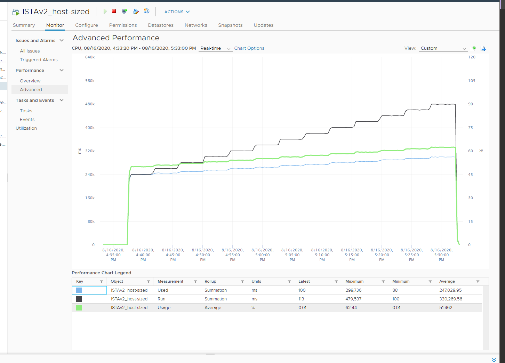
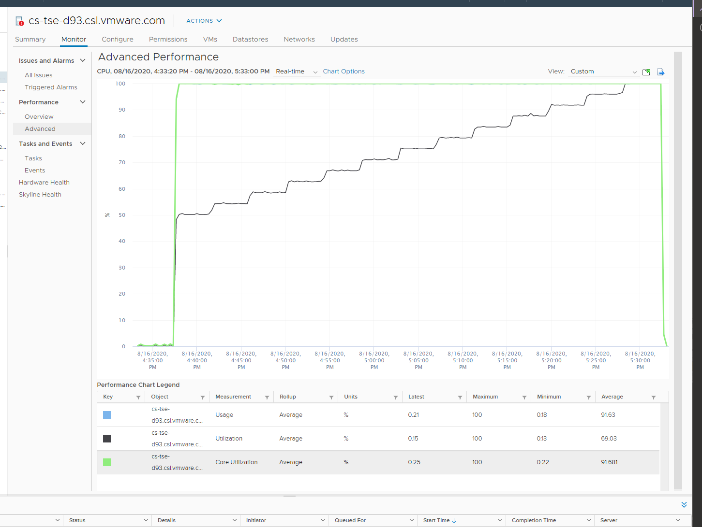

# Hyper-Threading ramp test: VM vs ESXi

## Setup
- One 24-vCPU VM on an ESXi host with 12 cores, Hyper-Threading on (24 threads).
- Power management fixed: cores run at nominal clock speed. No frequency effect.
- Start: 12 vCPUs busy, each pinned to a different core. Then load ramps to all 24 vCPUs at 100%.



## Values
| Metric | Start (12 vCPUs, 1 thread per core) | End (24 vCPUs, 2 threads per core) |
|---|---|---|
| VM Run (ms) | 240,000 (50%) | 480,000 (100%) |
| VM Used (ms) | 240,000 (50%) | 300,000 (62.5%) |
| VM Usage (%) | 50% | 62.5% |
| ESXi Core Utilization (%) | 100% | 100% |
| ESXi Usage (%) | 100% | 100% |
| ESXi Thread Utilization (%) | 50% | 100% |

## Why
- VM Run counts time per vCPU: 20,000 ms × 24 at the end.
- VM Used rises only 1.25x: Hyper-Threading delivers 1.25x per core. Used (ms) tracks Usage (%).
- VM Usage (%) is aware of Hyper-Threading. Each vCPU gets 62.5% on average.
- ESXi Core Utilization is 100% from the start: each core runs a thread.
- ESXi Usage (%) equals Core Utilization here because frequency is static. It stays at 100%: all cores were busy, and the test ran on a release that capped the metric at 100%. Current releases are not capped.
- ESXi Thread Utilization (%) counts threads, ignoring that 2 threads share a core. It ramps 50% → 100%.
- VM Run and ESXi Utilization both doubled.

## Use of each metric
| Metric | Use |
|---|---|
| VM Run | Guest OS sizing: counts each vCPU used by the guest. |
| VM Usage (%) | Not for VM capacity: shows 62.5% when the VM already runs 100%. |
| ESXi Usage (%) | Capacity: conservative. Not for performance: cannot show remaining room. |
| ESXi Thread Utilization (%) | Performance: tracks the ramp. Capacity: 100% means a performance hit; the HT effect starts at 50%. |

## Misconceptions
- "VM Usage 62.5%, so 37.5% headroom" → the VM is already at 100% Run.
- "ESXi Usage 100%, so the host is full" → threads may still be free. Check Utilization.
- "VM aware of HT means ESXi Usage is too" → VM Usage (%) is HT-aware; ESXi Usage (%) is not.

## Metadata
```yaml
id: vsphere/technology/cpu/metrics/comparisons/vm-vs-esxi-ht-ramp-test
retriever_guide: metric-meaning
scope: vsphere
technology:
- cpu
pillar:
- performance
- capacity
product:
- vsphere
- vcf-operations
object:
- VirtualMachine
- HostSystem
metric_class: consumption
internal_derive:
- vsphere/technology/cpu/concepts/hyper-threading
- vsphere/technology/cpu/concepts/cpu-measurement-levels
same_name: []
same_meaning: []
related:
- vsphere/technology/cpu/metrics/virtual-motherboard/run
- vsphere/technology/cpu/metrics/virtual-motherboard/used
- vsphere/technology/cpu/metrics/virtual-motherboard/usage
- vsphere/technology/cpu/metrics/host/core-utilization
- vsphere/technology/cpu/metrics/host/utilization
- vsphere/technology/cpu/metrics/host/usage
images:
  - path: ../../images/hyper-threading-ramp-test-vm-cpu-run-used-usage.png
    product: [vsphere]
    object: [VirtualMachine]
    metric: ['VM CPU Run', 'VM CPU Used', 'VM CPU Usage']
    topic: 'Hyper-Threading accounting'
    image_type: timeline
  - path: ../../images/hyper-threading-ramp-test-esxi-cpu-usage-core-utilization-utilization.png
    product: [vsphere]
    object: [HostSystem]
    metric: ['ESXi CPU Usage', 'ESXi CPU Core Utilization', 'ESXi CPU Utilization']
    topic: 'Hyper-Threading accounting'
    image_type: timeline
source:
  document: PART 3 - Counters.docx
  path: CPU > VM (pp. 78-118) > Quiz! > VM vs ESXi
corrections: []
review_notes:
- 'Test data from Valentin Bondzio (book footnote).'
status: draft
```
