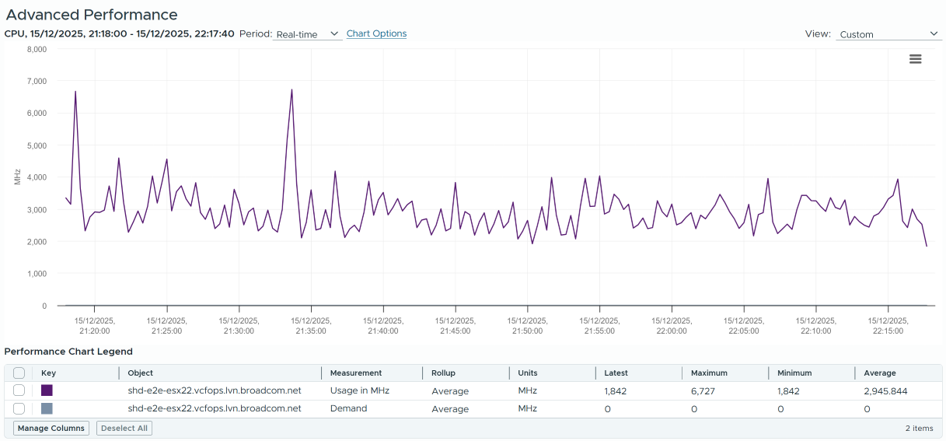
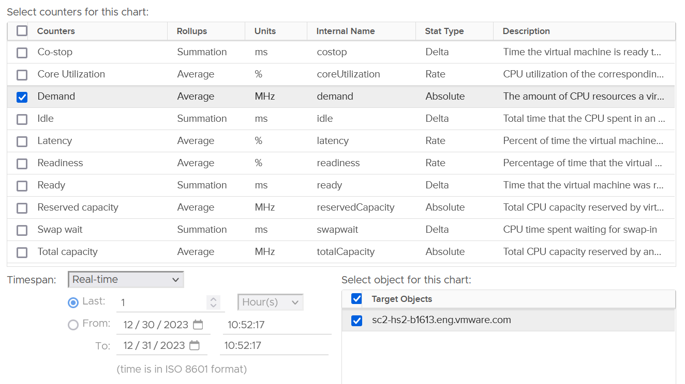

# ESXi CPU Demand

## Meaning
- A sum-of-consumers metric at the provider. Providers have 2 kinds of counters:
  - Provider metric: exists only at the provider. Example: ESXi physical network.
  - Sum of consumer metric: aggregates the consumers. Example: sum of VM network at ESXi.
- ESXi Demand is the second kind: the sum over the VMs.
- Not the sum of VM worlds plus VMkernel worlds.
- An internal metric of the CPU scheduler: the ideal total demand had there been no contention at all.

## Behaviour
- Internal counter of the kernel CPU scheduler. The kernel knows Hyper-Threading costs performance, so Demand looks at a different context from Utilization and Used.
- Value at ESXi: summation over the VMs, not over physical threads. So it is not available per core or thread.
- Can exceed 500%. Example: a host running flat out with Usage (%) above 100%; Demand 4.7x higher.
- Includes reservations of running VMs and of the kernel. Usage includes actual use by running VMs and the kernel.
- Host with no VMs: Demand flat at 0, or flat at the kernel reservation. Example: flat 10.21% for weeks, equal to Overhead (MHz). Usage is not 0: it includes kernel work such as vSAN and NSX.
- Example, real-time chart of a host without VMs: Usage about 3,000 MHz on average (peak 6,727 MHz), Demand 0 throughout.

- Kernel reservation below kernel use: Demand below Usage.
- Once VMs share cores, Demand is higher than Usage.
- Not capped at 100%.


## Traps
- "ESXi Demand = VM usage + kernel usage" → wrong. Demand counts VM demand and reservations, not usage.
- "Demand above 300% means the host is 3x overloaded" → Demand sums VM demand and reservations. Check contention.
- "Host with no VMs has 0 Demand" → it can be 0, or flat at the kernel reservation. Either way Usage is not 0: kernel work is in Usage, not in Demand.

## Metadata
```yaml
id: vsphere/technology/cpu/metrics/host/demand
retriever_guide: metric-meaning
scope: vsphere
technology:
- cpu
pillar:
- performance
- capacity
product:
- vsphere
object:
- HostSystem
metric_class: consumption
internal_derive:
- vsphere/architecture/provider-consumer
same_name: []
same_meaning: []
related:
- vsphere/technology/cpu/metrics/comparisons/consumption-metrics
- vsphere/technology/cpu/concepts/hyper-threading
- vsphere/technology/cpu/metrics/comparisons/host-consumption-metrics
- vsphere/technology/cpu/metrics/host/reserved-capacity
images:
  - path: ../../images/esxi-cpu-demand-usage-without-vm.png
    product: [vsphere]
    object: [HostSystem]
    metric: ['ESXi CPU Usage', 'ESXi CPU Demand']
    image_type: timeline
  - path: ../../images/esxi-cpu-demand-chart.png
    product: [vsphere]
    object: [HostSystem]
    metric: ['ESXi CPU Demand']
    image_type: timeline
source:
  document: PART 3 - Counters.docx
  path: The World of Metrics > Metrics Nuances > Virtualization Impact; CPU > ESXi > Demand
corrections:
- "2026-11-02 correction ('provider metric') refined by Q009 (2026-11-03): ESXi Demand is a sum-of-consumer metric held at the provider."
review_notes:
- 'Section ''Behaviour'': screenshot of a host without VMs uploaded by the author (2026-11-07): Demand 0, Usage about 3 GHz.'
- 'Section Behaviour: from CPU > ESXi.'
- "Section 'Meaning': author (2026-11-03), Q009: providers have provider metrics and sum-of-consumer metrics. ESXi Demand is a sum of VM Demand."
status: draft
```
