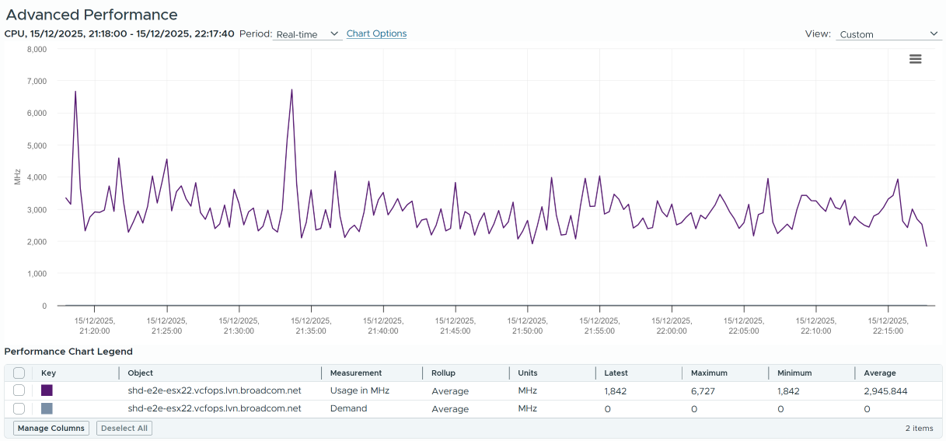
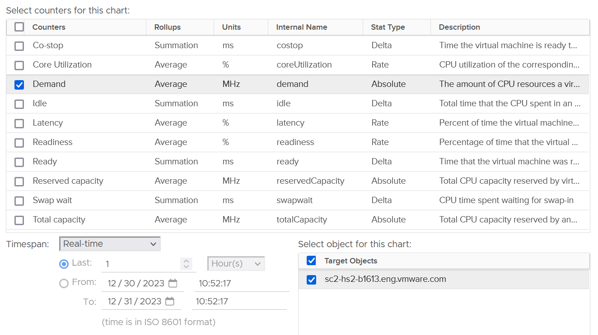

# ESXi CPU Demand

## Meaning
- ESXi CPU Demand is a sum-of-consumers metric at the provider: the sum over the VMs, not a provider metric of its own ([`vsphere/architecture/provider-consumer`](../../../../architecture/provider-consumer.md)).
- Not the sum of VM worlds plus VMkernel worlds.
- An internal metric of the CPU scheduler: the ideal total demand had there been no contention at all. vSphere Web Services API 9.1 defines `cpu.demand`, for VirtualMachine and HostSystem, as the CPU a VM would use with no CPU contention or CPU limit; it names no reservation.
- Relevance for operations: capacity, in its VCF Operations form, which follows the capacity model (section vCenter vs VCF Operations). Not a performance signal: Demand above Usage can be reservation alone, so read VM CPU Ready and Co-stop. The legacy CPU Active metrics duplicate it ([`vsphere/technology/cpu/metrics/host/cpu-utilization-for-resources`](cpu-utilization-for-resources.md)).

## vCenter vs VCF Operations
Same name, two formulas. vCenter looks from the administration view (what the scheduler wants now); VCF Operations from the operations view (what the host must be able to deliver). The split dates back to vRealize Operations; it is not a 9.x change.

| Tool | ESXi CPU Demand (MHz) includes | Excludes |
|---|---|---|
| vCenter (`cpu.demand`) | The demand of the running VMs | The kernel's CPU reservation (System Resource Reservation) and the CPU reservations of VMs |
| VCF Operations (`CPU\|Demand`) | Per running VM, the higher of its demand and its CPU reservation; plus the kernel's CPU reservation | |

- Per VM, the higher of the two, not the sum: a VM demanding 4 GHz with a 5 GHz reservation counts 5 GHz; demanding 6 GHz, it counts 6 GHz. The same rule as the capacity model (Capacity demand, section Demand).
- Usage is one counter in both tools: actual use by running VMs and the kernel. VCF Operations stores the 5-minute average of the 20-second samples.
- Example: a host with a 3 GHz kernel CPU reservation, VMs demanding 0.5 GHz, no VM reservations. vCenter Demand about 0.5 GHz; VCF Operations Demand about 3.5 GHz. Subtract the reservation to compare the two. Usage agrees between the tools, except that one 20-second peak weighs 1/15 of a 5-minute VCF Operations value.
- Arithmetic check: a 5-minute average cannot exceed the largest 20-second sample. A VCF Operations Demand far above the vCenter maximum is the formula, not the rollup.
- On a quiet host, VCF Operations Demand sits far above Usage with no contention: the gap is reserved capacity, not unmet demand. When the kernel uses more than its reservation, VCF Operations Demand can sit below Usage. vCenter Demand on a quiet host sits below Usage, because kernel work is in Usage only.
- Host with no VMs: vCenter Demand flat at 0; VCF Operations Demand flat at the kernel reservation. Example: flat 10.21% for weeks in VCF Operations, equal to Overhead (MHz). Usage is not 0 in either: it includes kernel work such as vSAN and NSX.
- VM CPU Demand does not include the VM's reservation in either tool ([resource controls](../../../../architecture/resource-controls.md), Reservation: CPU vs memory).

## Behaviour (both tools)
- Internal counter of the kernel CPU scheduler. The kernel knows Hyper-Threading costs performance, so Demand looks at a different context from Utilization and Used.
- Value at ESXi: summation over the VMs, not over physical threads. So it is not available per core or thread.
- Can exceed 500%. Example: a host running flat out with Usage (%) above 100%; Demand 4.7x higher.
- Example, vCenter real-time chart of a host without VMs: Usage about 3,000 MHz on average (peak 6,727 MHz), Demand 0 throughout.

- Once VMs share cores, Demand is higher than Usage.
- Not capped at 100%.


## Misconceptions
- "ESXi Demand = VM usage + kernel usage" → wrong. Demand counts VM demand (and, in VCF Operations, reservations), not usage.
- "ESXi CPU Demand in vCenter and in VCF Operations is the same counter" → same name, two formulas. VCF Operations counts the kernel's CPU reservation and, per running VM, the higher of its demand and its CPU reservation.
- "VCF Operations Demand far above vCenter Demand is a rollup bug" → it is the reservations. Subtract the CPU System Resource Reservation (host > Configure > System > System Resource Reservation) and the VM reservations, and compare.
- "Demand above Usage means VMs wait for CPU" → in VCF Operations the gap can be reservation alone. Check Ready and Co-stop.
- "Demand above 300% means the host is 3x overloaded" → Demand sums VM demand (and, in VCF Operations, reservations). Check contention.
- "Host with no VMs has 0 Demand" → 0 in vCenter, flat at the kernel reservation in VCF Operations. Either way Usage is not 0: kernel work is in Usage, not in Demand.

## Metadata
```yaml
id: vsphere/technology/cpu/metrics/host/demand
retriever_guide: metric-meaning
scope: vsphere
technology:
- cpu
pillar:
- performance
- capacity
product:
- vsphere
object:
- HostSystem
metric_class: consumption
internal_derive:
- vsphere/architecture/provider-consumer
same_name:
- vsphere/technology/cpu/metrics/virtual-motherboard/demand
same_meaning: []
related:
- vsphere/architecture/resource-controls
- vsphere/technology/cpu/metrics/comparisons/consumption-metrics
- vsphere/technology/cpu/concepts/hyper-threading
- vsphere/technology/cpu/metrics/comparisons/host-consumption-metrics
- vsphere/technology/cpu/metrics/host/reserved-capacity
- vsphere/technology/cpu/metrics/host/cpu-utilization-for-resources
images:
  - path: ../../images/esxi-cpu-demand-usage-without-vm.png
    product: [vsphere]
    object: [HostSystem]
    metric: ['ESXi CPU Usage', 'ESXi CPU Demand']
    image_type: timeline
  - path: ../../images/esxi-cpu-demand-chart.png
    product: [vsphere]
    object: [HostSystem]
    metric: ['ESXi CPU Demand']
    image_type: timeline
source:
  document: Knowledge base; vSphere Web Services API 9.1 reference, CPU Counters
  path: The World of Metrics > Metrics Nuances > Virtualization Impact; CPU > ESXi > Demand; https://developer.broadcom.com/xapis/vsphere-web-services-api/9.1/cpu_counters.html, demand
corrections: []
review_notes: []
status: draft
```
