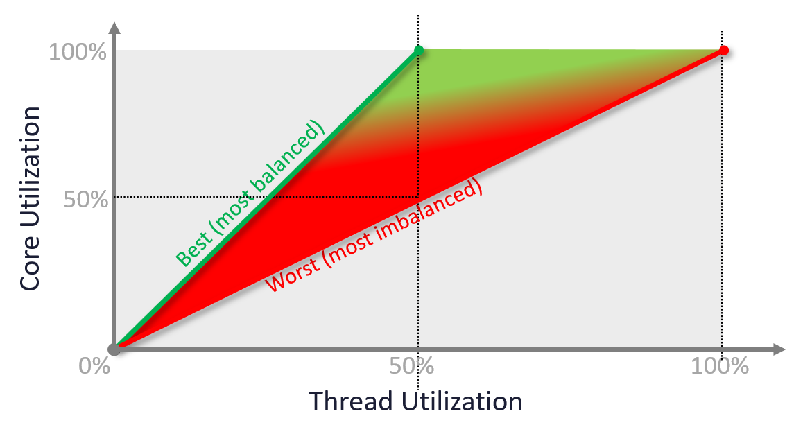
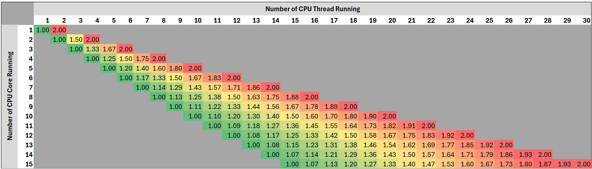

# ESXi CPU Imbalance

## Meaning
- How many threads run per running core.
- Use it together with Core Utilization.
- Not a built-in VCF Operations metric. Published in the VCF vCommunity Adapter: https://github.com/e1-rahabok/VCF-vCommunity-Adapter/tree/main/docs/reference/metrics

## Formula
```text
ESXi CPU Imbalance = count of running threads / count of running cores
Cluster ESXi CPU Imbalance = average (ESXi CPU Imbalance)
```

## Why
- All cores should be used before 2 threads share a core.
- With Hyper-Threading the worst score is 2.0.
- While cores are idle, no core should run 2 threads. The ideal is 1.0 until Core Utilization reaches 100%.
- The score's colour moves from red to green as Core Utilization reaches 100%.



## Example
- 64 cores, 128 threads. Score 1.5 with 40 running cores:
  - 20 cores run 2 threads.
  - 20 cores run 1 thread.
  - 24 cores are idle.
- Ideal: 60 cores running 1 thread each.

## Misconceptions
- "Score 2.0 is always bad" → bad only while cores are idle. At 100% Core Utilization, 2 threads per core is expected.

## Metadata
```yaml
id: vsphere/technology/cpu/metrics/host/imbalance
retriever_guide: metric-meaning
scope: vsphere
technology:
- cpu
pillar:
- performance
product:
- vsphere
- vcf-operations
object:
- HostSystem
metric_class: consumption
internal_derive: []
same_name: []
same_meaning: []
related:
- vsphere/technology/cpu/metrics/host/core-utilization
- vsphere/technology/cpu/metrics/host/utilization
- vsphere/technology/cpu/metrics/host/peak-core-usage
images:
  - path: ../../images/esxi-cpu-imbalance-core-utilization-vs-thread-utilization-best-and-worst.png
    product: [vcf-operations]
    object: [HostSystem]
    metric: ['ESXi CPU Imbalance', 'ESXi CPU Core Utilization', 'ESXi CPU Utilization']
    image_type: diagram
  - path: ../../images/esxi-cpu-imbalance-score-by-running-cores-and-threads.png
    product: [vcf-operations]
    object: [HostSystem]
    metric: ['ESXi CPU Imbalance']
    image_type: table
source:
  document: PART 3 - Counters.docx
  path: CPU > ESXi > Consumption Metrics > Imbalance
corrections: []
review_notes: []
status: draft
```
