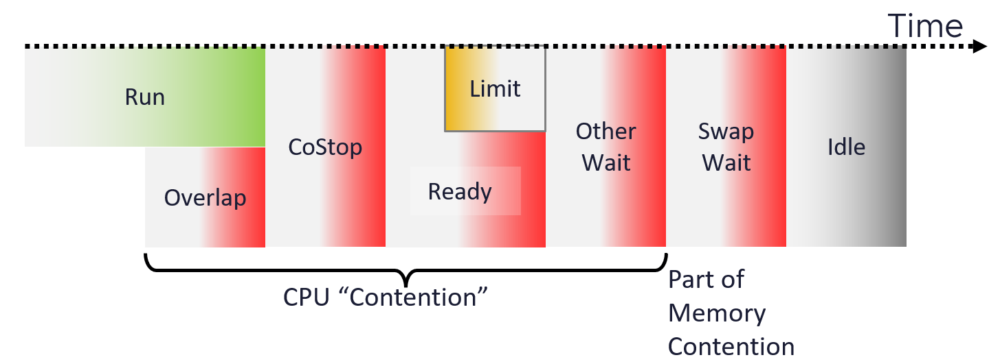

# VM CPU Contention (VCF Operations)

## Meaning
- Time the vCPU does not get CPU time.
- A VCF Operations metric. vSphere has no Contention counter. The vSphere counter is CPU Latency (esxtop %LAT_C).
- Before VCF Operations 8.18 (July 2024) Contention mapped to CPU Latency, which excludes limit. From 8.18 it has its own formula, which includes limit.

## Formula (from July 2024)
```text
Contention (%) = Overlap + Co-stop + Ready + Other Wait (if less than 1%)
```
- Other Wait is added only when below 1%. The condition prevents false positives: idle VMs can report raised VM Wait after some upgrades (Broadcom KB 338438).


## Mechanism
- CPU frequency does not apply: the vCPU is not running.
- In most cases the value comes from Ready. Contention is often almost identical to Ready.
- Includes Ready caused by a limit. Reason: separate what from why. The VM faces contention; the cause (limit, shares, host load) is a separate question.
- Swap Wait is excluded. It belongs to memory contention.

## Limitation
- Because it includes limit, it cannot measure ESXi or cluster performance. A limit is unrelated to the cluster.

## Traps
- "Contention = Latency" → true only before July 2024.
- "High Contention means the cluster is overloaded" → a limit can cause it.

## Metadata
```yaml
id: vsphere/technology/cpu/metrics/virtual-motherboard/contention
retriever_guide: metric-meaning
scope: vsphere
technology:
- cpu
pillar:
- performance
product:
- vcf-operations
object:
- VirtualMachine
layer:
- virtual-motherboard
metric_class: contention
internal_derive:
- vsphere/technology/cpu/concepts/vcpu-states
same_name: []
same_meaning: []
related:
- vsphere/technology/cpu/metrics/virtual-motherboard/ready
- vsphere/technology/cpu/metrics/virtual-motherboard/latency
- vsphere/technology/cpu/metrics/virtual-motherboard/overlap
- vsphere/technology/cpu/metrics/virtual-motherboard/co-stop
- vsphere/technology/cpu/metrics/virtual-motherboard/other-wait
- vsphere/technology/cpu/metrics/comparisons/vm-contention-metrics
- vsphere/technology/cpu/troubleshooting/vm-cpu-contention-high
images:
  - path: ../../images/vm-cpu-contention-components-overlap-costop-ready-other-wait.png
    product: [vcf-operations]
    object: [VirtualMachine]
    metric: ['VM CPU Contention']
    image_type: diagram
source:
  document: PART 3 - Counters.docx
  path: CPU > VM (pp. 78-118) > Contention Metrics > Contention
corrections: []
review_notes:
- "Section 'Formula': author (2026-11-03), Q004: the 1% condition avoids false positives. https://knowledge.broadcom.com/external/article/338438/increased-vmwait-for-idle-vms-after-upgr.html"
- "Section 'Meaning': author (2026-11-03), Q005: Contention is a VCF Operations counter; vSphere has CPU Latency (%LAT_C). The formula changed in VCF Operations 8.18."
- 'Moved 2026-11-06 from vsphere/technology/cpu/metrics/virtual-motherboard/contention (architecture review 2026-11-06, section 5).'
status: draft
```
