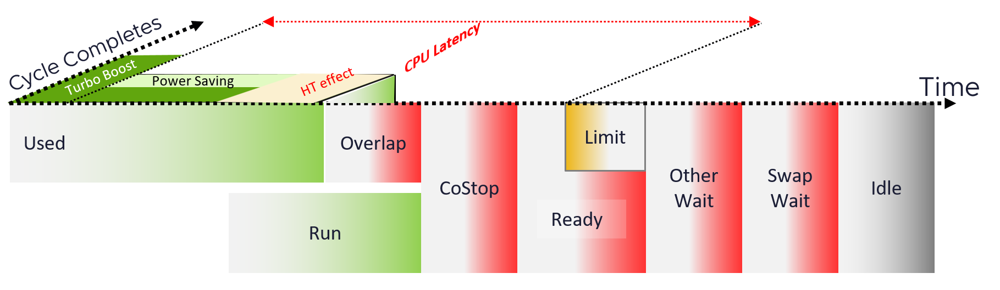

# VM CPU Latency

## Meaning
- Does not always indicate a performance problem.
- Affected by CPU frequency, which goes up or down.
- At lower frequency the VM runs slower but is not waiting to be served. Equivalent to running on an older CPU.

## Contrast with other Latency metrics
- Memory Latency and Disk Latency do indicate a performance problem. They are primary counters for how well the VM is served.

## Contrast with Linux Steal Time
- Linux Steal Time includes only CPU Ready.
- Overlap is not in Steal Time. ESXi accounts Overlap as Run, not as wait, so it bypasses the steal-time accumulator. The guest is not told the time was taken.
- Linux Steal Time is blind to Overlap. Use Net Run = Run - Overlap (VCF Operations) for actual execution time.
- VM CPU Latency includes many factors, including CPU frequency.
- Pattern: same purpose, different formula.

## Hyper-Threading
- Ready, Co-stop and Wait do not register Hyper-Threading contention. Contention for shared core resources happens in hardware, not in the scheduler.
- CPU Latency is the counter for throughput lost when the sibling thread runs.
- Hyper-Threading changes CPU Latency by 0% to 37.5%.

## What Latency includes
- esxtop counter: %LAT_C. Tracks time the vCPU could have run in an ideal case.
- Includes: Overlap, Co-stop (also when caused by a limit), Ready excluding Max Limited, Hyper-Threading effect, power saving below nominal frequency.
- Excludes: Max Limited, Other Wait, Swap Wait, Idle.
- Hyper-Threading and frequency are effects, not metrics. esxtop %A/MPERF shows the frequency effect.


## Hyper-Threading
```text
Used + Latency = 100%
```
- Both threads running: Used reports 62.5% and Latency 37.5%. Ready stays 0%.

## Use
- Volatile, because of Hyper-Threading and frequency. Not suitable as a KPI counter.
- The VM KPI uses Ready. Use Latency (or Contention) for troubleshooting CPU-sensitive VMs.
- Latency and Ready correlate poorly: built for different purposes (2,500 VMs analyzed).
- Latency can fall while Ready and Co-stop rise.
- Latency near 0% with Ready above 15%: a limit. Latency excludes it. VMware Cloud Director sets limits, so Latency misses that contention.
- More stable contention measure: Ready + Co-stop + Overlap + Other Wait + Swap Wait. All in ms.

## Historical issue
- ESXi 6.5 and older: VMs with Latency Sensitivity = High showed guest idle time as %LAT_C. Fixed in ESXi 6.7.

## Misconceptions
- "CPU Latency rose, so the VM has CPU contention" → check whether CPU frequency changed. Waiting shows in unmet-demand metrics (Ready, Co-Stop). See `vsphere/architecture/vm-vs-guest-os`, area D.
- "Steal Time inside Linux equals VM CPU Latency" → different formulas.
- "Latency is the best KPI metric" → too volatile. Use Ready.
- "Latency 0% means no contention" → limits are excluded. Check Ready.

## Metadata
```yaml
id: vsphere/technology/cpu/metrics/virtual-motherboard/latency
retriever_guide: metric-meaning
scope: vsphere
technology:
- cpu
pillar:
- performance
product:
- vsphere
object:
- VirtualMachine
layer:
- virtual-motherboard
metric_class: contention
internal_derive:
- vsphere/architecture/vm-vs-guest-os
- vsphere/technology/cpu/concepts/vcpu-states
- vsphere/technology/cpu/concepts/hyper-threading
same_name:
- vsphere/technology/memory/metrics/virtual-motherboard/latency
- vsphere/technology/storage/metrics/virtual-motherboard/disk-latency
same_meaning: []
related:
- vsphere/technology/cpu/metrics/virtual-motherboard/ready
- vsphere/technology/cpu/concepts/guest-os-vs-vm-cpu
- vsphere/technology/cpu/metrics/virtual-motherboard/contention
- vsphere/technology/cpu/metrics/comparisons/vm-contention-metrics
- vsphere/technology/cpu/troubleshooting/vm-cpu-contention-high
images:
  - path: ../../images/vm-cpu-latency-components-overlap-costop-ready-ht-power.png
    product: [vsphere]
    object: [VirtualMachine]
    metric: ['VM CPU Latency']
    image_type: diagram
source:
  document: Private Cloud Management by Iwan Rahabok (https://isvara.io/download)
  path: The World of Metrics > Metrics Nuances > Complexity > Naming Complexity; CPU > Architecture > Architecture intro; State of a VM vCPU; CPU > VM > Contention Metrics > Latency
corrections: []
review_notes:
- Sections Hyper-Threading: from CPU > Architecture.
- 'Sections What Latency includes, Hyper-Threading, Use, Historical issue: from CPU > VM. Latency diagram adapted from a Valentin Bondzio diagram.'
status: draft
```
