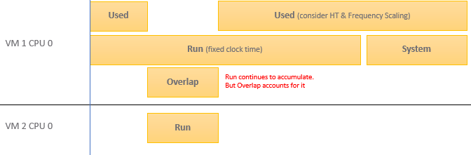

# VM CPU Overlap

## Meaning
- Time a running vCPU was interrupted so the kernel could run a system service.
- The service can be on behalf of the interrupted VM or another VM.
- Contention metric. Unit: ms, summed over the 20-second sample.

## Mechanism
- While ESXi runs a vCPU, IO processing (for example incoming network packets) can arrive.
- With no other core free, the kernel schedules the work on a busy core.
- If that core runs a vCPU, the vCPU is interrupted.
- Only system services (kernel processes) cause Overlap. Other vCPU worlds do not.
- So Overlap is usually lower than Ready and Co-stop.
- Disk and network IO drive the value. The IO can come from the host or other VMs, not only this VM.


## Effect on other metrics
- Run does not see Overlap. Run keeps accumulating during the interruption.
- Used and Demand account for it. Usage goes down when Overlap goes up.
- Ready does not include Overlap: the vCPU stays in the Run state.
- Net Run = Run - Overlap.
- Linux Steal Time does not include Overlap. ESXi counts Overlap as Run, so the guest is not told the time was taken. Net Run is the only way to see actual execution time.

## Effect on the Guest OS
- A freeze. The guest clock does not tick for that vCPU. Time jumps when it runs again.
- Include Overlap in Guest OS sizing: it is runtime the guest demanded. Same effect as unmet Demand.

## Names
- Some VMware documentation calls Overlap "Stolen".
- The book states that Linux tracks it as stolen time.

## VCF Operations
- Reports the peak 20-second value of any vCPU.
- Example: a 68-vCPU VM with 20,000 ms of Overlap: low for its size, but one vCPU worth of interruption.

## Traps
- "Run includes the interruption, so Run equals work done" → Run does not see Overlap. Use Net Run or Used.
- "Overlap comes from this VM's IO" → it can come from host IO or other VMs.
- "Ready covers all time a vCPU was not running" → Overlap happens inside the Run state.

## Metadata
```yaml
id: vsphere/technology/cpu/metrics/virtual-motherboard/overlap
retriever_guide: metric-meaning
scope: vsphere
technology:
- cpu
pillar:
- performance
product:
- vsphere
object:
- VirtualMachine
layer:
- virtual-motherboard
metric_class: contention
internal_derive:
- vsphere/technology/cpu/concepts/vcpu-states
same_name: []
same_meaning: []
related:
- vcf-operations/metrics/vm/cpu-net-run
- vsphere/technology/cpu/metrics/virtual-motherboard/run
- vsphere/technology/cpu/metrics/virtual-motherboard/used
- vsphere/technology/cpu/metrics/comparisons/vm-contention-metrics
- vsphere/technology/cpu/metrics/virtual-motherboard/system
images:
  - path: ../../images/vm-cpu-used-vs-run-overlap-and-system.png
    product: [vsphere]
    object: [VirtualMachine]
    metric: ['VM CPU Used', 'VM CPU Run', 'VM CPU Overlap', 'VM CPU System']
    image_type: diagram
source:
  document: PART 3 - Counters.docx
  path: CPU > VM (pp. 78-118) > Contention Metrics > Overlap
corrections: []
review_notes:
- "Section 'Hyper-Threading': author (2026-11-03), Q001: Linux Steal Time includes Ready only, not Overlap. The book's VM section statement that Linux tracks Overlap as stolen time is wrong."
status: draft
```
