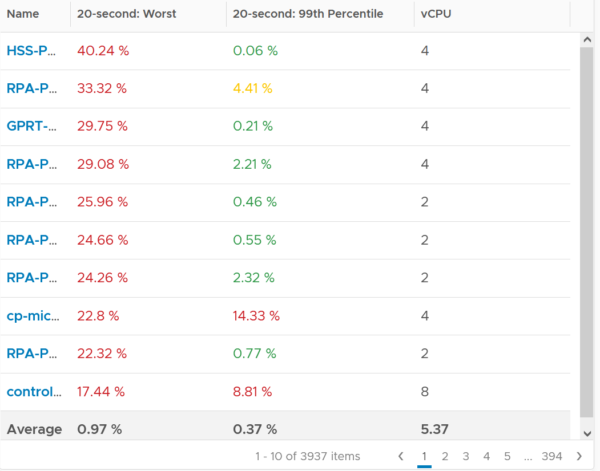

# VM CPU Ready

## Meaning
- Ready applies to a consumer (the VM). A physical core or thread is always ready, so Ready does not apply to ESXi.

## Values above 100%
- VM CPU Ready can exceed 100%. Many VM-level values in esxtop exceed 100%.
- Cause: summation, not average.

## Effect of limits
- A CPU limit impacts CPU Ready.

## Mechanism
- Ready: the vCPU demands runtime, and the kernel has no physical thread to run it.
- The kernel has no physical thread (not core) for the vCPU.
- VM-side causes: insufficient shares relative to other VMs, vMotion, a limit.
- ESXi-side cause: high host utilization. Sign: other VMs show Ready too.
- For the Guest OS, Ready is frozen time. Linux reports it as Steal Time. Windows does not account it.
- Ready does not register Hyper-Threading contention. A busy sibling thread does not put a vCPU into Ready.
- Ready on one vCPU can cause Co-stop on a sibling vCPU of the same VM.
- See `vsphere/technology/cpu/concepts/vcpu-states`.

## Read against Run
- Ready 5% with Run 95%: low.
- Ready 2% with Run 10%: very high. Ready is 20% of Run.

## Units
- vCenter and VCF Operations Ready (ms) is not normalized by vCPU count. A 4-vCPU VM totals 80,000 ms of Run + Ready + Co-stop + Wait per 20-second sample.
- The % version is normalized by vCPU count. Prefer it.

## Limit
- Ready includes time held back by a limit. The effect on the vCPU is the same.
- Under a limit the vCPU sits in the limbo queue. vCenter also reports this part as Max Limited (ms).
- Resource pools can apply limits unintentionally.
- Example: 4-vCPU VM on a 2.7 GHz CPU (10.77 GHz capacity) with a 4 GHz limit. Usage stopped at 3.95 GHz, Demand reached 6.6 GHz, Ready spiked to 40%.

## Floor and size
- Ready includes CPU scheduling cost (normally microseconds). It is not a flat 0 on an idle VM.
- Example: below 0.2% Ready on an idle VM running at 0.8%.
- Ready is lower when the guest stays busy than when processes keep waking and sleeping (more scheduling events).
- All else equal, Ready is higher on larger VMs. A busy host is less likely to run many vCPUs at the same time.
- Downsizing reduces both Ready and Co-stop: a smaller VM fits into free threads more easily.
- Counter-effect: shares scale with vCPU count by default. A smaller VM gets fewer shares, which can raise Ready under contention.
- High Ready with low Co-stop: whenever the VM runs, there are enough threads for all its vCPUs. An all-or-nothing pattern.

## Guest OS sizing
- Ready is runtime the guest demanded and did not get. Include it in Guest OS CPU sizing.
- 2% Ready on 10% Run: 20% of business transactions were delayed. The application may not notice 2% Ready on 98% Run.

## Ready (ms) vs Readiness (%)
- vCenter has 2 counters: Ready (ms) and Readiness (%). Same pattern.
- Readiness (%) is normalized by vCPU count. For a 4-vCPU VM, 80,000 ms = 100%. Not normalized it would read 400%.

## Observed values
- Use the 20-second peak, not the 5-minute peak. Unless the problem is chronic, Ready lasts seconds, not minutes.
- 3,937 production VMs, 4 months, about 35,000 samples per VM.
- Worst 20-second value per VM: the 10 worst VMs were bad (17%-40%). Average of the worst values: 0.97%.
- After removing the worst 1% of samples (about 350 per VM, the worst 29 hours in 4 months): average 0.37%. Most VMs green.
- Ready above 50% with high Usage results in poor performance.


## Traps
- "Host-level Ready is the host waiting for CPU" → Ready is a consumer metric. See `vsphere/architecture/provider-consumer`.
- "Ready 2% is always low" → read it against Run.
- "Ready is always caused by ESXi" → shares, vMotion and limits are VM-side causes.
- "5-minute Ready is low, so no problem" → Ready lasts seconds. Check the 20-second peak.
- "Idle VM should show 0% Ready" → scheduling cost keeps it slightly above 0.

## Metadata
```yaml
id: vsphere/technology/cpu/metrics/virtual-motherboard/ready
retriever_guide: metric-meaning
scope: vsphere
technology:
- cpu
pillar:
- performance
product:
- vsphere
object:
- VirtualMachine
layer:
- virtual-motherboard
metric_class: contention
internal_derive:
- vsphere/architecture/provider-consumer
- vsphere/architecture/resource-controls
- vsphere/technology/cpu/concepts/vcpu-states
same_name: []
same_meaning: []
related:
- vsphere/technology/cpu/metrics/virtual-motherboard/latency
- vsphere/technology/cpu/concepts/guest-os-vs-vm-cpu
- vsphere/technology/cpu/metrics/virtual-motherboard/run
- vsphere/technology/cpu/metrics/virtual-motherboard/co-stop
- vsphere/technology/cpu/metrics/virtual-motherboard/contention
- vsphere/technology/cpu/metrics/comparisons/vm-contention-metrics
- vsphere/tools/vsphere-client/performance-guidance
- vsphere/tools/vsphere-client/vcenter-statistics
images:
  - path: ../../images/vm-cpu-ready-20-second-worst-vs-99th-percentile-across-vms.png
    product: [vsphere]
    object: [VirtualMachine]
    metric: ['VM CPU Ready']
    image_type: scatter
    sample: '3,937 VMs'
source:
  document: PART 3 - Counters.docx
  path: The World of Metrics > Metrics Nuances > Complexity > Other Nuances; CPU > Architecture (pp. 52-78) > State of a VM vCPU; State Across Time; State Across Multiple vCPU; CPU > VM (pp. 78-118) > Contention Metrics > Ready; Best Practice; Ready | Readiness
corrections: []
review_notes:
- Sections Mechanism, Read against Run, Units, and the last 2 traps: from CPU > Architecture.
- 'Sections Limit, Floor and size, Guest OS sizing, Ready (ms) vs Readiness (%), Observed values: from CPU > VM.'
- 'Section ''Observed values'': the 50% statement is the book''s observation on a 16-vCPU VM, not a stated threshold.'
- 'To check: Section ''Larger VMs'': ''Shares scale with vCPU count by default''; not in the book.'
status: draft
```
