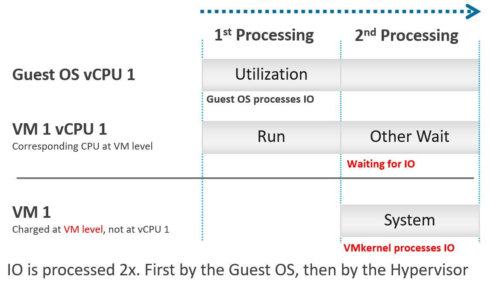

# VM CPU System

## Meaning
- CPU time the hypervisor spends on behalf of the VM: privileged instructions and IO commands.
- Unit: ms. Charged to the VM. Part of the VM's VMX world.

## Mechanism
- IO is processed twice: first by the Guest OS storage subsystem, then by the hypervisor storage subsystem.
- IP-based storage adds ESXi network stack processing.
- ESXi typically uses another core for this work and puts the vCPU in a wait state.
- Run does not include this work. It must be charged back to the VM.
- The Guest OS does not see the second processing. It sees a slower disk.
- Snapshots add work: the kernel traverses the snapshot chain.
- ESXi processes IO for all VMs issuing IO at that time. It may serialize random IO into sequential IO.


## Instance
- Not available per vCPU. The physical core doing the IO may serve more than one vCPU. No breakdown is possible.
- In vCenter, selecting System shows no per-vCPU instances.
- System is charged at VM level, not to vCPU 0 or any other vCPU.
- Result: total VM Used is higher than the sum of its vCPUs' Used.
- This is kernel accounting. It does not affect CPU scheduling.

## Scope
- CPU accounting only, not storage accounting.
- Since vSphere 6.5, Storage vMotion effort is not charged to the VM being moved.

## Values
- Most VMs: System below 0.5 vCPU most of the time (2,431 VMs observed).
- IO-intensive VMs such as NSX Edge: System is noticeable (Broadcom KB 59640). Adding vCPUs makes performance worse.
- The System counter in Linux differs from System in vSphere.

## Traps
- "System is charged to vCPU 0" → it is charged at VM level only.
- "VM Used should equal the sum of vCPU Used" → VM Used also holds System, so it is higher.
- "Add vCPUs to a high-System VM" → for NSX Edge it makes performance worse.
- "Guest OS System = VM System" → different counters.

## Metadata
```yaml
id: vsphere/technology/cpu/metrics/virtual-motherboard/system
retriever_guide: metric-meaning
scope: vsphere
technology:
- cpu
pillar:
- performance
- capacity
product:
- vsphere
object:
- VirtualMachine
layer:
- virtual-motherboard
metric_class: consumption
internal_derive:
- vsphere/architecture/kernel-worlds
same_name: []
same_meaning: []
related:
- vsphere/technology/cpu/metrics/virtual-motherboard/used
- vsphere/technology/cpu/metrics/virtual-motherboard/usage
- vsphere/technology/cpu/metrics/virtual-motherboard/overlap
- vsphere/technology/cpu/concepts/guest-os-vs-vm-cpu
images:
  - path: ../../images/vm-cpu-system-io-processed-by-guest-os-and-vmkernel.png
    product: [vsphere]
    object: [VirtualMachine]
    metric: ['VM CPU System']
    image_type: diagram
source:
  document: PART 3 - Counters.docx
  path: CPU > VM (pp. 78-118) > Consumption Metrics > System
corrections: []
review_notes:
- 'To check: Section ''Values'': KB cited by the book, not read (https://kb.vmware.com/s/article/59640).'
- 'vCenter counter description reads: amount of time spent on system processes on each virtual CPU in the virtual machine. Differs from the book''s per-vCPU statement.'
status: draft
```
