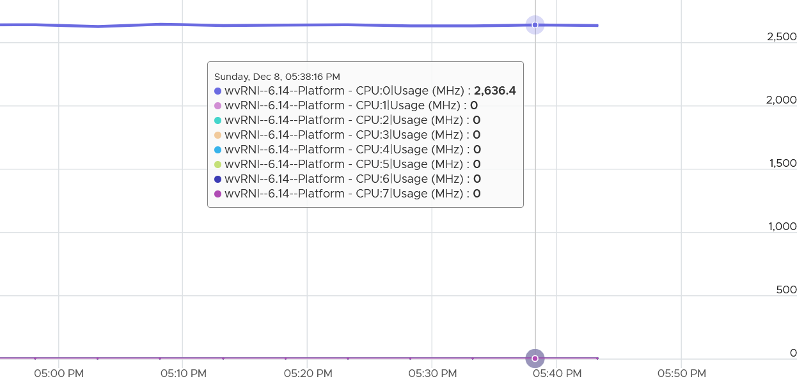

# VM CPU Usage Disparity (VCF Operations)

## Meaning
- How unevenly the vCPUs of one VM are used.
- Built from per-vCPU usage: Peak among vCPUs, Min among vCPUs, and Max - Min.

## Why it exists
- To show owners of large VMs how their vCPUs are used, when cost and refund do not convince them to downsize.
- Without it, the application team plots each vCPU one by one.

## Reading it
| Pattern | Meaning |
|---|---|
| All vCPUs balanced and low | The application cannot consume even one vCPU. Questions the vendor's vCPU request. Wastes software licenses. |
| Imbalance | Some vCPUs saturated, others not. Peak among vCPUs shows saturation. |
| Jumping process | vCPUs take turns being high. Process ping-pong: frequent start/stop or moving between vCPUs. Each move costs a context switch and cache warm-up. |
| CPU affinity | The same vCPUs are always busier. Not normal. Investigate. |

- Min among vCPUs is not useful on large VMs. One vCPU is bound to be near 0%.
- Max - Min shows the degree of disparity and how it changes over time.

## Name
- Disparity, not imbalance. Imbalance implies the vCPUs should be balanced, which is not the case.
- It does not indicate a Guest OS problem. VCF Operations cannot see inside the Guest OS.

## Example
- Average utilization 12%, Usage Disparity above 100%.
- Per-vCPU plot: only the first vCPU was busy. Likely a uniprocessor kernel, compiled without SMP support.
- Above 100%: Turbo.


## Traps
- "Disparity means the guest is broken" → it is an observation, not a diagnosis.
- "Usage cannot exceed 100% on one vCPU" → Turbo can push it above 100%.

## Metadata
```yaml
id: vsphere/technology/cpu/metrics/virtual-motherboard/usage-disparity
retriever_guide: metric-meaning
scope: vsphere
technology:
- cpu
pillar:
- capacity
- performance
- value
product:
- vcf-operations
object:
- VirtualMachine
layer:
- virtual-motherboard
instance:
- per-vcpu
metric_class: consumption
internal_derive: []
same_name: []
same_meaning: []
related:
- vsphere/technology/cpu/metrics/virtual-motherboard/usage
- vsphere/technology/cpu/health-check/oversized-vm-downsizing
images:
  - path: ../../images/vm-cpu-usage-disparity-only-first-vcpu-busy.png
    product: [vcf-operations]
    object: [VirtualMachine]
    metric: ['VM CPU Usage Disparity']
    image_type: timeline
source:
  document: PART 3 - Counters.docx
  path: CPU > VM (pp. 78-118) > Consumption Metrics > CPU Usage Disparity
corrections: []
review_notes:
- 'Moved 2026-11-06 from vsphere/technology/cpu/metrics/virtual-motherboard/usage-disparity (architecture review 2026-11-06, section 5).'
status: draft
```
