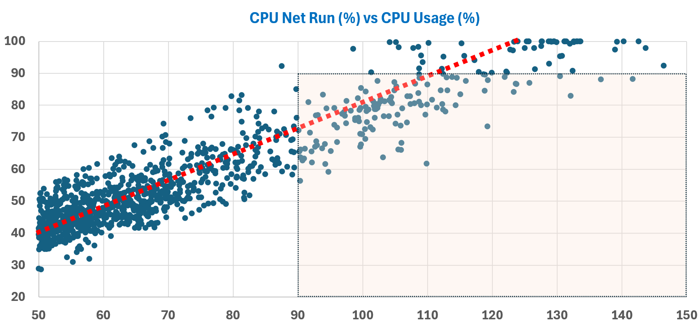

# VM CPU Usage

## Meaning
- Usage (MHz) counts the CPU cycles completed. Easier to think of usage as throughput.
- A clearer name for CPU Usage is CPU Throughput.
- It counts the productive cycles of the VM's vCPUs plus the load charged at VM level, scaled by frequency and Hyper-Threading.
- It includes IO processing done by the hypervisor on behalf of the VM. Significant for heavy databases and NSX Edge.
- Because of the above factors, Usage in % is confusing as it's measured against base nominal clock speed.
- Relevance for operations: performance (throughput) and chargeback.
- Not relevance for capacity, because Turbo and Hyper-Threading move it: Run is the capacity counter. 

## Hyper-Threading
- Scenario: two vCPUs run on the two threads of the same physical core at the same time.
- VM Usage is HT-aware. When both threads run, the VM is charged a 37.5% penalty, so it shows about 62.5% (Broadcom KB 335065; [`vsphere/technology/cpu/concepts/hyper-threading`](../../concepts/hyper-threading.md), section Hyper-Threading accounting: VM CPU Used and ESXi CPU Used).
- The Guest OS cannot see the underlying physical core or its two threads. 
- The host view of the same core: see [`vsphere/technology/cpu/metrics/host/usage`](../host/usage.md).

## Masked degradation
- At Run 100%, throughput per vCPU can fall from 1.7 GHz to 0.81 GHz as the host fills up (sample CPU, 1 GHz nominal).
- Usage (%) masks this degradation.
- See [`vsphere/technology/cpu/concepts/cpu-frequency`](../../concepts/cpu-frequency.md).

## Formula
```text
Usage (%) = (sum of Usage (MHz) of each vCPU + VM-level load) / VM static CPU speed
```
- Gap to Used grows on VMs processing many network packets or storage commands.
- Usage (%): VM level only. Usage (MHz): vCPU and VM level.
- Both exist only in vCenter, not in ESXi.
- Usage (%) and Usage (MHz) are very similar but not always identical.

## Turbo example
- One 24-vCPU VM fills a host: 12 cores, 2.4 GHz nominal, HT on. VM at about 100%.
- No Turbo: 12 × 2.4 GHz × 1.25 = 36 GHz. Not 57.6 GHz (24 × 2.4): HT yields 1.25x, not 2x.
- With Turbo (1.08x all-core): 12 × 2.4 × 1.25 × 1.08 ≈ 39 GHz.
- Turbo disabled during the test: Usage dropped to just below 36 GHz.
- Usage (MHz) can exceed total capacity. Total capacity is based on base clock speed.

## Usage vs Run
- VMs with Usage above 90% and Run below 90% are likely to be upsized without reason.


## Misconceptions
- "Each VM gets only 62.5% of what it demands" → the 62.5% is an accounting charge for sharing a CPU core.
- "Use Usage for capacity" → it includes frequency. Use Run for capacity.
- "Usage (%) above 90%, so add vCPUs" → check Run. Turbo inflates Usage.
- "Usage (MHz) cannot exceed the VM capacity" → Turbo pushes it above.
- "Linux, VM and ESXi CPU Usage share a name, so they mean the same" → no. VM CPU Usage is per VM and carries the Hyper-Threading charge (62.5% per vCPU on a busy core); ESXi CPU Usage is per core against the base clock, one or two busy threads counting once; Linux CPU usage is busy time seen by the guest kernel, which does not see Hyper-Threading or frequency.

## Metadata
```yaml
id: vsphere/technology/cpu/metrics/virtual-motherboard/usage
retriever_guide: metric-meaning
up_front: 'Linux, VM and ESXi CPU Usage share a name, so they mean the same'
scope: vsphere
technology:
- cpu
pillar:
- performance
- capacity
product:
- vsphere
object:
- VirtualMachine
layer:
- virtual-motherboard
metric_class: consumption
internal_derive:
- vsphere/technology/cpu/concepts/hyper-threading
- vsphere/architecture/provider-consumer
- vsphere/technology/cpu/concepts/run-time-vs-run-quality
- vsphere/technology/cpu/concepts/cpu-frequency
same_name:
- vsphere/technology/cpu/metrics/host/usage
same_meaning: []
related:
- vsphere/technology/cpu/metrics/comparisons/consumption-metrics
- vsphere/technology/cpu/metrics/host/core-utilization
- vsphere/technology/cpu/concepts/cpu-frequency
- vsphere/technology/cpu/concepts/hyper-threading
- vsphere/technology/cpu/concepts/guest-os-vs-vm-cpu
- vsphere/technology/cpu/metrics/virtual-motherboard/net-run
- vsphere/technology/cpu/metrics/virtual-motherboard/demand
- vsphere/technology/cpu/metrics/virtual-motherboard/usage-disparity
- vsphere/technology/cpu/decision-tree/oversized-vm-downsizing
images:
  - path: ../../images/vm-cpu-usage-vs-run-scatter-across-vms.png
    product: [vsphere]
    object: [VirtualMachine]
    metric: ['VM CPU Usage', 'VM CPU Run']
    image_type: scatter
    sample: '1,102 VMs'
source:
  document: Knowledge base; Broadcom KB 335065
  path: The World of Metrics > Metrics Nuances > Complexity > Naming Complexity; CPU > Architecture > Guest OS vs VM; ESXi ≠ VM + Kernel; CPU Throughput; Impacts on VM; CPU > VM > Consumption Metrics > Used | Usage > Usage; KB 335065, Cause
corrections: []
review_notes:
- 'To check: Section ''Formula'': whether VM CPU Usage (%) includes the VMX load, which would explain the gap between Usage (%) and Usage (MHz); the vSphere Web Services API 9.1 descriptions of cpu.usage and cpu.usagemhz do not say (https://developer.broadcom.com/xapis/vsphere-web-services-api/9.1/cpu_counters.html). Needs a lab comparison on a 9.1 host.'
status: draft
```
