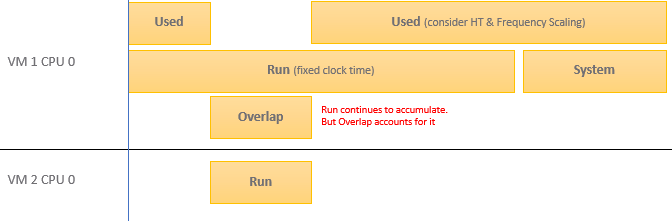

# VM CPU Used

## Meaning by instance
- Per-vCPU instance: excludes System time.
- VM aggregate: includes System time.
- Pattern: same name, same object, different formula.
- Relevance for operations: chargeback and the work done (section Use cases). Not capacity, because frequency and Hyper-Threading move it: Run is the capacity counter.

## Reason
- System time is charged at VM level. It does not exist at vCPU level.
- See [`vsphere/architecture/kernel-worlds`](../../../../architecture/kernel-worlds.md) for work charged to the VM rather than to a vCPU.

## Notes
- CPU Used is buggy. Do not build conclusions on it alone.

## Fair Share Scheduler
- The scheduler charges each vCPU with Used, not Run, to keep relative fairness.
- Used adjusts Run for:
  - a shared physical core (Hyper-Threading): Used goes down. Used is lower than Run.
  - CPU frequency.
  - hypervisor work that interrupts the vCPU for other VMs or the system (Overlap): Used is decreased. Kernel work done for this VM (System) is added to VM-level Used.
- See [`vsphere/technology/cpu/concepts/run-time-vs-run-quality`](../../concepts/run-time-vs-run-quality.md).

## Hyper-Threading charge
- VM CPU Used carries a charge for a shared core: a vCPU is charged less than its Run while the sibling thread runs, and its full Run while the sibling thread is halted.
- The rate, how it differs from ESXi CPU Used, and the worked examples: [`vsphere/technology/cpu/concepts/hyper-threading`](../../concepts/hyper-threading.md), sections Hyper-Threading accounting: VM CPU Used and ESXi CPU Used; Hyper-Threading accounting: Worked example.
- The esxtop %USED of a vCPU world is the same charge, per world.

## Formula
```text
Used (VM)   = Run - Overlap ± E + System + VMX + MKS + Helper
Used (vCPU) = Run - Overlap ± E
```
- E combines:
  - Turbo Boost gain. Can be 50% more when other cores in the socket are idle.
  - power-saving loss. Frequency at 40% of nominal: 60% of the CPU time counts as stolen.
  - SMT loss: the charge for a core whose sibling thread runs (section Hyper-Threading charge).


## Worlds charged to the VM
| World | Work | Size |
|---|---|---|
| MKS | Console: video frame buffer, mouse, keyboard, console graphics. | Typically negligible. |
| VMX | VM power states, configuration changes, high-level virtual hardware emulation. In esxtop, System time is charged to the VMX world. | - |
| Helper | Asynchronous IO helper worlds, virtual storage controllers, background kernel threads for the VM. | Negligible. |

## Unit
- Used accounts for actual frequency but is reported in ms.
- Conversion from cycles to ms uses the static (nominal) frequency.
- Example, nominal 2 GHz: at 3 GHz Used is 50% higher than Run. At 1.5 GHz Used is 25% lower than Run.
- Older Guest OS versions report on the nominal speed, like Run.

## Use cases
- Amount of work done.
- VM migration: the destination host must absorb the real footprint.
- Chargeback: charge the full cost of the VM, based on actual utilization, not rated clock speed.

## Misconceptions
- "Sum of per-vCPU Used equals VM Used" → the VM value includes System time; the per-vCPU values do not.
- "Used lower than Run means the VM received less runtime" → Used is a charge adjusted for shared core, frequency and hypervisor IO.

## Metadata
```yaml
id: vsphere/technology/cpu/metrics/virtual-motherboard/used
retriever_guide: metric-meaning
scope: vsphere
technology:
- cpu
pillar:
- performance
- capacity
product:
- vsphere
object:
- VirtualMachine
layer:
- virtual-motherboard
instance:
- aggregate
- per-vcpu
metric_class: consumption
internal_derive:
- vsphere/architecture/kernel-worlds
- vsphere/technology/cpu/concepts/run-time-vs-run-quality
- vsphere/technology/cpu/concepts/hyper-threading
same_name:
- vsphere/technology/cpu/metrics/host/used
same_meaning: []
related:
- vsphere/technology/cpu/metrics/comparisons/consumption-metrics
- vsphere/technology/cpu/metrics/virtual-motherboard/run
- vsphere/technology/cpu/metrics/virtual-motherboard/system
- vsphere/technology/cpu/metrics/virtual-motherboard/overlap
- vsphere/technology/cpu/troubleshooting/run-vs-used-gap
- vsphere/tools/esxtop/cpu
images:
  - path: ../../images/vm-cpu-used-vs-run-overlap-and-system.png
    product: [vsphere]
    object: [VirtualMachine]
    metric: ['VM CPU Used', 'VM CPU Run', 'VM CPU Overlap', 'VM CPU System']
    image_type: diagram
source:
  document: Knowledge base
  path: The World of Metrics > Metrics Nuances > Complexity > Naming Complexity; CPU > Architecture > Fair Share Scheduler; CPU Efficiency; CPU > VM > Consumption Metrics > Used | Usage > Used
corrections: []
review_notes: []
status: draft
```
