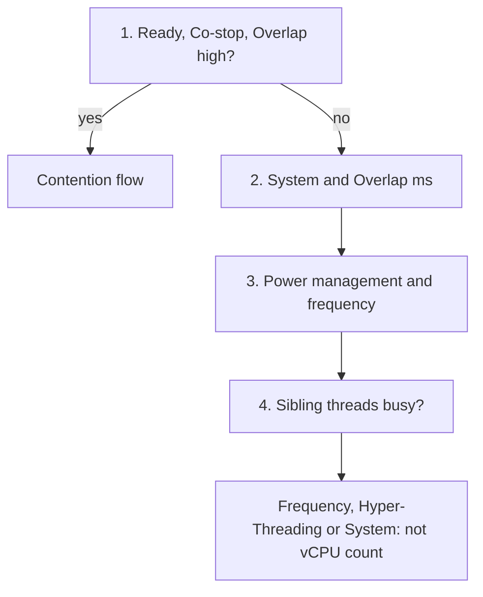

# VM CPU Run and Used differ

## Symptom
- VM CPU Run and Used differ by a wide margin, and someone asks whether the VM needs more vCPUs.
- Run is time only; Used also moves with frequency, Hyper-Threading and work done for the VM ([`vsphere/technology/cpu/metrics/virtual-motherboard/run`](../metrics/virtual-motherboard/run.md), [`vsphere/technology/cpu/metrics/virtual-motherboard/used`](../metrics/virtual-motherboard/used.md)).

## Flow


## Checks, in order
1. Contention (VirtualMachine): Ready, Co-stop, Overlap. High → [`vsphere/technology/cpu/troubleshooting/vm-cpu-contention-high`](vm-cpu-contention-high.md). Low → step 2.
2. System (ms) and Overlap (ms) (VirtualMachine): they move Used away from Run ([`vsphere/technology/cpu/metrics/virtual-motherboard/system`](../metrics/virtual-motherboard/system.md)). → step 3.
3. Configuration, host (HostSystem). The host power management policy and the actual frequency (esxtop %A/MPERF) ([`vsphere/technology/cpu/concepts/power-states`](../concepts/power-states.md)). → step 4.
4. Hyper-Threading (HostSystem). Whether sibling threads are busy ([`vsphere/technology/cpu/concepts/hyper-threading`](../concepts/hyper-threading.md)).

## Why this order
- Contention first: a VM that waits has a different problem, with its own flow.
- System and Overlap next: work charged to the VM explains Used above Run without any hardware effect.
- Frequency before Hyper-Threading: power management is a setting that can be checked and changed; a busy sibling depends on the other VMs.

## How to read the result
| Pattern | Meaning | Next step |
|---|---|---|
| Used higher than Run | Turbo raises Used. System, VMX, MKS and Helper add to VM-level Used. | Check frequency and System. |
| Used lower than Run, little System and Overlap | Power saving and Hyper-Threading lower Used. | Do not add vCPUs. Check power management and SMT. |
| Example: 4-vCPU Ubuntu VM, Used about 44% of Run | Power saving plus SMT. | If Run is far from 100% and the team asks for speed, adding vCPUs is the wrong answer. |
| Example: 1-vCPU VM, 2.095 GHz host, 2 GHz limit | Demand and Usage flat around 1.96 GHz (about 94%). Used about 18,600 ms (93%). Run much lower: Used 41% higher than Run. | Cause: CPU frequency. The VM ran above nominal clock speed because of Turbo Boost. Used grows with frequency; Run is time only. |

## Misconceptions
- "Used is far below Run, so the VM needs more vCPUs" → power saving and Hyper-Threading lower Used; more vCPUs do not change either.

## Metadata
```yaml
id: vsphere/technology/cpu/troubleshooting/run-vs-used-gap
retriever_guide: troubleshooting
scope: vsphere
technology:
- cpu
pillar:
- performance
- capacity
product:
- vsphere
- vcf-operations
object:
- VirtualMachine
internal_derive:
- vsphere/technology/cpu/metrics/virtual-motherboard/run
- vsphere/technology/cpu/metrics/virtual-motherboard/used
- vsphere/technology/cpu/troubleshooting/vm-cpu-contention-high
- vsphere/technology/cpu/metrics/virtual-motherboard/system
- vsphere/technology/cpu/concepts/power-states
- vsphere/technology/cpu/concepts/hyper-threading
related:
- vsphere/technology/cpu/metrics/virtual-motherboard/ready
- vsphere/technology/cpu/metrics/virtual-motherboard/demand
- sp5-framework/performance/performance-management
source:
  document: Private Cloud Management by Iwan Rahabok (https://isvara.io/download)
  path: CPU > VM > When Run is lower than Used; When Run is higher than Used
corrections: []
review_notes: []
status: draft
```
