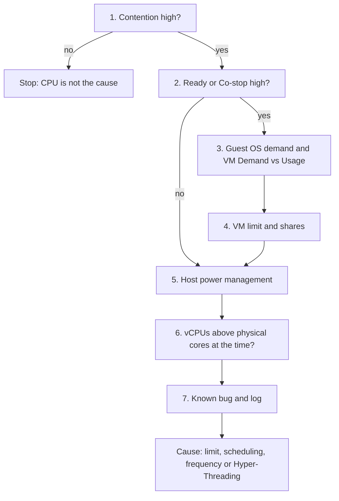

# VM CPU Contention or Latency is high

## Symptom
- VM CPU Contention (VCF Operations) or CPU Latency is high, or the CPU rows of VM Performance (%) are yellow or worse.
- Entered from `sp5-framework/performance/troubleshooting/vm-slow` (step 4), a health check performance step, or an alert.
- Contention includes Ready, Co-stop, limit time, power management and Hyper-Threading: a high value is not yet a wait for a physical thread.

## Flow


## Checks, in order
1. Contention (VirtualMachine) (`vsphere/technology/cpu/metrics/virtual-motherboard/contention`). Low → stop: Ready, Co-stop, power management and CPU overcommit are all accounted for in it, so CPU is not the cause. High (above 37.5%) → step 2.
2. Ready and Co-stop (VirtualMachine): the time a vCPU waited for a physical thread, or for its siblings. Read Ready against Run (`vsphere/technology/cpu/metrics/virtual-motherboard/ready`, `vsphere/technology/cpu/metrics/virtual-motherboard/co-stop`). Both low with high contention → the wait is frequency or Hyper-Threading → step 5. Not low → step 3.
3. Demand (Guest OS, VirtualMachine). Guest OS CPU run queue, context switches and CPU usage show whether the guest asks for more than it gets. VM Demand rising while Usage falls: the VM demanded more CPU than it got. → step 4.
4. Configuration, VM (VirtualMachine). A CPU limit, and CPU shares against the other VMs (`vsphere/architecture/resource-controls`). Latency near 0% with high Ready: a limit, because Latency excludes Max Limited. → step 5.
5. Configuration, host (HostSystem). Power management policy (`vsphere/technology/cpu/concepts/power-states`). Set to maximum performance: frequency scaling is ruled out and Hyper-Threading remains. Otherwise both can be at play. → step 6.
6. Overcommit at the time of the issue (HostSystem). More vCPUs than physical cores on the host: Hyper-Threading can be the cause (`vsphere/technology/cpu/concepts/hyper-threading`). Otherwise it is not. → step 7.
7. Known bug and log (VirtualMachine, HostSystem): versions against known issues, and events in the window (`sp5-framework/performance/troubleshooting/vm-slow`, its known bug and log checks).

## Why this order
- Contention first: it holds every CPU wait, so a low value ends the flow at once.
- Ready and Co-stop next: they separate a wait for a thread from the effects of frequency and Hyper-Threading, which Contention also counts.
- Demand before configuration: it shows whether the guest wanted the CPU it did not get.
- VM settings before host settings: a limit or low shares explain one VM; power management and overcommit explain the host.
- Known bug and log last: they explain what the counters have placed in time.

## How to read the result
- Frequency-sensitive application: set power management to maximum.
- Hyper-Threading cuts per-thread CPU time by 37.5%. Applications rarely notice: it is transparent, and a CPU 37.5% faster makes up for it.
- Latency near 0% with high Ready: a limit (Latency excludes Max Limited).
- Contention rises when Demand rises and Usage falls: the VM demanded more CPU than it got.
- Ready and Co-stop low, contention high, power management at maximum, no overcommit: Hyper-Threading alone.

## Misconceptions
- "Contention above 37.5% means CPU starvation" → it can be Hyper-Threading and frequency alone. Check Ready and Co-stop.
- "Use Latency as the KPI" → too volatile. Use Ready.
- "High Ready, so add vCPUs" → more vCPUs make co-scheduling harder and can raise Ready and Co-stop.

## Metadata
```yaml
id: vsphere/technology/cpu/troubleshooting/vm-cpu-contention-high
retriever_guide: troubleshooting
scope: vsphere
technology:
- cpu
pillar:
- performance
product:
- vsphere
- vcf-operations
object:
- VirtualMachine
internal_derive:
- vsphere/technology/cpu/metrics/virtual-motherboard/contention
- vsphere/technology/cpu/metrics/virtual-motherboard/latency
- vsphere/technology/cpu/metrics/comparisons/vm-contention-metrics
- vsphere/technology/cpu/metrics/virtual-motherboard/ready
- vsphere/technology/cpu/metrics/virtual-motherboard/co-stop
- vsphere/architecture/resource-controls
- vsphere/technology/cpu/concepts/power-states
- vsphere/technology/cpu/concepts/hyper-threading
- sp5-framework/performance/troubleshooting/vm-slow
related:
- sp5-framework/performance/performance-management
source:
  document: Private Cloud Management by Iwan Rahabok (https://isvara.io/download)
  path: CPU > VM > Contention Metrics > Latency
corrections: []
review_notes:
- 'Section ''Checks'': the 37.5% value is from the book.'
status: draft
```
