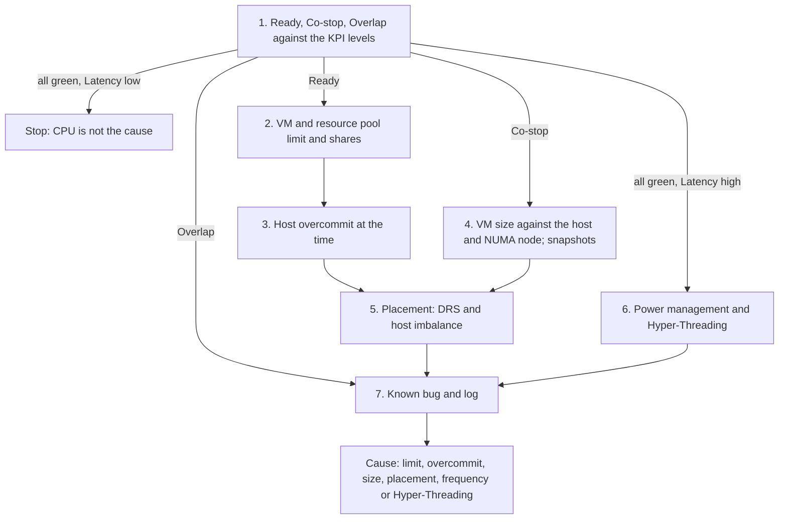

# VM CPU Contention or Latency is high

## Symptom
- VM CPU Contention (VCF Operations) or CPU Latency (vCenter, esxtop %LAT_C) is high, the CPU rows of VM Performance (%) are yellow or worse, or the VM CPU contention alert fired.
- Entered from [`sp5-framework/performance/vm-slow`](../../../../sp5-framework/performance/vm-slow.md) (step 4), a health check performance step, or an alert.
- The two metrics count different waits. Contention, from VCF Operations 8.18: Ready (with the time held back by a limit), Co-stop, Overlap, and Other Wait when below 1%. CPU Latency also counts the effect of frequency scaling and Hyper-Threading, and leaves out the time held back by a limit ([`vsphere/technology/cpu/metrics/virtual-motherboard/contention`](../metrics/virtual-motherboard/contention.md), [`vsphere/technology/cpu/metrics/virtual-motherboard/latency`](../metrics/virtual-motherboard/latency.md)).

## Flow


## Checks, in order
1. Ready, Co-stop and Overlap (VirtualMachine): their 20-second peaks against the KPI levels of VM Performance (%), which come with [`vsphere/object-types/vm/vm-performance`](../../../object-types/vm/vm-performance.md). All green and CPU Latency low → stop: CPU is not the cause. All green and CPU Latency high → the wait is frequency or Hyper-Threading, which Latency counts and Contention does not → step 6. Ready not green → step 2. Co-stop not green → step 4. Overlap not green → step 7 (kernel work for disk and network IO interrupts the vCPU: [`vsphere/technology/cpu/metrics/virtual-motherboard/overlap`](../metrics/virtual-motherboard/overlap.md)).
2. Limits and shares (VirtualMachine, ResourcePool). A CPU limit on the VM, or a limit or low shares on its resource pool against its siblings ([`vsphere/architecture/resource-controls`](../../../architecture/resource-controls.md), [`vsphere/object-types/resource-pool/resource-pool-design`](../../../object-types/resource-pool/resource-pool-design.md)). Ready includes the time a limit holds back; CPU Latency near 0% with high Ready points to a limit, because Latency leaves it out. A limit or starved pool found → cause. None → step 3.
3. Overcommit at the time of the issue (HostSystem). The vCPUs of the running VMs against the host's physical threads, and Ready across the host's VMs ([`vsphere/technology/cpu/metrics/comparisons/host-contention-metrics`](../metrics/comparisons/host-contention-metrics.md)). Many VMs waiting at once: the host is too busy. → step 5.
4. VM size and snapshots (VirtualMachine). Co-stop rises with the vCPU count and with a VM wider than its NUMA node: a vCPU waits for its siblings ([`vsphere/technology/cpu/metrics/virtual-motherboard/co-stop`](../metrics/virtual-motherboard/co-stop.md), [`sp5-framework/capacity/vm-size`](../../../../sp5-framework/capacity/vm-size.md), [`vsphere/technology/cpu/configuration/numa-settings`](../configuration/numa-settings.md)). A snapshot also raises Co-stop. → step 5.
5. Placement (ClusterComputeResource). DRS automation level and migration threshold, and whether this host is busier than its peers ([`vsphere/object-types/cluster/concepts/drs-overview`](../../../object-types/cluster/concepts/drs-overview.md), [`vsphere/technology/cpu/metrics/cluster/inter-host-imbalance`](../metrics/cluster/inter-host-imbalance.md)). A busy host in a cluster with idle hosts: placement, not capacity. → step 7.
6. Power management and Hyper-Threading (HostSystem). Power policy at maximum performance rules out frequency scaling ([`vsphere/technology/cpu/concepts/power-states`](../concepts/power-states.md)). More vCPUs than physical cores: Hyper-Threading shares a core between two threads ([`vsphere/technology/cpu/concepts/hyper-threading`](../concepts/hyper-threading.md)). → step 7.
7. Known bug and log (VirtualMachine, HostSystem): versions against known issues, and events in the window ([`sp5-framework/performance/vm-slow`](../../../../sp5-framework/performance/vm-slow.md), its known bug and log checks).

## Order rationale
- The parts of Contention first: each names a different cause, so the part that is not green picks the branch. All green ends the flow, unless CPU Latency says the wait is frequency or Hyper-Threading.
- Ready branch: settings on the VM and its pool before the host, because a limit or low shares explain one VM; then the host; then the cluster.
- Co-stop branch: the VM's own shape (size, NUMA, snapshot) before placement.
- Frequency and Hyper-Threading only when Latency alone is high: Contention does not count them.
- Known bug and log last: they explain what the counters have placed in time.

## Interpretation
- High Ready with a limit: the VM is held back by design; remove or raise the limit, or accept it.
- High Ready on many VMs of one host while other hosts idle: placement (DRS), not capacity.
- High Co-stop on a wide VM: fewer vCPUs, or keep the VM within one NUMA node.
- CPU Latency high, Contention green, power management at maximum, no overcommit: Hyper-Threading alone. Applications rarely notice: it is transparent, and a faster CPU makes up for it.
- Frequency-sensitive application: set power management to maximum.

## Misconceptions
- "CPU Latency above 37.5% means CPU starvation" → Hyper-Threading and frequency alone can cause it; Contention leaves both out.
- "Contention and Latency are the same" → only before VCF Operations 8.18. Contention now includes the time a limit holds back and leaves out frequency and Hyper-Threading.
- "Use Latency as the KPI" → too volatile. Use Ready.
- "High Ready, so add vCPUs" → more vCPUs make co-scheduling harder and can raise Ready and Co-stop.

## Metadata
```yaml
id: vsphere/technology/cpu/troubleshooting/vm-cpu-contention-high
retriever_guide: troubleshooting
scope: vsphere
technology:
- cpu
pillar:
- performance
product:
- vsphere
- vcf-operations
object:
- VirtualMachine
internal_derive:
- vsphere/technology/cpu/metrics/virtual-motherboard/contention
- vsphere/technology/cpu/metrics/virtual-motherboard/latency
- vsphere/technology/cpu/metrics/comparisons/vm-contention-metrics
- vsphere/technology/cpu/metrics/virtual-motherboard/ready
- vsphere/technology/cpu/metrics/virtual-motherboard/co-stop
- vsphere/technology/cpu/metrics/virtual-motherboard/overlap
- vsphere/object-types/vm/vm-performance
- vsphere/architecture/resource-controls
- vsphere/object-types/resource-pool/resource-pool-design
- vsphere/technology/cpu/metrics/comparisons/host-contention-metrics
- sp5-framework/capacity/vm-size
- vsphere/technology/cpu/configuration/numa-settings
- vsphere/object-types/cluster/concepts/drs-overview
- vsphere/technology/cpu/metrics/cluster/inter-host-imbalance
- vsphere/technology/cpu/concepts/power-states
- vsphere/technology/cpu/concepts/hyper-threading
- sp5-framework/performance/vm-slow
related:
- sp5-framework/performance/performance-management
- vsphere/object-types/vm/vm-alerts
source:
  document: Private Cloud Management by Iwan Rahabok (https://isvara.io/download)
  path: CPU > VM > Contention Metrics > Latency
corrections:
- 'Section ''Checks, in order'': the source tests Contention against 37.5% (the Hyper-Threading share in CPU Latency). That is the CPU Latency logic before VCF Operations 8.18; Contention now leaves out frequency and Hyper-Threading, so step 1 reads its parts against the KPI levels and only CPU Latency leads to Hyper-Threading (Q144).'
review_notes:
- 'To check: Sections ''Checks, in order'' steps 2-5 (limits and pool shares, host overcommit, VM size and snapshots, DRS placement) are a synthesis of the linked files, not the source''s flow.'
status: draft
```
