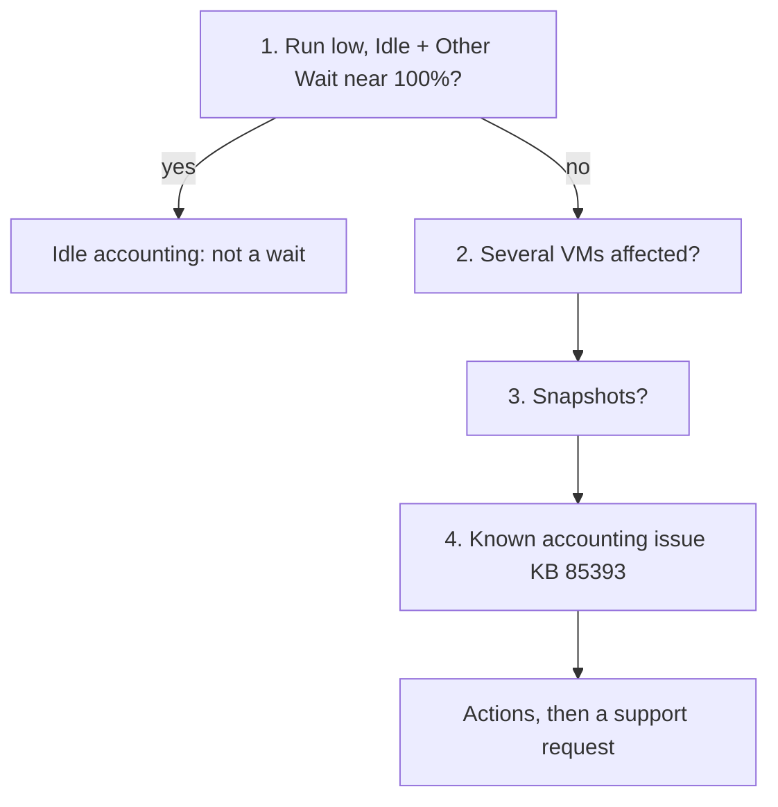

# VM CPU Other Wait is high

## Symptom
- VM CPU Other Wait is high. It is not in VM Performance (%): rare false positives were seen, so it is read only when a VM is slow and the other CPU counters do not explain it.

## Flow


## Checks, in order
1. Idle and Run (VirtualMachine) ([`vsphere/technology/cpu/metrics/virtual-motherboard/idle`](../metrics/virtual-motherboard/idle.md)). When Run is low, Idle and Other Wait add up to about 100%: the VM is idle, not waiting. → stop. Otherwise → step 2.
2. Breadth (VirtualMachine). Several VMs affected: find what they share (host, datastore, versions). → step 3.
3. Configuration (VirtualMachine). Snapshots on the VM ([`vsphere/technology/storage/concepts/snapshot-impact`](../../storage/concepts/snapshot-impact.md)). → step 4.
4. Known bug (VirtualMachine, HostSystem). Broadcom KB 85393: a known accounting issue inflates Other Wait and esxtop %VMWait. Compare the ESXi, virtual hardware and VMware Tools builds with the fixed builds.

## Order rationale
- Idle first: a low Run makes Other Wait large by accounting, with no wait at all.
- Breadth before one VM: what affected VMs share points to the cause.
- Snapshots before the known bug: they are a configuration that can be removed now.
- The known bug last: it needs build numbers, and its fix is an update.

## Interpretation
- Actions:
  - vMotion the VM.
  - Remove snapshots.
  - Update ESXi (including physical device drivers), virtual hardware and VMware Tools (virtual device drivers) to the latest build.
  - Still high: open a support request with Broadcom. Finding the root cause takes low-level debug data (stats vmx, schedtraces, vprobes).

## Misconceptions
- "Other Wait means storage latency" → no correlation found with disk latency or outstanding IO.
- "Other Wait is high, so the VM waits" → with low Run, Idle and Other Wait add up to about 100%.

## Metadata
```yaml
id: vsphere/technology/cpu/troubleshooting/vm-other-wait-high
retriever_guide: troubleshooting
scope: vsphere
technology:
- cpu
pillar:
- performance
product:
- vsphere
- vcf-operations
object:
- VirtualMachine
internal_derive:
- vsphere/technology/cpu/metrics/virtual-motherboard/other-wait
- vsphere/technology/cpu/metrics/virtual-motherboard/idle
- vsphere/technology/storage/concepts/snapshot-impact
related:
- vsphere/technology/cpu/metrics/virtual-motherboard/wait
- sp5-framework/performance/performance-management
source:
  document: Private Cloud Management by Iwan Rahabok (https://isvara.io/download)
  path: CPU > VM > Wait Metrics > Other Wait
corrections: []
review_notes: []
status: draft
```
