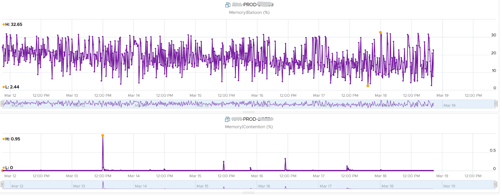

# Ballooning

## Mechanism
- The balloon is a kernel driver inside the Guest OS. It takes instructions from the VMkernel to inflate or deflate.
- Inflate: the driver asks the Guest OS to allocate memory to it. ESXi does not back that memory with physical pages, so other VMs can use it.
- Deflate: when ESXi is no longer under memory pressure, it tells the driver to release its pages inside the Guest OS. The VM Balloon counter returns to 0.
- Purpose: proactive. Reduces the chance of the Guest OS paging.
- The Guest OS initiates the reallocation. So Balloon Target can be 0 while Ballooned is still above 0.
- Balloon Target above 0: the hypervisor has asked this VM to give back memory through the balloon driver.
- A 1 GB balloon does not free 1 GB in ESXi when the pages were shared (TPS). It can be less.
- The Guest OS allocates to the balloon from Free pages first, then Cache, then Modified, then In Use.
- The Guest OS must have enough swap space configured for ballooning.
- How much is requested depends on the Idle Memory Tax. Do not change it.

## Performance impact
- Ballooning by itself does not cause a performance problem.
- A problem occurs when Windows or Linux requests a ballooned page again.
- The more ballooned, swapped and compressed, the higher the chance of a future performance hit.
- Severity depends on VM shares, reservation, limit and configured RAM. 10 MB ballooned hurts a 4 GB VM more than a 512 GB VM.
- Example: a 16 GB VM with 10,430 MB ballooned (63.66%) for 4 weeks, flat. The Guest OS never requested those pages; it worked within the remaining 6 GB. Granted + Swapped + Compressed was a flat line.


## Capacity impact
- A balloon is a request from ESXi, not from the application. Exclude it from Guest OS sizing.
- It distorts Guest OS sizing, and there is no way to measure the distortion.
- Guest OS In Use rises when the balloon allocates: the driver is treated like any process.
- Pages taken from Free: deduct the balloon from In Use.
- Pages taken from In Use: In Use does not change; the Guest OS pages out. Add Page Out or Cache back.

## Ballooned vs compressed and swapped
- ESXi knows nothing of free memory inside the guest. Compression and swapping pick pages at random. Ballooning lets the guest choose.
- Balloon can be 0 while Compressed or Swapped are above 0, although ballooning comes first in the reclamation order.
- Reason: past pressure. Compressed and swapped data is not brought back until requested (it costs CPU). The balloon deflates proactively when pressure ends.

## Trigger and requirement
- Trigger: host memory begins to get low and the VM's memory usage approaches its memory target. The balloon inflates when the host enters the Soft state (free memory at 64% of minFree; see [`vsphere/technology/memory/concepts/host-memory-states`](host-memory-states.md)).
- No host pressure, no balloon: a VM inside its configured memory on a host with free memory is never ballooned, with or without VMware Tools. It reuses its own mapped pages.
- The balloon driver makes the guest OS give up the pages it considers least valuable. Windows: the driver ships with VMware Tools. Linux: the driver is `vmw_balloon`, in the upstream kernel and loaded automatically on a VMware VM; open-vm-tools does not contain it (Broadcom KB 313773).
- Performance closely matches a native system under similar memory constraints.
- The guest OS must have enough swap space configured.
- Ballooning needs the balloon driver loaded, not the VMware Tools service: a Linux VM keeps ballooning while vmtoolsd is stopped. Without the driver (Windows without VMware Tools, Linux with the module missing or blacklisted), ESXi can only compress or swap, blind to which pages the guest uses.

## Misconceptions
- "ESXi can balloon any VM" → only a VM with the balloon driver loaded (VMware Tools on Windows, the kernel module on Linux); otherwise the host compresses and swaps.
- "Ballooned 10 GB, so the guest is slow" → only requested pages cause a hit. Check Latency.
- "Balloon frees exactly its size in ESXi" → shared pages free less.
- "Include ballooned memory in Guest OS sizing" → exclude it.
- "A VM that frees memory and then needs it again gets swapped or ballooned to make room" → no: the guest reuses pages it already has mapped; ESXi is not involved unless the host is under pressure.

## Metadata
```yaml
id: vsphere/technology/memory/concepts/ballooning
retriever_guide: how-it-works
scope: vsphere
technology:
- memory
pillar:
- performance
- capacity
product:
- vsphere
object:
- VirtualMachine
internal_derive:
- vsphere/technology/memory/concepts/memory-layers
- vsphere/technology/memory/concepts/host-memory-states
related:
- vsphere/technology/memory/metrics/virtual-motherboard/ballooned
- vsphere/technology/memory/metrics/virtual-motherboard/balloon-target
- vsphere/technology/memory/concepts/swap-and-compression
- vsphere/technology/memory/metrics/virtual-motherboard/latency
images:
  - path: ../images/vm-memory-heavy-balloon-with-rare-latency-spikes.png
    product: [vsphere]
    object: [VirtualMachine]
    metric: ['VM Memory Ballooned', 'VM Memory Latency']
    image_type: timeline
source:
  document: Private Cloud Management by Iwan Rahabok (https://isvara.io/download)
  path: Memory > VM > Contention Metrics > Balloon; Swap + Compress > Balloon
corrections: []
review_notes:
- 'Overcommit technique content: Performance Best Practices for VMware vSphere 9.1 (revision 20260624), ESX Memory Considerations > Memory Overcommit Techniques (pp. 33-34); https://www.vmware.com/docs/vsphere-esxi-vcenter-server-9-1-performance-best-practices'
- 'To check: Section ''Mechanism'': Idle Memory Tax is the Mem.IdleTax setting.'
status: draft
```
