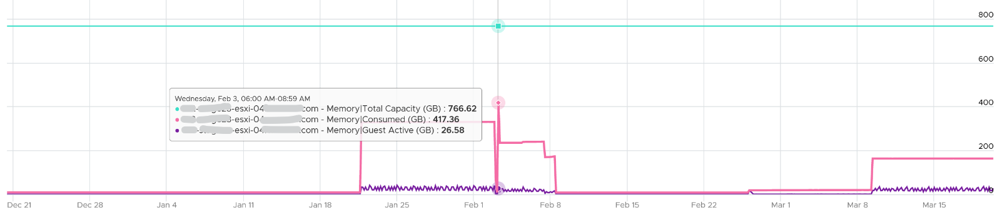
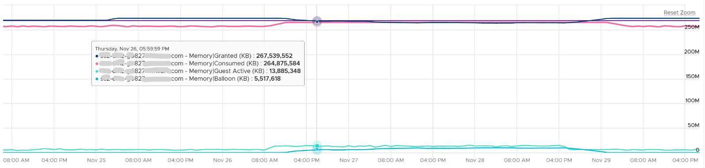

# ESXi memory states

## Mechanism
- ESXi starts reclaiming when free memory runs low.
- The State counter reports one of 5 states. Each is a multiple of Free Memory Minimum (minFree).
- Contention happens at hypervisor level. VMs feel its side effects. The degree per VM depends on shares, reservation and utilization.

## States
- Five states, each a share of minFree. Entering a state takes a lower free level than leaving it (hysteresis), so a short allocation spike does not make the state flap.

| State | Enter when free falls to (% of minFree) | Leave upward when free rises above | Free memory to enter (1 TB host, minFree 10.8 GB) | Action |
|---|---|---|---|---|
| High | | | above 32.4 GB | None. New memory is backed by 2 MB large pages. |
| Clear | 300% | 400% (back to High at 43.2 GB) | 32.4 GB | Stops backing new memory with large pages; breaks existing large pages into 4 KB pages so page sharing can collapse identical pages. |
| Soft | 64% | 100% | 6.9 GB | Ballooning inflates in the VMs. |
| Hard | 32% | 48% | 3.5 GB | Compression and host swapping start; ballooning stops inflating. |
| Low | 16% | 24% | 1.7 GB | All of the above; new VM memory allocations are blocked. |


- Keep hosts in High. A host that keeps 400% of minFree free keeps the 2 MB backing and its performance benefit. Unless high utilization is the goal, hosts sit in High.
- Clear is not idle: large-page breaking and page sharing work there. That is why Shared memory can jump while free memory is still far above the balloon point.
- minFree is computed at boot from host RAM, non-linearly: about 900 MB for the first 28 GB (6% of the first 4 GB, 4% of the next 8 GB, 2% of the next 16 GB), then 1% of the rest; about 10.8 GB on a 1 TB host. Read it with `vsish -e get /memory/memInfo` (Min free, State) or in the esxtop memory panel header (`state:`).

## Ballooning start point
| | 512 GB host | 1 TB host | 1.5 TB host |
|---|---|---|---|
| Balloon threshold (free) | 3.7 GB | 6.9 GB | 10.2 GB |
| Used at threshold | 508.3 GB | 993.1 GB | 1,489.8 GB |
| Used at threshold (%) | 99.3% | 99.3% | 99.3% |

- Ballooning starts only after about 99% of host memory is used.

## Reclamation sequence
- ESX uses five mechanisms to reduce the ESXi pages each VM takes: page sharing, ballooning, memory compression, swap to host cache, regular host-level swapping.
- Page sharing runs continuously. The other four start in that order as memory pressure rises.
- Ballooning starts when host memory begins to get low and a VM's memory usage approaches its memory target.
- Compression starts when VM memory usage approaches the level at which host-level swapping would be required.
- Swap to host cache starts when compression does not keep VM memory usage low enough, if a host cache is configured.
- Regular host-level swapping starts when the host cache is full or none is configured.
- Sharing, ballooning, compression and swap to host cache allow significant overcommitment, usually with little or no performance impact. Regular host-level swapping can degrade performance significantly.
- Avoid overcommitting memory to the point where regular host-level swapping swaps out active pages. Indicators: see [`vsphere/technology/memory/decision-tree/is-overcommit-affecting-vm`](../decision-tree/is-overcommit-affecting-vm.md).
- Details per mechanism: [`vsphere/technology/memory/concepts/page-sharing`](page-sharing.md), [`vsphere/technology/memory/concepts/ballooning`](ballooning.md), [`vsphere/technology/memory/concepts/swap-and-compression`](swap-and-compression.md).

## HA headroom
- Example: 12 hosts, sized for 11 (one for HA or maintenance).
- Target 99% during HA or maintenance → 99% × 11 / 12 = 90.75% in normal operation.
- At that level hosts do not reach the balloon state, so VMs are not swapped.
- Balloon in such a cluster points to a VM-level cause such as a limit, not host pressure.
- A limit does not cause balloon directly. It causes Compressed or Swapped when Consumed tries to grow beyond it. See [`vsphere/technology/memory/metrics/virtual-motherboard/ballooned`](../metrics/virtual-motherboard/ballooned.md).

## Low Free Threshold
- Counter: Low Free Threshold (KB). The free-memory level below which ESXi reclaims memory from VMs.
- Varies with host RAM. Check it only if ballooning seems to start too early.

## Memory regions
```text
Used   = Active (estimate of recently touched pages)
Cached = Consumed - Active
Free   = Total Capacity - Consumed
```
- Memory is cache: the active part is far smaller and more volatile than the inactive part.
- Example: an ESXi host with low Consumed and lower Active over 3 months, both far below total capacity.

- Overcommitted host at 100%: inactive granted pages cause no ballooning at first. When Active rises, Consumed rises and ballooning starts. When Active falls, ESXi deflates the balloon.


## Misconceptions
- "Ballooning starts at 90% host memory" → about 99%.
- "Host with balloon has VMs in contention" → example: 7 days of constant balloon, worst VM contention below 1%.
- "Clear state means ESXi does nothing" → in Clear, ESXi breaks 2 MB pages into 4 KB pages and page sharing starts; only High is idle.
- "The host goes back to High as soon as free memory passes 300% of minFree" → it returns at 400% (hysteresis); between 300% and 400% it stays in Clear.

## Metadata
```yaml
id: vsphere/technology/memory/concepts/host-memory-states
retriever_guide: how-it-works
scope: vsphere
technology:
- memory
pillar:
- performance
- capacity
product:
- vsphere
object:
- HostSystem
internal_derive: []
related:
- vsphere/technology/memory/concepts/ballooning
- vsphere/technology/memory/concepts/swap-and-compression
- vsphere/technology/memory/metrics/host/ballooned
- vsphere/technology/memory/metrics/host/consumed
- vsphere/technology/memory/configuration/host-level-swapping
images:
  - path: ../images/esxi-memory-state-counter.png
    product: [vsphere]
    object: [HostSystem]
    metric: ['ESXi Memory State']
    image_type: timeline
  - path: ../images/esxi-memory-consumed-vs-guest-active-vs-capacity.png
    product: [vsphere]
    object: [HostSystem]
    metric: ['ESXi Memory Consumed', 'ESXi Memory Active', 'ESXi Memory Total Capacity']
    image_type: timeline
    sample: '1 host, 3 months'
  - path: ../images/esxi-memory-overcommit-balloon-follows-active.png
    product: [vsphere]
    object: [HostSystem]
    metric: ['ESXi Memory Ballooned', 'ESXi Memory Active', 'ESXi Memory Consumed']
    image_type: timeline
source:
  document: Private Cloud Management by Iwan Rahabok (https://isvara.io/download)
  path: Memory > ESXi > Contention Metrics > Balloon; states, hysteresis and actions per state from the author's ESXi 9.1 memory reclamation manual (project/sources/esxi_memory_reclamation_manual.md)
corrections: []
review_notes:
- 'Overcommit technique content: Performance Best Practices for VMware vSphere 9.1 (revision 20260624), ESX Memory Considerations > Memory Overcommit Techniques (pp. 33-34); https://www.vmware.com/docs/vsphere-esxi-vcenter-server-9-1-performance-best-practices'
status: draft
```
