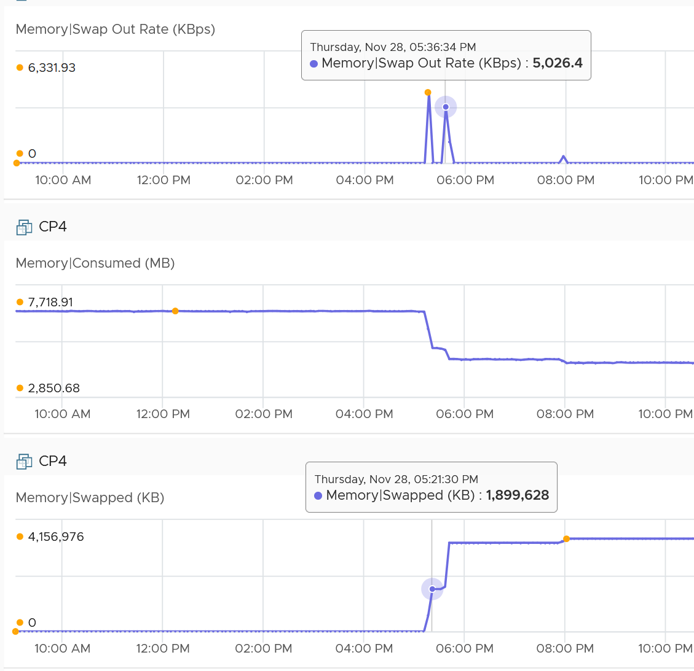
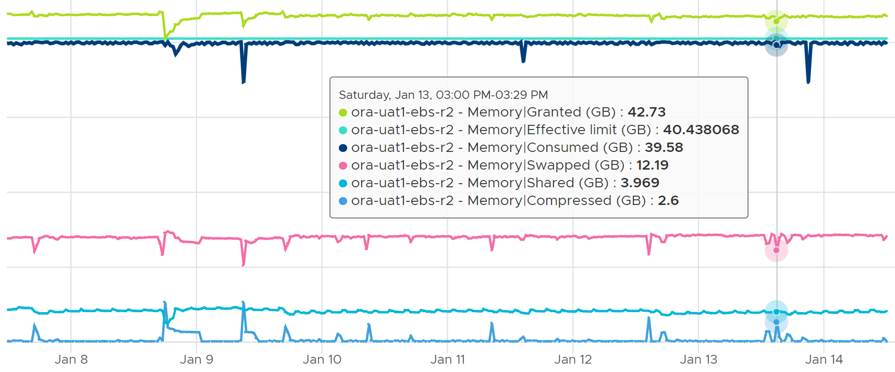

# Swap and compression

## Mechanism
- Compression and swapping work together. A page that cannot be compressed enough is swapped.
- Page size: 4 KB. Two compression levels: 4:1 (1 KB) and 2:1 (2 KB).
- If compression does not get the page to 2 KB or smaller, the page is swapped instead (vSphere 9.1 documentation, Memory Compression, p. 1841).
- So Swapped can be 0 while everything was compressed.
- A large page (2 MB) is not compressed directly. It is split into 4 KB pages first.
- Compressed is preferred: unzipping from DRAM is faster than reading from SSD.
- Host cache (if designed on fast SSD) is faster than disk swap.
- Compressed and swapped data stays out until the guest requests it. Bringing it back costs CPU.

## Swap instead of ballooning
- Host swapping is the fallback when the balloon driver cannot reclaim:
  - balloon driver never loaded (Windows without VMware Tools; Linux without the vmw_balloon module);
  - balloon driver deactivated;
  - balloon driver not running yet, for example while the guest boots;
  - balloon driver too slow for current demand;
  - balloon at its maximum size (Mem.CtlMaxPercent, default 65% of configured memory; sched.mem.maxmemctl per VM; or the guest-type maximum).
- Ballooning lets the guest choose which pages to give back. Host swapping picks pages without guest knowledge.
- Compression cache: up to 10% of VM memory by default (Mem.MemZipMaxPct, 5-100%). Compressed pages beyond the cache are swapped.
- Swap space reserved per VM = configured memory - memory reservation. In practice only a fraction is used.
- Guest swap (page file) should be at least configured memory - memory reservation, because ballooning pushes the guest to page.

## Transition: input, process, output
| Stage | Metric | Meaning |
|---|---|---|
| Input | Swap Target | The level of compressed plus swapped memory ESXi aims at for the VM. Compare it with Swapped; do not add it to Swapped. Above Swapped, ESXi can swap when it must; below Swapped, it stops swapping. Read it as compress-swap target. |
| Process | Compression rate, Decompression rate | Rate of compressing and decompressing. |
| Process | Swap out rate, Swap in rate | Rate of moving pages from DIMM to the swap file and back. |
| Output | Swapped, Swap out, Swap in | Swap result. |
| Output | Compressed, Compression saved | Compression result and savings. No compressed-in or compressed-out amounts. |

- The rate tells the shape: 10 MB in 1 second (acute) differs from 10 KB per second over 1,000 seconds (chronic). Same total.
- In and out happen at the same time on different pages. The swap file size can stay constant while its content changes.
- So Swapped is not Swap in - Swap out.

## Swap out vs swap in
- Swap out: ESXi was under memory pressure or the VM hit a limit. Not contention by itself: the page may never be requested.
- Swap in: contention. The guest requested a swapped page. Correlates highly with Memory Latency.
- Swap in does not mean current host pressure. It means pressure in the past, and the guest now requests that data.

## Example
- Swap out rate 6,331.93 + 5,026.4 + 1,882.13 + 615.86 = 13,856 KB/s over 300 s: 13,856 × 300 / 1,024 ≈ 4,059 MB. Swapped was 4,157 MB.
- No swap in during the period.
- Consumed dropped 4,868 MB (7,719 - 2,851). Other factors also contributed.


## Example: limit, swap and compress in opposite directions
- 64 GB VM. Swapped plus compressed peaked at 20 GB over 7 days.
- Consumed was flat for 7 days, just under VCF Operations Memory|Effective limit: a limit.
- Consumed stays under Memory|Effective limit by at least the VM overhead: the effective limit is the configured limit plus the overhead, and the limit caps Consumed alone (see [`vsphere/technology/memory/concepts/memory-limit`](memory-limit.md), section Signs in the counters).
- Granted hovered above Consumed and above the effective limit: Granted ignores the limit.
- The guest kept using pages: some were swapped in; others were compressed or swapped to make room under the limit. So Swapped fell while Compressed rose: they moved in opposite directions. The balloon, first in line under a limit, was already at its ceiling or could not take enough (see [`vsphere/technology/memory/concepts/memory-limit`](memory-limit.md)).
- Each swap-in is a wait for the vCPU that touched the page, so VM memory contention rose at those moments. That is the slowness the application sees.
- The host had free memory: the cause is the VM's limit, not the host. Fix: remove the limit or raise it to what the guest needs. More memory for the host or the VM changes nothing while the limit stays.


## Compression, host cache and swap: triggers and cost
- Compression starts when VM memory usage approaches the level at which host-level swapping would be required. It reduces the pages ESX must swap out.
- Decompression latency is much smaller than swap-in latency: compression costs far less than swapping out the same pages.
- Swap to host cache starts when compression does not keep usage low enough, if a host cache is configured (an administrator-configured swap cache, in most cases on SSD). Much faster than regular swap files on hard disks, even if some swapped pages are active.
- Regular host-level swapping starts when the host cache is full or none is configured. High access latency can degrade VM performance significantly.
- Host-level swapping is transparent to the guest OS and distinct from swapping inside the guest OS.

## Cost of a swapped page
- ESXi removes the page from the second-level page tables. The guest still believes the page is in RAM.
- When a vCPU touches it, an EPT violation exits to the VM monitor. The vCPU waits while the VMkernel reads the page back from the swap file: a synchronous wait, which VM memory contention counts. A compressed page waits for a decompression instead, much shorter.
- Double paging: if the guest later pages out that same page to its own swap, ESXi first reads it in from the host swap file, and the guest writes it straight back to guest swap. One page costs two reads and a write, on both swap devices. Pressure on both layers amplifies the I/O.
- A VM at a memory limit is the usual case: ESXi swaps blindly, the guest pages by its own rules. See [`vsphere/technology/memory/concepts/memory-limit`](memory-limit.md).

## Misconceptions
- "Swapped = Swap Out - Swap In" → no. Swapped is what sits in the swap file now; Swap Out and Swap In count transfers since the counters started on this host, so a vMotion arrival or a counter reset breaks the difference. Read VM Memory Swapped itself.
- "Swap out means contention" → only swap in is contention.
- "Swapped 0 means no reclamation" → pages may all be compressed.
- "The VM swaps, so the host is short of memory" → with free host memory and no other VM reclaimed, the cause is a limit on the VM or its pool: Consumed flat just under the effective limit.
- "Host-level swapping and guest OS swapping are the same" → they are distinct. Host-level swapping is transparent to the guest.
- "Memory compression is as costly as swapping" → decompression latency is much smaller than swap-in latency.

## Metadata
```yaml
id: vsphere/technology/memory/concepts/swap-and-compression
retriever_guide: how-it-works
scope: vsphere
technology:
- memory
pillar:
- performance
- capacity
product:
- vsphere
object:
- VirtualMachine
internal_derive:
- vsphere/technology/memory/concepts/host-memory-states
related:
- vsphere/technology/memory/metrics/virtual-motherboard/swapped
- vsphere/technology/memory/metrics/virtual-motherboard/compressed
- vsphere/technology/memory/metrics/virtual-motherboard/swap-target
- vsphere/technology/memory/metrics/virtual-motherboard/swap-in-rate
- vsphere/technology/memory/metrics/virtual-motherboard/latency
- vsphere/technology/memory/concepts/ballooning
- vsphere/technology/memory/concepts/memory-limit
images:
  - path: ../images/vm-memory-swap-out-rate-sum-matches-swapped.png
    product: [vsphere]
    object: [VirtualMachine]
    metric: ['VM Memory Swap Out Rate', 'VM Memory Swapped']
    image_type: timeline
  - path: ../images/vm-memory-limit-swapped-and-compressed-move-opposite.png
    product: [vsphere]
    object: [VirtualMachine]
    metric: ['VM Memory Consumed', 'VM Memory Swapped', 'VM Memory Compressed']
    image_type: timeline
source:
  document: Knowledge base; vSphere Web Services API 9.1; Performance Best Practices for VMware vSphere 9.1 (revision 20260624); vSphere 9.1 documentation (PDF built 2026-11-02)
  path: Memory > VM > Swap + Compress; Transition; Example; Quiz; Memory counters, swaptarget (https://developer.broadcom.com/xapis/vsphere-web-services-api/9.1/memory_counters.html); ESX Memory Considerations > Memory Overcommit Techniques (pp. 33-34); Resource Management, Using Swap Files, Swap Space and Memory Overcommitment, Memory Compression, Advanced Virtual Machine Attributes (pp. 1841, 1873-1874, 1944)
corrections: []
review_notes: []
status: draft
```
