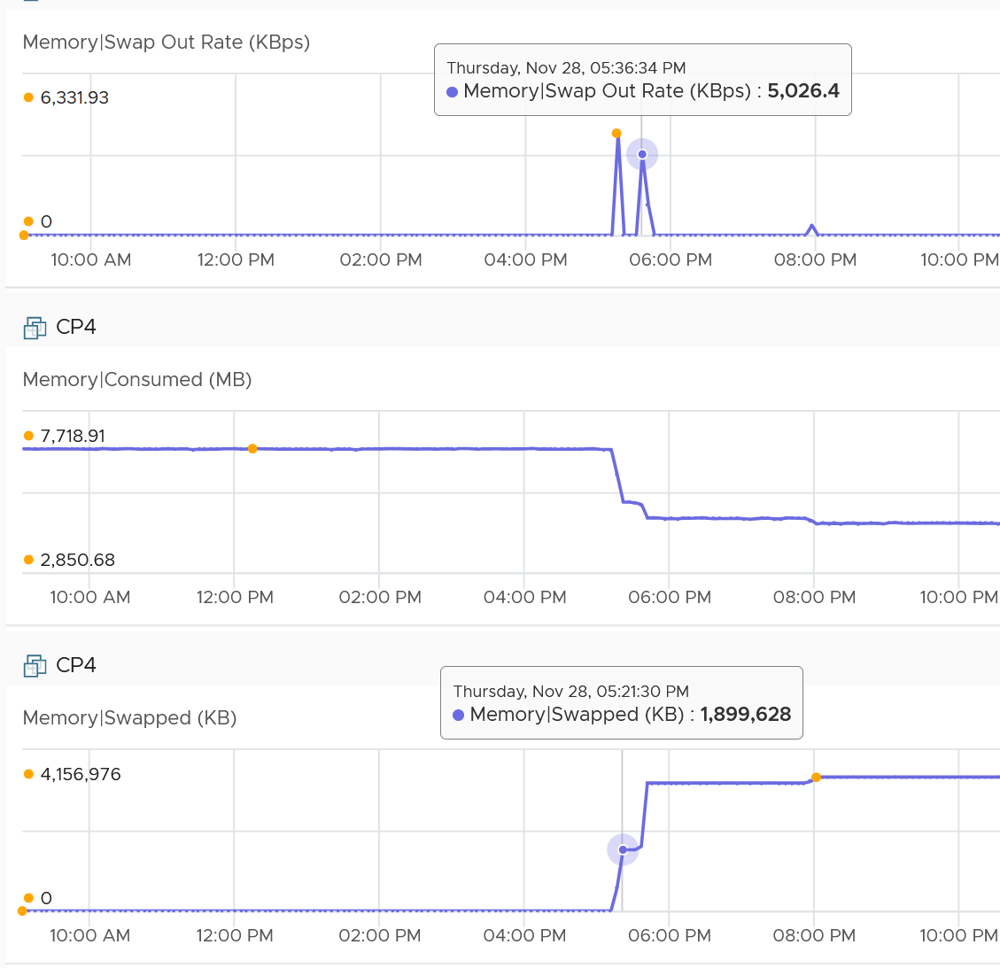
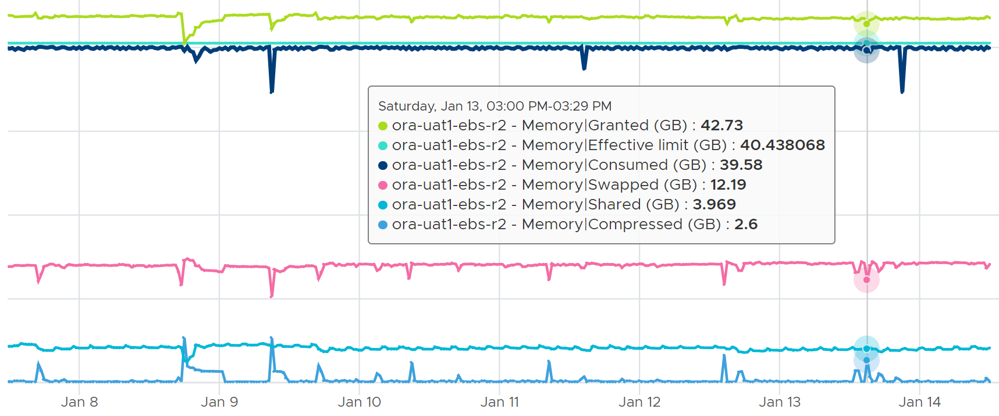

# Swap and compression

## Mechanism
- Compression and swapping work together. A page that cannot be compressed enough is swapped.
- Page size: 4 KB. Two compression levels: 4:1 (1 KB) and 2:1 (2 KB).
- If compression does not get the page below 2 KB, the page is swapped instead: cheaper.
- So Swapped can be 0 while everything was compressed.
- A large page (2 MB) is not compressed directly. It is split into 4 KB pages first.
- Compressed is preferred: unzipping from DRAM is faster than reading from SSD.
- Host cache (if designed on fast SSD) is faster than disk swap.
- Compressed and swapped data stays out until the guest requests it. Bringing it back costs CPU.

## When ESXi swaps instead of ballooning
- Host swapping is the fallback when the balloon driver cannot reclaim:
  - VMware Tools (balloon driver) never installed;
  - balloon driver deactivated;
  - balloon driver not running yet, for example while the guest boots;
  - balloon driver too slow for current demand;
  - balloon at its maximum size (sched.mem.maxmemctl, or the guest-type maximum).
- Ballooning lets the guest choose which pages to give back. Host swapping picks pages without guest knowledge.
- Compression cache: up to 10% of VM memory by default (Mem.MemZipMaxPct, 5-100%). Compressed pages beyond the cache are swapped.
- Swap space reserved per VM = configured memory - memory reservation. In practice only a fraction is used.
- Guest swap (page file) should be at least configured memory - memory reservation, because ballooning pushes the guest to page.

## Transition: input, process, output
| Stage | Metric | Meaning |
|---|---|---|
| Input | Swap Target | Pages to be compressed or swapped. Not pages already processed. Read it as compress-swap target. |
| Process | Compression rate, Decompression rate | Rate of compressing and decompressing. |
| Process | Swap out rate, Swap in rate | Rate of moving pages from DIMM to the swap file and back. |
| Output | Swapped, Swap out, Swap in | Swap result. |
| Output | Compressed, Compression saved | Compression result and savings. No compressed-in or compressed-out amounts. |

- The rate tells the shape: 10 MB in 1 second (acute) differs from 10 KB per second over 1,000 seconds (chronic). Same total.
- In and out happen at the same time on different pages. The swap file size can stay constant while its content changes.
- So Swapped is not Swap in - Swap out.

## Swap out vs swap in
- Swap out: ESXi was under memory pressure or the VM hit a limit. Not contention by itself: the page may never be requested.
- Swap in: contention. The guest requested a swapped page. Correlates highly with Memory Latency.
- Swap in does not mean current host pressure. It means pressure in the past, and the guest now requests that data.

## Example
- Swap out rate 6,331.93 + 5,026.4 + 1,882.13 + 615.86 = 13,856 KB/s over 300 s: 13,856 × 300 / 1,024 ≈ 4,059 MB. Swapped was 4,157 MB.
- No swap in during the period.
- Consumed dropped 4,868 MB (7,719 - 2,851). Other factors also contributed.


## Example: limit, swap and compress in opposite directions
- 64 GB VM. Swapped plus compressed peaked at 20 GB over 7 days.
- Consumed was flat for 7 days: a limit. The small gap above the limit is VM overhead.
- Granted hovered above Consumed.
- The guest kept using pages: some were swapped in; others were compressed or swapped to make room. So Swapped and Compressed moved in opposite directions.


## Compression, host cache and swap: triggers and cost
- Compression starts when VM memory usage approaches the level at which host-level swapping would be required. It reduces the pages ESX must swap out.
- Decompression latency is much smaller than swap-in latency: compression costs far less than swapping out the same pages.
- Swap to host cache starts when compression does not keep usage low enough, if a host cache is configured (an administrator-configured swap cache, in most cases on SSD). Much faster than regular swap files on hard disks, even if some swapped pages are active.
- Regular host-level swapping starts when the host cache is full or none is configured. High access latency can degrade VM performance significantly.
- Host-level swapping is transparent to the guest OS and distinct from swapping inside the guest OS.

## Traps
- "Swapped = Swap in - Swap out" → in and out run in parallel on different pages.
- "Swap out means contention" → only swap in is contention.
- "Swapped 0 means no reclamation" → pages may all be compressed.

- "Host-level swapping and guest OS swapping are the same" → they are distinct. Host-level swapping is transparent to the guest.
- "Memory compression is as costly as swapping" → decompression latency is much smaller than swap-in latency.
## Metadata
```yaml
id: vsphere/technology/memory/concepts/swap-and-compression
retriever_guide: how-it-works
scope: vsphere
technology:
- memory
pillar:
- performance
- capacity
product:
- vsphere
object:
- VirtualMachine
internal_derive:
- vsphere/technology/memory/concepts/host-memory-states
related:
- vsphere/technology/memory/metrics/virtual-motherboard/swapped
- vsphere/technology/memory/metrics/virtual-motherboard/compressed
- vsphere/technology/memory/metrics/virtual-motherboard/swap-target
- vsphere/technology/memory/metrics/virtual-motherboard/swap-in-rate
- vsphere/technology/memory/metrics/virtual-motherboard/latency
- vsphere/technology/memory/concepts/ballooning
images:
  - path: ../images/vm-memory-swap-out-rate-sum-matches-swapped.png
    product: [vsphere]
    object: [VirtualMachine]
    metric: ['VM Memory Swap Out Rate', 'VM Memory Swapped']
    image_type: timeline
  - path: ../images/vm-memory-limit-swapped-and-compressed-move-opposite.png
    product: [vsphere]
    object: [VirtualMachine]
    metric: ['VM Memory Consumed', 'VM Memory Swapped', 'VM Memory Compressed']
    image_type: timeline
source:
  document: PART 3 - Counters.docx
  path: Memory > VM > Swap + Compress; Transition; Example; Quiz
corrections: []
review_notes:
- 'Overcommit technique content: Performance Best Practices for VMware vSphere 9.1 (revision 20260624), ESX Memory Considerations > Memory Overcommit Techniques (pp. 33-34); https://www.vmware.com/docs/vsphere-esxi-vcenter-server-9-1-performance-best-practices'
- 'Section ''When ESXi swaps instead of ballooning'': from the vSphere 9.1 documentation, vSphere Resource Management > Using Swap Files, Swap Space and Memory Overcommitment, Memory Compression, Advanced Virtual Machine Attributes (pp. 1841, 1873-1874, 1944).'
- 'Section ''Mechanism'': the book''s sentence on why there is no 3:1 compression is incomplete. Left out.'
status: draft
```
