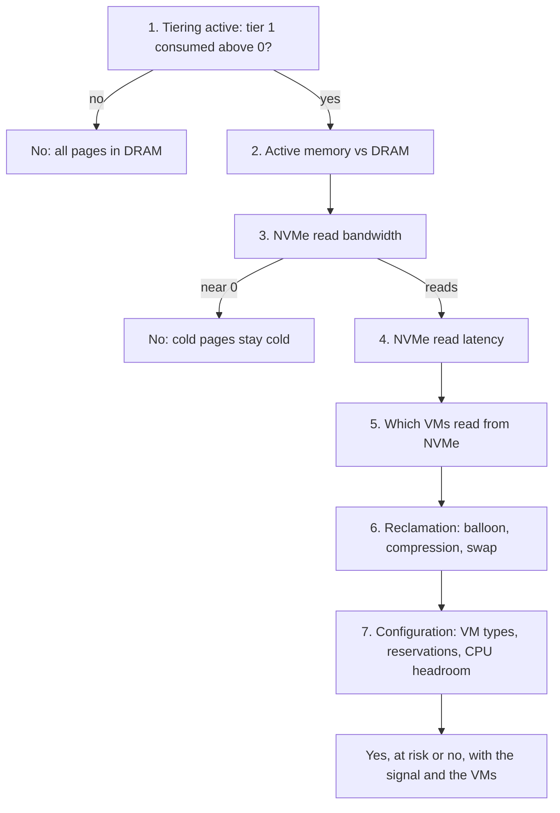

# Is memory tiering slowing this host?

## Question
- Is memory tiering slowing the VMs of this ESXi host, or about to?
- The answer is yes, at risk, or no, with the signal that decides it (active memory against DRAM, NVMe reads, NVMe read latency, reclamation) and the VMs it hits.
- An operational question, answered by a decision tree; not a health check. The mechanism and the thresholds: [`vsphere/technology/memory/concepts/memory-tiering`](../concepts/memory-tiering.md).

## Flow


## Checks, in order
1. Tier 1 consumed (HostSystem): `tier.consumed` per tier, or `memstats -r vmtier-stats` per VM. 0 → no: tiering starts only when DRAM consumption passes about 80%, or the VMs are excluded from tiering. Above 0 → step 2.
2. Active memory as % of host DRAM (HostSystem): vCenter Active, or esxtop TCHD summed over the VMs. 50% or lower: green. 50-75%: at risk; test the workloads. Above 75%: significant loss expected. → step 3.
3. NVMe read bandwidth (HostSystem): tier in rate, pages fetched back from NVMe. Near 0 → no: the pages on NVMe stay cold. Above 200 MB/s → watch the latency. → step 4.
4. NVMe read latency (HostSystem): `latency.read` of the NVMe tier, in ns, statistics level 3. Below 200 µs: good. 200-400 µs: potential issues. Above 400 µs: impact expected. High latency at almost no reads is a device waking from a power-saving state: the cause, not a reason to discard it. The VMs that read then waited. → step 5.
5. Per-VM NVMe read bandwidth (VirtualMachine): which VMs fetch from NVMe. A VM with high read bandwidth waits on NVMe whatever the host average says. → step 6.
6. Reclamation (HostSystem, VirtualMachine): ballooned, compressed, swapped. On a tiered host, reclamation means one of: a VM excluded from tiering without a full memory reservation, a memory limit, or demand beyond DRAM + NVMe. Memory overcommit must not be combined with tiering. → step 7.
7. Configuration (VirtualMachine, HostSystem, ClusterComputeResource):
   - VMs that should not be tiered: above 32 vCPUs and 512 GB (performance study), above 64 vCPUs and 512 GB (documentation); latency-sensitive VMs. Disable tiering for them with a full memory reservation.
   - Each full reservation shrinks the DRAM left for tiered VMs: the effective DRAM:NVMe ratio falls below 1:1.
   - CPU headroom: tiering costs CPU; a non-tiered host in the cluster above 75% CPU lowers its efficiency.
   - NVMe device health and wear (`esxcli nvme device log smart get`), mixed-use class with at least 3 DWPD.
   - HA: before vSphere 9.1.1, admission control does not reserve DRAM separately; restarts need DRAM ([`vsphere/object-types/cluster/concepts/admission-control-and-cluster-state`](../../../object-types/cluster/concepts/admission-control-and-cluster-state.md)).

## Why this order
- Tiering active first: with nothing on tier 1, nothing can wait on NVMe.
- Active memory before the device: it is the leading signal. When the working set outgrows DRAM, NVMe reads rise.
- Reads before latency: what the VMs lose is reads × latency. Few reads at a high latency, or many reads at a good latency, both cost wait time.
- Host before VM: the host signals say whether to look; the per-VM reads say who pays.
- Reclamation after tiering: on a tiered host it points to a configuration mistake, not to tiering.

## How to read the result
- No at step 1 or 3: tiering is not slowing the host.
- Active memory above 50% with rising NVMe reads: at risk now; move VMs to hosts with more DRAM, or lower the DRAM:NVMe ratio.
- NVMe reads with latency above 400 µs: yes; check the device class, wear and write load (garbage collection).
- One VM with high NVMe reads: yes for that VM; disable tiering for it with a full reservation, or give it a host with spare DRAM.
- Balloon, compression or swap on a tiered host: a configuration problem first (non-tiered VM without reservation, limit, overcommit).

## Misconceptions
- "Tier 1 consumed is high, so the VMs are slow" → tier 1 holds cold pages: saturation, not contention. Read active memory and NVMe reads.
- "NVMe latency is 900 µs on an idle device, so ignore it" → the VMs that read then waited 900 µs each. Measure the total (reads × latency); the wake-up explains it, it does not erase it.
- "Latency is below 200 µs, so tiering costs nothing" → each fetch still costs about 1,000x a DRAM access; many fetches slow the VM.
- "Only reads come from NVMe, so write-heavy VMs are safe" → a write to a cold page waits for the page to come back first.

## Metadata
```yaml
id: vsphere/technology/memory/decision-tree/is-memory-tiering-slowing-host
retriever_guide: decision-tree
scope: vsphere
technology:
- memory
pillar:
- performance
- capacity
product:
- vsphere
- vcf-operations
object:
- HostSystem
- VirtualMachine
- ClusterComputeResource
internal_derive:
- vsphere/technology/memory/concepts/memory-tiering
- vsphere/object-types/cluster/concepts/admission-control-and-cluster-state
related:
- vsphere/technology/memory/decision-tree/is-overcommit-affecting-vm
- vsphere/technology/memory/vm-memory-latency-high
- vsphere/object-types/cluster/models/cluster-risk
- vsphere/object-types/cluster/models/cluster-consumption
source:
  document: Memory Tiering Performance, VMware Cloud Foundation 9.0 (performance study, July 2025); VMware vSphere 9.1 documentation (PDF built 2026-11-02)
  path: 'performance study > Using and monitoring Memory Tiering (pp. 34-39); vSphere Resource Management > Memory Tiering over NVMe (pp. 1844-1873); vSphere Availability > Memory Tiering and HA Admission Control'
corrections: []
review_notes:
- 'To check: Step 4: whether VCF Operations exposes the NVMe tier read latency and read bandwidth per host and per VM, and their metric keys (candidate key: mem:NVMe|latency.read_latest).'
status: draft
```
