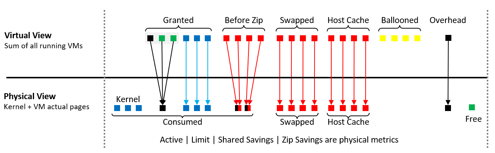
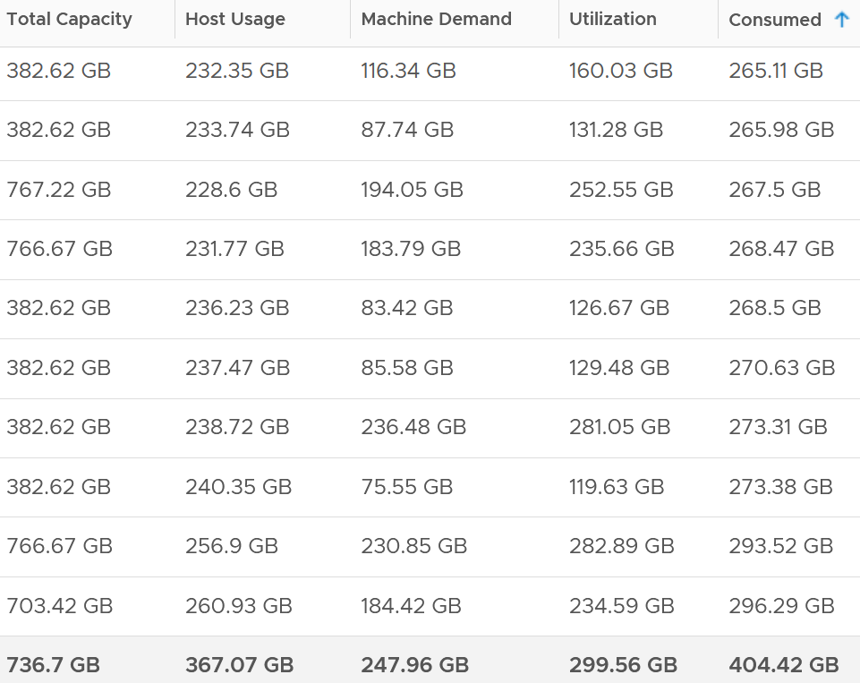

# ESXi memory metrics compared

## Volume
- vCenter: 38 ESXi memory metrics plus 11 for kernel memory. About 50 kernel processes are tracked.
- A cluster of 8 hosts can have more than 800 ESXi memory metrics.

## Groups
| Group | Counters | Use |
|---|---|---|
| Performance | Latency (normalized average of VMs) | Use max VM Memory Contention instead. |
| Past contention | Swap (5 counters), Compressed, Host cache | Capacity more than performance. |
| Capacity warning | Balloon, State, Low Free Threshold | Leading indicators. |
| Utilization | Consumed, Granted, Shared, Shared Common, Utilization | Consumed is the main capacity counter. |
| Reservation | Total reservation (capacity), Reservation consumed, Reservation available | Reservations cannot be overcommitted. |
| Other | Zero, Overhead, Heap (kernel heap, small and constant) | - |
| Internal | Active (kernel memory allocation), Persistent Memory, VMFS pointer block cache | Not for operations. The cache capacity miss ratio may be of interest. |

- Besides Latency, all memory metrics are capacity metrics.


## 185-host comparison (averages)
| Metric | Value | Meaning |
|---|---|---|
| Total Capacity | 736.7 GB | Physical memory. |
| Usable Memory | 729 GB | About 1% below total. Likely vCenter Managed: memory the kernel manages for VMs, kernel and user worlds. |
| VMkernel Usage | 7.6 GB | Far below kernel reservation (51.6 GB). |
| Host Usage | 367.07 GB | Sum of VM Consumed. Excludes ESX System Usage. Use: migration. |
| Machine Demand | 247.96 GB | Sum of VM Utilization. |
| Utilization | 299.56 GB | Machine Demand + ESX System Usage (a VCF Operations metric, the kernel reservation). |
| Consumed | 404.42 GB | Highest, unless sharing savings are large. |

- Workload = Utilization / Usable.


## VM reservation across counters
- Test on a 9.1 lab host, vCenter Advanced Performance, 20-second samples: a running VM's reservation was raised twice (+820 MB, then +8 GB). Only the reservation counters moved.

| Counter (vCenter) | Unit | Moves with a VM reservation | Reading |
|---|---|---|---|
| Reservation consumed | MB | Yes, by the full step | VMs only, the reservation as set; no kernel reservation or kernel use |
| Reservation available | KB | Yes, falls by the same amount | Total reservation minus Reservation consumed |
| Total reservation | MB | No | Reservable capacity of the host, about 362,000 MB on the lab host |
| Consumed | KB | No | Pages the host holds; about 12.4 GB, flat |
| Granted | KB | No | Mapped memory of VMs and management agents; about 11.9 GB, flat |
| VMkernel consumed | KB | No | Use by the VMkernel itself; about 0.70 GB, drifting 4 MB in an hour |
| Overhead consumed | KB | No | 0 throughout |

- Reason: Consumed, Granted and VMkernel consumed count pages in use. A reservation change by itself does not change the pages the host holds, so a VM reservation is in none of them.
- A VM reservation therefore shows only in the reservation counters. A host can hold large reservations and show a low Consumed.
- The kernel reservation (System Resource Reservation, about 4.2 GB on the lab host) is in none of these seven counters; it is host/system Resource memory allocation minimum ([overhead](../../../../architecture/overhead.md), section Memory metrics).

## Misconceptions
- "Use host Latency for performance" → it is an average. Use the worst VM.
- "Consumed and Utilization should match" → Consumed includes cache and inactive pages.

## Metadata
```yaml
id: vsphere/technology/memory/metrics/comparisons/host-memory-metrics
retriever_guide: metric-meaning
scope: vsphere
technology:
- memory
pillar:
- capacity
- performance
product:
- vsphere
- vcf-operations
object:
- HostSystem
metric_class: consumption
internal_derive:
- vsphere/technology/memory/concepts/memory-layers
same_name: []
same_meaning: []
related:
- vsphere/technology/memory/metrics/host/consumed
- vsphere/technology/memory/metrics/host/granted
- vsphere/technology/memory/metrics/host/shared
- vsphere/technology/memory/metrics/host/utilization
- vsphere/technology/memory/metrics/host/ballooned
- vsphere/technology/memory/metrics/host/state
- vsphere/technology/memory/metrics/host/reservation
- vsphere/technology/memory/metrics/host/latency
- vsphere/technology/memory/metrics/host/swap-used
- vsphere/technology/memory/metrics/host/compressed
images:
  - path: ../../images/esxi-memory-virtual-view-vs-physical-view.png
    product: [vsphere]
    object: [HostSystem]
    topic: 'ESXi memory views'
    image_type: diagram
  - path: ../../images/esxi-memory-usage-demand-utilization-consumed-across-hosts.png
    product: [vsphere, vcf-operations]
    object: [HostSystem]
    metric: ['ESXi Memory Usage', 'ESXi Memory Demand', 'ESXi Memory Utilization', 'ESXi Memory Consumed']
    image_type: table
    sample: '185 hosts'
source:
  document: Knowledge base
  path: Memory > ESXi > Overview; Consumption Metrics > Analysis
corrections: []
review_notes:
- 'To check: VMFS pointer block cache: the 9.1 equivalent of the vSphere 8.0 documentation linked by (https://docs.vmware.com/en/VMware-vSphere/8.0/vsphere-storage/GUID-FD9634FD-65E4-4EC8-BE9A-8BA0F68DD387.html).'
status: draft
```
