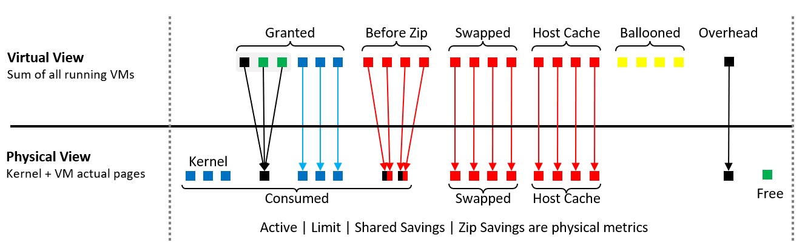
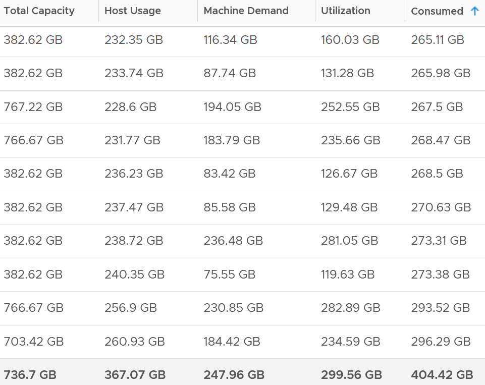

# ESXi memory metrics compared

## Volume
- vCenter: 38 ESXi memory metrics plus 11 for kernel memory. About 50 kernel processes are tracked.
- A cluster of 8 hosts can have more than 800 ESXi memory metrics.

## Groups
| Group | Counters | Use |
|---|---|---|
| Performance | Latency (normalized average of VMs) | Use max VM Memory Contention instead. |
| Past contention | Swap (5 counters), Compressed, Host cache | Capacity more than performance. |
| Capacity warning | Balloon, State, Low Free Threshold | Leading indicators. |
| Utilization | Consumed, Granted, Shared, Shared Common, Utilization | Consumed is the main capacity counter. |
| Reservation | Total reservation, Reservation consumed, Reservation available | Reservations cannot be overcommitted. |
| Other | Zero, Overhead, Heap (kernel heap, small and constant) | - |
| Internal | Active (kernel memory allocation), Persistent Memory, VMFS pointer block cache | Not for operations. The cache capacity miss ratio may be of interest. |

- Besides Latency, all memory metrics are capacity metrics.


## 185-host comparison (averages)
| Metric | Value | Meaning |
|---|---|---|
| Total Capacity | 736.7 GB | Physical memory. |
| Usable Memory | 729 GB | About 1% below total. Likely vCenter Managed: memory the kernel manages for VMs, kernel and user worlds. |
| VMkernel Usage | 7.6 GB | Far below kernel reservation (51.6 GB). |
| Host Usage | 367.07 GB | Sum of VM Consumed. Excludes ESX system usage. Use: migration. |
| Machine Demand | 247.96 GB | Sum of VM Utilization. |
| Utilization | 299.56 GB | Machine Demand + ESX System Usage. |
| Consumed | 404.42 GB | Highest, unless sharing savings are large. |

- Workload = Utilization / Usable.


## Misconceptions
- "Use host Latency for performance" → it is an average. Use the worst VM.
- "Consumed and Utilization should match" → Consumed includes cache and inactive pages.

## Metadata
```yaml
id: vsphere/technology/memory/metrics/comparisons/host-memory-metrics
retriever_guide: metric-meaning
scope: vsphere
technology:
- memory
pillar:
- capacity
- performance
product:
- vsphere
- vcf-operations
object:
- HostSystem
metric_class: consumption
internal_derive:
- vsphere/technology/memory/concepts/memory-layers
same_name: []
same_meaning: []
related:
- vsphere/technology/memory/metrics/host/consumed
- vsphere/technology/memory/metrics/host/granted
- vsphere/technology/memory/metrics/host/shared
- vsphere/technology/memory/metrics/host/utilization
- vsphere/technology/memory/metrics/host/ballooned
- vsphere/technology/memory/metrics/host/state
- vsphere/technology/memory/metrics/host/reservation
- vsphere/technology/memory/metrics/host/latency
- vsphere/technology/memory/metrics/host/swap-used
- vsphere/technology/memory/metrics/host/compressed
images:
  - path: ../../images/esxi-memory-virtual-view-vs-physical-view.png
    product: [vsphere]
    object: [HostSystem]
    topic: 'ESXi memory views'
    image_type: diagram
  - path: ../../images/esxi-memory-usage-demand-utilization-consumed-across-hosts.png
    product: [vsphere, vcf-operations]
    object: [HostSystem]
    metric: ['ESXi Memory Usage', 'ESXi Memory Demand', 'ESXi Memory Utilization', 'ESXi Memory Consumed']
    image_type: table
    sample: '185 hosts'
source:
  document: Private Cloud Management by Iwan Rahabok (https://isvara.io/download)
  path: Memory > ESXi > Overview; Consumption Metrics > Analysis
corrections: []
review_notes:
- 'To check: VMFS pointer block cache: the 9.1 equivalent of the vSphere 8.0 documentation linked by the book (https://docs.vmware.com/en/VMware-vSphere/8.0/vsphere-storage/GUID-FD9634FD-65E4-4EC8-BE9A-8BA0F68DD387.html).'
status: draft
```
