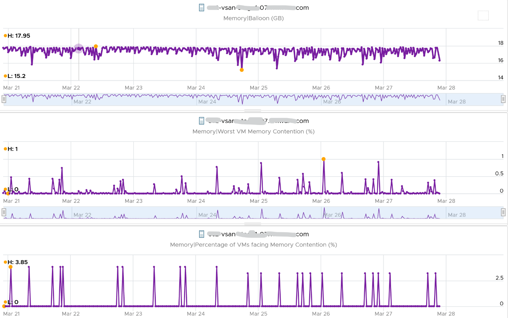

# ESXi Memory Ballooned

## Meaning
- Sum of ballooned memory of the VMs on the host.
- A leading indicator that the host is under memory pressure. A primary capacity metric.
- More a capacity warning than a performance metric, assuming no limits.
- A host that runs with no ballooning by design (performance-first) keeps ESXi Memory Ballooned at 0; there ESXi Memory Consumed is the capacity counter ([`vsphere/technology/memory/metrics/host/utilization`](utilization.md), section Reason).
- Relevance for operations: capacity, as a leading warning that the host reclaims memory; an alert on a host that runs with no ballooning by design. Not a performance counter: VM waits show in VM Memory Contention.

## Behaviour
- Ballooning starts at the Soft state: about 99% of host memory used. See [`vsphere/technology/memory/concepts/host-memory-states`](../../concepts/host-memory-states.md).
- Balloon is slower to act than swap and compress and works at a different layer. Host balloon can be 0 while swap and compress exist.
- Consumed drops when balloon rises: ballooned pages are no longer backed by ESXi pages.
- Balloon does not mean contention. Example: constant, significant balloon for 7 days; worst VM contention below 1%; most of 19 VMs had none.


## Misconceptions
- "Host balloon means VMs are slow" → check Max VM Memory Contention.

## Metadata
```yaml
id: vsphere/technology/memory/metrics/host/ballooned
retriever_guide: metric-meaning
scope: vsphere
technology:
- memory
pillar:
- capacity
product:
- vsphere
object:
- HostSystem
metric_class: consumption
internal_derive:
- vsphere/technology/memory/concepts/ballooning
- vsphere/technology/memory/concepts/host-memory-states
- vsphere/architecture/provider-consumer
same_name:
- vsphere/technology/memory/metrics/virtual-motherboard/ballooned
same_meaning: []
related:
- vsphere/technology/memory/metrics/comparisons/host-memory-metrics
- vsphere/technology/memory/concepts/host-memory-states
- vsphere/technology/memory/metrics/virtual-motherboard/ballooned
- vsphere/technology/memory/metrics/host/consumed
images:
  - path: ../../images/esxi-memory-balloon-7-days-without-vm-contention.png
    product: [vsphere]
    object: [HostSystem]
    metric: ['ESXi Memory Ballooned', 'VM Memory Contention']
    image_type: timeline
    sample: '1 host, 7 days'
source:
  document: Knowledge base
  path: Memory > ESXi > Overview; Contention Metrics > Balloon; All Together; Consumed > Ballooned
corrections: []
review_notes: []
status: draft
```
