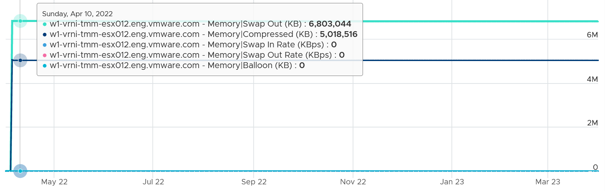

# ESXi Memory Compressed

## Meaning
- ESXi Memory Compressed is the result of compression: the zipped pages held in the compression cache in DRAM. It is not the amount subjected to compression.
- The compression cache sits inside ESXi Memory Consumed, because cache pages are ESXi pages in use. The memory compression freed is outside ESXi Memory Consumed.
- Each VM's compression cache is capped by Mem.MemZipMaxPct, default 10% of the VM's memory. Compressed pages beyond the cap are swapped.
- Pages can stay compressed for a long time when nothing requests them. Example: about 5 GB compressed for about 1 year, with balloon at 0 (no current pressure).


## Counters per tool
| Tool | Counter | Object | Meaning |
|---|---|---|---|
| esxtop | CACHEUSD | per VM | Compressed result held in DRAM |
| esxtop | CACHESZ | per VM | Compression cache size |
| vCenter | `mem.compressed` | VM and host | Compressed result |
| vCenter | `mem.zipped`, `mem.zipSaved` | VM only | Zipped result; memory saved |

- The vSphere Web Services API 9.1 summary of `mem.compressed` reads "Amount of memory reserved by userworlds". That summary is a copy error; the counter is the compressed amount.
- Host Compressed equals the sum of the VMs' esxtop CACHEUSD on that host, because the host counter sums the VM compression caches.

## Misconceptions
- "Compressed > 0 means current pressure" → it can be years old. Check balloon and swap-in.
- "Compressed is the memory freed by compression" → it is the result kept in DRAM. The freed amount is VM `mem.zipSaved`.
- "The mem.compressed summary says userworld reservation" → copy error in the API summary.

## Metadata
```yaml
id: vsphere/technology/memory/metrics/host/compressed
retriever_guide: metric-meaning
scope: vsphere
technology:
- memory
pillar:
- capacity
product:
- vsphere
object:
- HostSystem
metric_class: context
internal_derive:
- vsphere/technology/memory/concepts/swap-and-compression
- vsphere/technology/memory/concepts/host-memory-states
same_name: []
same_meaning: []
related:
- vsphere/technology/memory/metrics/host/swap-used
- vsphere/technology/memory/metrics/virtual-motherboard/compressed
- vsphere/technology/memory/concepts/swap-and-compression
images:
  - path: ../../images/esxi-memory-compressed-flat-for-1-year.png
    product: [vsphere]
    object: [HostSystem]
    metric: ['ESXi Memory Compressed']
    image_type: timeline
    sample: '1 host, 1 year'
source:
  document: Private Cloud Management by Iwan Rahabok (https://isvara.io/download)
  path: Memory > ESXi > Overview; Swap + Compress
corrections: []
review_notes:
- 'Sections ''Meaning'' and ''Counters per tool'': from the vSphere 9.1 documentation (Memory Compression; esxtop Memory panel: CNSM, CACHESZ, CACHEUSD) and https://developer.broadcom.com/xapis/vsphere-web-services-api/9.1/memory_counters.html.'
- 'To check: Section ''Counters per tool'': host Compressed equals the sum of esxtop CACHEUSD; compare on a host that is compressing.'
status: draft
```
