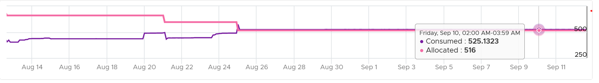
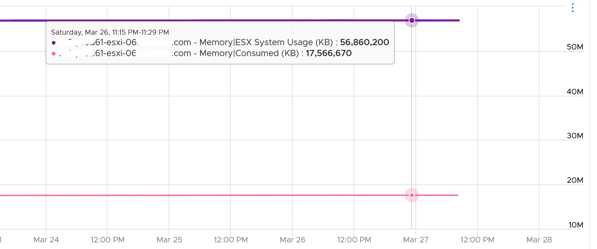
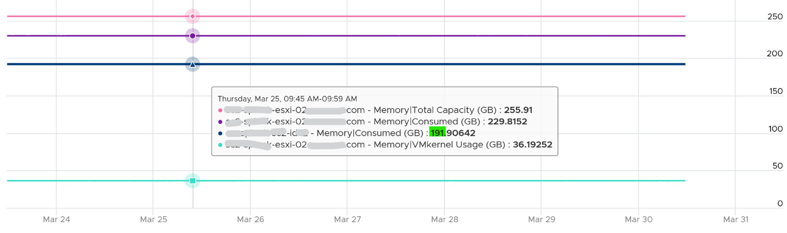

# ESXi Memory Consumed

## Meaning
- Includes memory consumed by ESXi itself.

## Scope
- ESXi pages, summed at host level: VMs plus the kernel's own memory plus VM overhead.
- Physical memory is shared by VMs and the hypervisor. Manage them as one.
- Very high Consumed triggers compression and swapping proactively. That alone does not mean VMs contend for RAM.

## Formula
```text
Consumed = physical memory - free
VCF Operations Usage (%) = Consumed / Total Capacity
```
- Only pages mapped in physical DIMM.
- excludes: ballooned (guest level), swapped (on disk or host cache).
- includes: the resulting compressed size (not the input), the result of TPS savings (not the shared amount), VM overhead, all kernel processes (user and kernel space).
- Compression: the compression cache (the zipped pages held in DRAM) is inside ESXi Memory Consumed, because cache pages are ESXi pages in use, not free. Only the memory compression freed leaves ESXi Memory Consumed.
- Example: a 4 KB page compressed to 1 KB keeps 1 KB in ESXi Memory Consumed and frees 3 KB.
- Includes actual kernel use, not kernel reservation.

## Behaviour
- The primary ESXi utilization counter, but full of cache and inactive pages. Near 100% in an overcommitted host is the goal, not a problem.
- Drops when balloon or swap out rises.
- ESXi Memory Consumed falling while ESXi Memory Compressed rises shows the compression saving plus any swap out. The compressed result stays inside Consumed.
- Includes non-VM consumers: kernel, vSAN, NSX. Can exceed the memory allocated to all running VMs.

- Host with 0 VMs: example 17 GB consumed, likely vSAN.
- Same host: kernel reservation (ESX System Usage) about 57 GB, Consumed about 17.5 GB. Consumed is actual use, not reservation.

- Example: 255 GB host, 229 GB consumed = 191 GB by the one VM + 36 GB by the kernel. Kernel consumption = sum of 3 kernel resource pools.
- Evacuated host: Consumed fell from 400 GB to 32 GB (vSAN), not 0. Kernel usage stayed nearly constant; kernel reservation did not change.


## Traps
- Summing VM Consumed and expecting ESXi Consumed.
- "Host Consumed near 100% is a problem" → memory is cache. Check balloon, swap-in and VM contention.
- "Host with no VMs should show 0 Consumed" → kernel, vSAN and NSX consume memory.
- "Consumed does not include compressed memory" → it includes the compressed result in DRAM; it excludes only what compression freed.

## Metadata
```yaml
id: vsphere/technology/memory/metrics/host/consumed
retriever_guide: metric-meaning
scope: vsphere
technology:
- memory
pillar:
- capacity
product:
- vsphere
object:
- HostSystem
metric_class: consumption
internal_derive:
- vsphere/architecture/provider-consumer
same_name:
- vsphere/technology/memory/metrics/cluster/consumed
- vsphere/technology/memory/metrics/virtual-motherboard/consumed
same_meaning: []
related:
- vsphere/technology/memory/concepts/memory-layers
- vsphere/technology/memory/metrics/host/granted
- vsphere/technology/memory/metrics/host/utilization
- vsphere/technology/memory/concepts/host-memory-states
images:
  - path: ../../images/esxi-memory-consumed-above-vm-allocated.png
    product: [vsphere]
    object: [HostSystem]
    metric: ['ESXi Memory Consumed']
    image_type: timeline
  - path: ../../images/esxi-memory-system-usage-vs-consumed-host-without-vms.png
    product: [vsphere]
    object: [HostSystem]
    metric: ['ESXi Memory ESX System Usage', 'ESXi Memory Consumed']
    image_type: timeline
    sample: '1 host, 0 VMs'
  - path: ../../images/esxi-memory-consumed-equals-vm-consumed-plus-kernel.png
    product: [vsphere]
    object: [HostSystem]
    metric: ['ESXi Memory Consumed']
    image_type: screenshot
source:
  document: PART 3 - Counters.docx
  path: The World of Metrics > Metrics Nuances > Complexity > Naming Complexity; Memory > Architecture > Virtual Memory; Relationship; Memory > ESXi > Consumption Metrics > Consumed
corrections: []
review_notes:
- 'Section ''Scope'': from Memory > Architecture.'
- 'Sections Formula, Behaviour: from Memory > ESXi.'
- 'Section ''Formula'' (compression): Consumed = total host memory minus free host memory, from the vSphere Web Services API 9.1, https://developer.broadcom.com/xapis/vsphere-web-services-api/9.1/memory_counters.html; esxtop CNSM excludes the memory saved by compression (vSphere 9.1 documentation, esxtop Memory panel).'
status: draft
```
