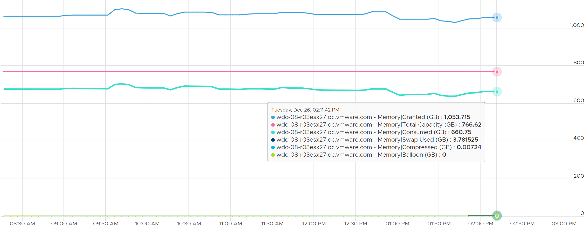

# ESXi Memory Granted

## Meaning
- Consumer-level counter: sum of granted memory of the running VMs, plus non-VM user worlds.
- Excludes kernel space: privileged processes get memory without the granting process.
- Consumed includes both user and kernel space.
- Relevance for operations: none for capacity: the VMs' view, which can exceed total capacity. Capacity reads ESXi Memory Consumed in the method's cluster models and ESXi Memory Utilization in the VCF Operations capacity engine.

## Behaviour
- Can exceed total capacity. Example: 1,053 GB granted on a 755 GB host.
- Consumed + Swapped + Compressed stays below total capacity.
- Not 0 on a host with no running VMs.
- Granted equals the Resource memory mapped counter of the host group (the same value on all 132 samples of a 9.1 lab host). Mapped memory is held by host/user (the VMs, 11.5 GB there) and host/vim (the management agents, 0.41 GB); host/system maps 0. So Granted contains the management agents' memory, not the kernel's.
- A VM reservation is not in Granted: raising a running VM's reservation by several GB left Granted flat ([`vsphere/technology/memory/metrics/comparisons/host-memory-metrics`](../comparisons/host-memory-metrics.md), section VM reservation across counters).
- A short-lived process in host/vim raises Granted by 16.5 MB every 3 minutes on that host (the esx-datapath-ctrs group), with Consumed up by about 40 MB at the same sample. A saw-tooth of this size is not VM activity.


## Misconceptions
- "Granted above capacity is impossible" → it is the VMs' view.

## Metadata
```yaml
id: vsphere/technology/memory/metrics/host/granted
retriever_guide: metric-meaning
scope: vsphere
technology:
- memory
pillar:
- capacity
product:
- vsphere
object:
- HostSystem
metric_class: consumption
internal_derive:
- vsphere/technology/memory/concepts/memory-layers
- vsphere/architecture/provider-consumer
- vsphere/architecture/kernel-worlds
same_name:
- vsphere/technology/memory/metrics/virtual-motherboard/granted
same_meaning: []
related:
- vsphere/technology/memory/metrics/comparisons/host-memory-metrics
- vsphere/technology/memory/metrics/host/consumed
- vsphere/technology/memory/metrics/virtual-motherboard/granted
images:
  - path: ../../images/esxi-memory-granted-above-total-capacity.png
    product: [vsphere]
    object: [HostSystem]
    metric: ['ESXi Memory Granted']
    image_type: timeline
source:
  document: Knowledge base
  path: Memory > ESXi > Consumption Metrics > Granted
corrections: []
review_notes:
- 'To check: Section ''Behaviour'': the 3-minute pulse (16.5 MB in Granted, about 40 MB in Consumed, a dip of about 134 MB in Total reservation) is seen on one lab host; its cause (esx-datapath-ctrs is the only group that appears at the same samples) is not confirmed.'
status: draft
```
