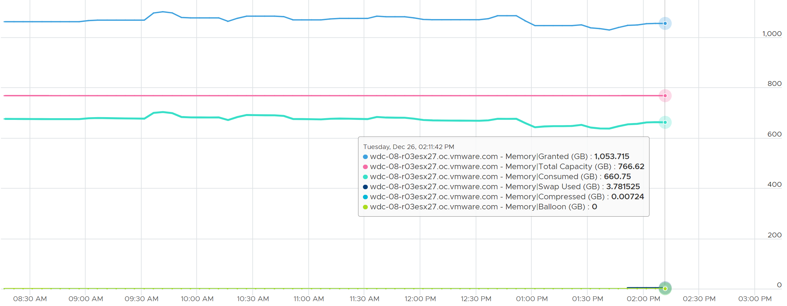

# ESXi Memory Granted

## Meaning
- Consumer-level counter: sum of granted memory of the running VMs, plus non-VM user worlds.
- Excludes kernel space: privileged processes get memory without the granting process.
- Consumed includes both user and kernel space.

## Behaviour
- Can exceed total capacity. Example: 1,053 GB granted on a 755 GB host.
- Consumed + Swapped + Compressed stays below total capacity.
- Not 0 on a host with no running VMs.


## Misconceptions
- "Granted above capacity is impossible" → it is the VMs' view.

## Metadata
```yaml
id: vsphere/technology/memory/metrics/host/granted
retriever_guide: metric-meaning
scope: vsphere
technology:
- memory
pillar:
- capacity
product:
- vsphere
object:
- HostSystem
metric_class: consumption
internal_derive:
- vsphere/technology/memory/concepts/memory-layers
- vsphere/architecture/provider-consumer
- vsphere/architecture/kernel-worlds
same_name:
- vsphere/technology/memory/metrics/virtual-motherboard/granted
same_meaning: []
related:
- vsphere/technology/memory/metrics/comparisons/host-memory-metrics
- vsphere/technology/memory/metrics/host/consumed
- vsphere/technology/memory/metrics/virtual-motherboard/granted
images:
  - path: ../../images/esxi-memory-granted-above-total-capacity.png
    product: [vsphere]
    object: [HostSystem]
    metric: ['ESXi Memory Granted']
    image_type: timeline
source:
  document: Knowledge base
  path: Memory > ESXi > Consumption Metrics > Granted
corrections: []
review_notes:
- 'To check: what host Granted holds with no running VMs (non-VM user worlds is a guess).'
status: draft
```
