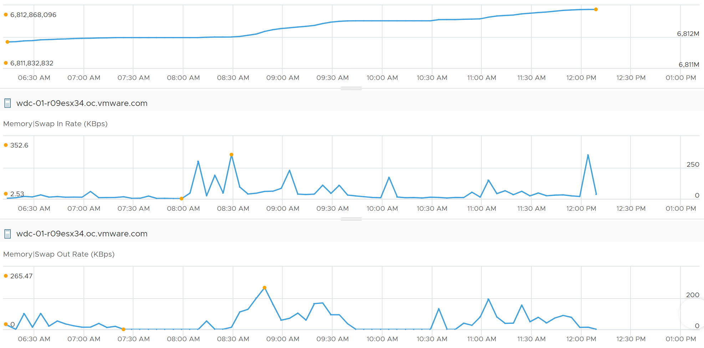

# ESXi Memory Swap Used

## Meaning
- The host-level counterpart of VM Swapped. Different names for different vantage points.

## Swap counters at host level
| Counter | Meaning |
|---|---|
| Swap Consumed | Memory swapped by all powered-on VMs and vSphere services. Falls when pages are swapped back in. |
| Swap In, Swap Out | Cumulative amounts swapped in or out to date. |
| Swap In Rate, Swap Out Rate | Rates. The book suspects they include compression; unconfirmed. |

- 5 swap counters at host level, not 6: Swap Target is missing.
- Swap Out is cumulative: it does not fall when pages are swapped in.
- Small swap-in rates matter little: 1-2 KB/s averaged over 20 s = 20-40 KB.


## Metadata
```yaml
id: vsphere/technology/memory/metrics/host/swap-used
retriever_guide: metric-meaning
scope: vsphere
technology:
- memory
pillar:
- performance
product:
- vsphere
object:
- HostSystem
metric_class: contention
internal_derive:
- vsphere/technology/memory/concepts/host-memory-states
same_name: []
same_meaning:
- vsphere/technology/memory/metrics/virtual-motherboard/swapped
related:
- vsphere/technology/memory/metrics/host/compressed
- vsphere/technology/memory/concepts/swap-and-compression
images:
  - path: ../../images/esxi-memory-swap-in-vs-swap-out-cumulative.png
    product: [vsphere]
    object: [HostSystem]
    metric: ['ESXi Memory Swap In', 'ESXi Memory Swap Out']
    image_type: timeline
source:
  document: PART 3 - Counters.docx
  path: The World of Metrics > Metrics Nuances > Complexity > Naming Complexity; Memory > ESXi > Swap + Compress
corrections: []
review_notes:
- metric_class set to contention. Author to confirm.
- 'Section ''Swap counters at host level'': from Memory > ESXi.'
- 'Section ''Swap counters at host level'': the book suggests Swap Consumed = swapped out - swapped in, which conflicts with its VM section (Swapped is not swap in - swap out). Open question in project/author-questions.md.'
status: draft
```
