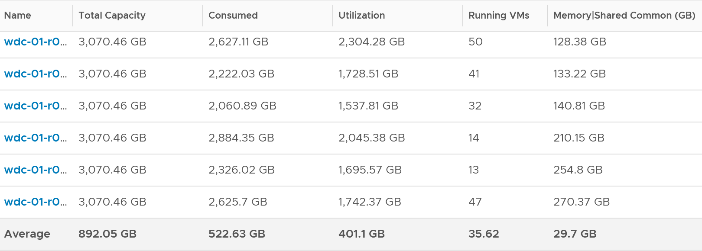

# ESXi Memory Utilization (VCF Operations)

## Formula
```text
Utilization = Machine Demand + ESX System Usage
Machine Demand = sum of running VM Utilization
```
- ESX System Usage is the kernel reservation. Raw vCenter counter: Memory \ ESX System Usage (KB). The name is legacy.
- So the two forms are the same: sum of running VM Utilization + kernel reservation.
- Equals ESX System Usage on a host with no running VMs.

## Reason
- Consumed is too conservative: mostly cache.
- Active is too aggressive: not designed for sizing.
- Utilization sits between them.
- Uses the kernel reservation, not actual kernel use: not exact, but gives a buffer.

## Observed values
- 192 hosts, 6,840 VMs: Utilization was 122 GB lower than Consumed on average. Including Shared Common, the gap is 152 GB.


## Misconceptions
- "Utilization = Consumed" → it removes cache and inactive pages via guest metrics.

## Metadata
```yaml
id: vsphere/technology/memory/metrics/host/utilization
retriever_guide: metric-meaning
scope: vsphere
technology:
- memory
pillar:
- capacity
product:
- vcf-operations
object:
- HostSystem
metric_class: consumption
internal_derive:
- vsphere/technology/memory/concepts/memory-capacity
- sp5-framework/capacity/demand
- vsphere/technology/memory/concepts/memory-overhead
same_name: []
same_meaning: []
related:
- vsphere/technology/memory/metrics/host/consumed
- vsphere/technology/memory/metrics/virtual-motherboard/utilization
- vsphere/technology/memory/metrics/comparisons/host-memory-metrics
images:
  - path: ../../images/esxi-memory-utilization-vs-consumed-across-hosts.png
    product: [vcf-operations]
    object: [HostSystem]
    metric: ['ESXi Memory Utilization', 'ESXi Memory Consumed']
    image_type: table
    sample: '192 hosts'
source:
  document: Knowledge base
  path: Memory > ESXi > Consumption Metrics > Utilization; Analysis
corrections: []
review_notes: []
status: draft
```
