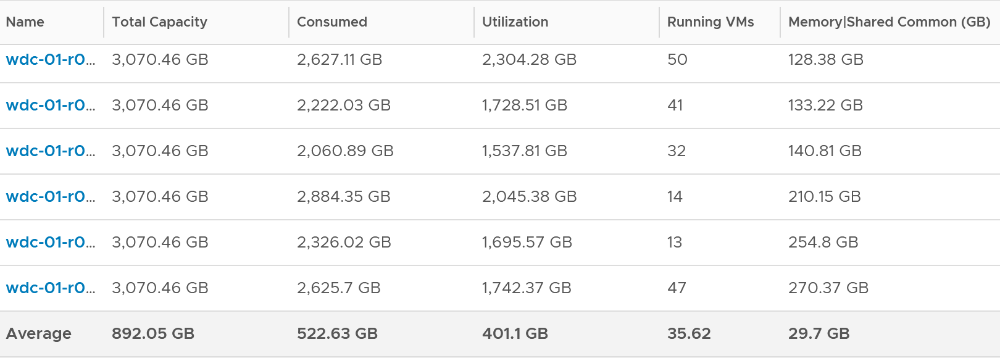

# ESXi Memory Utilization (VCF Operations)

## Formula
```text
Utilization    = Machine Demand + ESX System Usage
Machine Demand = sum over running VMs of the VM term
VM term        = Max (VM Memory Utilization, VM memory reservation) + VM overhead
```
- This file is the one home of the VCF Operations host formula. The capacity model it applies, Demand = Max (Utilization, Reservation) per VM: [`sp5-framework/capacity/demand`](../../../../../sp5-framework/capacity/demand.md), section Demand. VM Memory Utilization: [`vsphere/technology/memory/metrics/virtual-motherboard/utilization`](../virtual-motherboard/utilization.md).
- VCF Operations 9.1 describes host Mem|Utilization (`mem|total_need`) as based on the utilization of the VMs below the host, including their reservations, limits and the overhead to run them (Host System metrics). The description gives no formula: the VM term above is the method's rule (Max of Utilization and reservation) applied to that description, not a published formula, and how the limit enters is not published.
- A VM reservation above the VM's Utilization raises the VM term to the reservation: a reservation is taken whether it is consumed or not.
- ESX System Usage is the kernel reservation, a metric VCF Operations computes (`mem|host_systemUsage`). vCenter has no counter of that name: it holds the kernel reservation as host/system Resource memory allocation minimum, the number on the System Resource Reservation page ([`vsphere/architecture/overhead`](../../../../architecture/overhead.md), section Memory metrics).
- Equals ESX System Usage on a host with no running VMs.
- The VCF Operations capacity pages (Time Remaining, Capacity) name this metric Demand: memory Demand there is Utilization, not Consumed (Broadcom KB 439253). The capacity engine projects it against usable capacity.
- Relevance for operations: capacity in VCF Operations: the host memory demand of its capacity engine (Time Remaining, Capacity Remaining). The method's cluster models read ESXi Memory Consumed instead, because ESXi Memory Utilization mixes realms (section Reason).

## Use
- Not a performance counter: a high value means the host memory is spoken for, not that a VM waits. Memory waits show in VM Memory Contention, and in Memory Wait on a tiered host.

## Reason
- ESXi Memory Utilization is the Guest OS need of each VM, raised to the VM's reservation. Its VM term, VM Memory Utilization, reads Guest OS counters (Guest OS Needed Memory) through VMware Tools, so it mixes realms: an ESXi capacity figure rests on Guest OS data that the hypervisor neither sees nor controls ([`vsphere/architecture/vm-vs-guest-os`](../../../../architecture/vm-vs-guest-os.md), section Two realms).
- ESXi Memory Consumed stays in one realm, the ESXi pages the VMs hold, and is conservative: it holds guest cache and inactive pages, which ESXi can take back by ballooning.
- The method's cluster models (Cluster Consumption, Cluster Risk) therefore read ESXi Memory Consumed, with ballooned, compressed and swapped memory and the NVMe tier counted on top as saturation ([`vsphere/object-types/cluster/models/cluster-consumption`](../../../../object-types/cluster/models/cluster-consumption.md)).
- Most clusters without memory tiering can run with some ballooning: the risk of actual contention from it is operationally negligible. A performance-first class keeps ESXi Memory Ballooned at 0 ([`vsphere/technology/memory/metrics/host/ballooned`](ballooned.md)).
- VM Memory Active is too aggressive: a sampled estimate made for VMkernel memory management, not designed for sizing.
- Uses the kernel reservation, not actual kernel use (VMkernel consumed): a reservation is taken whether consumed or not, the same rule as a VM reservation. Not exact, but it gives a buffer.

## Observed values
- 192 hosts, 6,840 VMs: Utilization was 122 GB lower than Consumed on average. Including Shared Common, the gap is 152 GB.


## Misconceptions
- "Utilization = Consumed" → it removes cache and inactive pages via guest metrics.
- "Host memory Utilization adds what the kernel consumes" → it adds the kernel reservation (ESX System Usage), which is taken whether consumed or not.
- "The Demand on the capacity pages and Memory Utilization are two different metrics" → the capacity pages show Memory Utilization under the name Demand.
- "ESXi Memory Utilization is the better capacity counter, because VCF Operations plans on it" → it mixes realms: its VM term comes from Guest OS counters through VMware Tools. The method's cluster models read ESXi Memory Consumed, conservative but in one realm, with reclamation counted as saturation.
- "ESXi Memory Consumed near 100% means the host is out of memory" → Consumed is conservative: it holds guest cache and inactive pages. Read the saturation counters (Ballooned, Compressed, Swapped) and VM Memory Contention.

## Metadata
```yaml
id: vsphere/technology/memory/metrics/host/utilization
retriever_guide: metric-meaning
scope: vsphere
technology:
- memory
pillar:
- capacity
product:
- vcf-operations
object:
- HostSystem
metric_class: consumption
internal_derive:
- vsphere/technology/memory/concepts/memory-capacity
- sp5-framework/capacity/demand
- vsphere/technology/memory/concepts/memory-overhead
same_name: []
same_meaning: []
related:
- vsphere/technology/memory/metrics/host/consumed
- vsphere/technology/memory/metrics/virtual-motherboard/utilization
- vsphere/technology/memory/metrics/comparisons/host-memory-metrics
- vsphere/object-types/cluster/models/cluster-consumption
- vsphere/architecture/vm-vs-guest-os
images:
  - path: ../../images/esxi-memory-utilization-vs-consumed-across-hosts.png
    product: [vcf-operations]
    object: [HostSystem]
    metric: ['ESXi Memory Utilization', 'ESXi Memory Consumed']
    image_type: table
    sample: '192 hosts'
source:
  document: Knowledge base; VCF Operations 9.1 documentation (TechDocs, last updated 2026-11-12), Host System Metrics; Broadcom KB 439253, Understanding Demand vs. Utilization Memory Metrics in VMware Aria Operations (VCF Operations)
  path: Memory > ESXi > Consumption Metrics > Utilization; Analysis
corrections: []
review_notes:
- 'To check: Section ''Formula'': the VM term is not published. On one 9.1 host with a reserved VM and a VM with a limit, compare Mem|Machine Demand (`mem|host_demand`) with the sum of VM Mem|Utilization (KB), check how the limit enters, and whether VM Mem|Demand for aggregation (`mem|host_demand_for_aggregation`) is the VM term.'
status: draft
```
