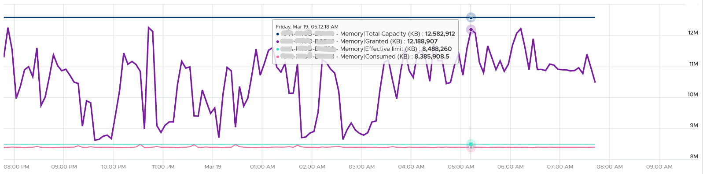
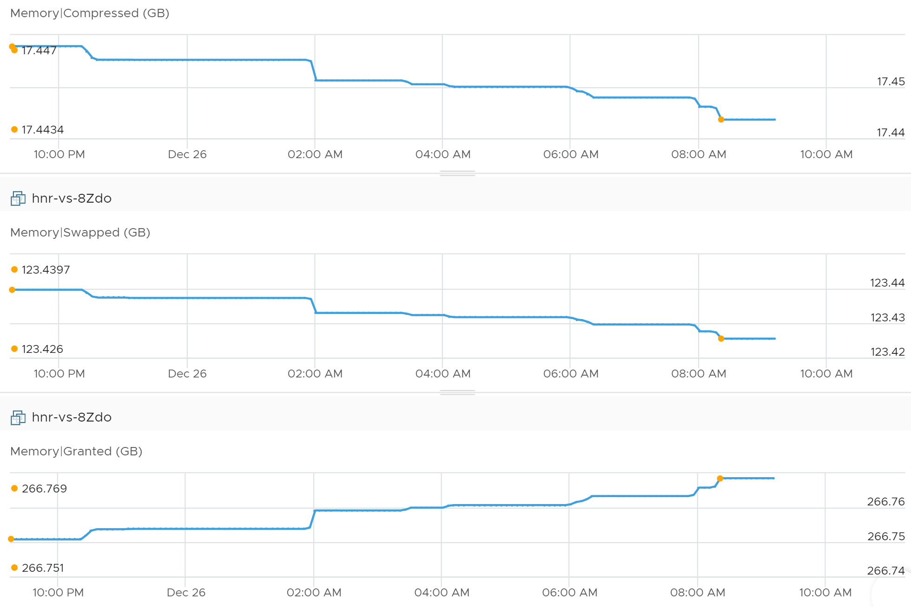

# VM Memory Granted

## Meaning
- VM pages that have ESXi pages mapped to them. The consumer (VM) view.
- Excludes ballooned, swapped, compressed and host-cache pages.

## Formula
```text
Granted = normal pages + shared pages + zero pages + pages being swapped in + tiered pages
```
- Normal page: a single page backed by DIMM. Not exposed as its own metric.
- Being swapped in: a staging state between unmapped and normal.
- Tiered pages: memory tiering is in-line, so tiered pages count as granted. Swapped pages do not.
- During a swap transition, Granted still includes the pages in transition.

## Behaviour
- A guest touches much of its address space over time: OS initialization, memory zeroing, page tables, file cache, application allocations. Each touched page gets a mapping.
- Many mapped pages hold zeroes or are shared through TPS. They cost little physical RAM but still count in Granted.
- Without host memory pressure, the VMkernel does not reclaim them aggressively.
- So Granted rises toward the configured size over time. Configured size is its upper limit.
- Granted ignores physical savings. It can stay flat while Consumed falls as sharing rises.
- Granted ignores limits. Example: 12 GB Windows VM with an 8 GB limit: Granted moved well above 8 GB; Consumed stayed below the limit.
- Granted rises when Compressed and Swapped fall: pages come back.



## Traps
- "Granted = Consumed" → Granted is the VM view, Consumed the ESXi view after savings and limits.
- "Granted near configured means the guest uses all its memory" → touched pages stay mapped, including zero and shared pages.

## Metadata
```yaml
id: vsphere/technology/memory/metrics/virtual-motherboard/granted
retriever_guide: metric-meaning
scope: vsphere
technology:
- memory
pillar:
- performance
- capacity
product:
- vsphere
object:
- VirtualMachine
layer:
- virtual-motherboard
metric_class: consumption
internal_derive:
- vsphere/technology/memory/concepts/memory-layers
same_name: []
same_meaning: []
related:
- vsphere/technology/memory/metrics/virtual-motherboard/consumed
- vsphere/technology/memory/metrics/virtual-motherboard/shared
- vsphere/technology/memory/metrics/virtual-motherboard/zero-pages
- vsphere/technology/memory/metrics/comparisons/vm-memory-metrics
images:
  - path: ../../images/vm-memory-granted-ignores-limit-consumed-below-limit.png
    product: [vsphere]
    object: [VirtualMachine]
    metric: ['VM Memory Granted', 'VM Memory Consumed']
    image_type: timeline
  - path: ../../images/vm-memory-granted-rises-as-compressed-and-swapped-fall.png
    product: [vsphere]
    object: [VirtualMachine]
    metric: ['VM Memory Granted', 'VM Memory Compressed', 'VM Memory Swapped']
    image_type: timeline
source:
  document: PART 3 - Counters.docx
  path: Memory > VM > Consumption Metrics > Granted
corrections: []
review_notes: []
status: draft
```
