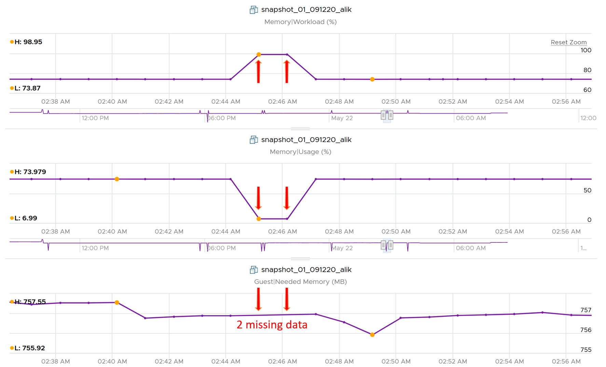

# VM Memory Usage

## Meaning
- One label, two formulas. vCenter VM Memory Usage (%) reads Active, an ESXi estimate; VCF Operations VM Memory Usage (%) reads the Guest OS. Formulas: section By tool.
- Active is a sampled estimate of recently touched pages, made for VMkernel memory management.
- Relevance for operations: vCenter Usage (%): none for sizing or capacity. VCF Operations Usage (%): Guest OS sizing. Details: section Use.

## Use
- For operations, vCenter Usage (%): not for sizing or capacity. Active does not see how the Guest OS uses its cache, so a cut to it removes that cache.
- For operations, VCF Operations Usage (%): Guest OS sizing, as Needed Memory against the VM's size; sizing rules: [`guest-os/system/guest-os-sizing`](../../../../../guest-os/system/guest-os-sizing.md), section Memory.
- VCF Operations 9.1 lists VM Memory|Usage (%) (`mem|usage_average`) among the metrics disabled by default, with no description (Virtual Machine metrics). To chart it, enable it in the policy; its history starts at that point.
- Without the metric, the same ratio comes from two metrics that 9.1 collects by default: Guest|Needed Memory (`guest|mem.needed_latest`) over Mem|Total Capacity (KB) (`mem|guest_provisioned`).

## Difference from ESXi and cluster Usage
- Two-level memory hierarchy in virtualization.
- ESXi and cluster Usage map to Consumed, which is related to capacity.

## By tool
- vCenter UI Usage (%) = Active / configured memory (vSphere API 9.1, `mem.usage`: active ÷ virtual-machine-configured-size).
- VCF Operations Usage (%) = Guest OS Needed Memory (KB) / VM Memory Total Capacity (KB) × 100.
- Example: 1 GB VM, Guest OS Needed Memory 757 MB: 757 / 1,024 = 74%.
- Guest OS metrics missing: VCF Operations Usage (%) falls back to Active (example: dropped to 6.99%). Broadcom KB 390432: without VMware Tools running, Memory|Usage (%) prefers Memory|Non Zero Active (KB).
- The top chart of the image is VM Memory|Workload (%): it jumped to 98.95% in the same gap, because it reads VM Memory Utilization, which falls back to Consumed ([`vsphere/technology/memory/metrics/virtual-motherboard/utilization`](utilization.md)).
- The VCF Operations 9.1 Virtual Machine metric list has no VM Memory|Workload (%). For the capacity reading of a VM in 9.1, read Mem|Utilization (KB) (`mem|vmMemoryDemand`), collected by default.


## Misconceptions
- "VM Memory Usage and ESXi Memory Usage measure the same thing" → VM Usage is Active (vCenter) or Needed Memory (VCF Operations); ESXi Usage is Consumed. Read as one metric, they have led customers to buy more RAM than required.
- "VM Memory Usage (%) dipped, so the guest freed memory" → without guest data the VCF Operations value falls back to Active; the source changed, not the guest.
- "VCF Operations 9.1 has no VM Memory Usage (%), so it does not collect the guest's memory need" → the metric is disabled by default; Guest|Needed Memory and Mem|Total Capacity are collected and give the same ratio.

## Metadata
```yaml
id: vsphere/technology/memory/metrics/virtual-motherboard/usage
retriever_guide: metric-meaning
scope: vsphere
technology:
- memory
pillar:
- performance
- capacity
product:
- vsphere
- vcf-operations
object:
- VirtualMachine
layer:
- virtual-motherboard
metric_class: consumption
internal_derive:
- sp5-framework/observability/resource-nature
same_name:
- vsphere/technology/memory/metrics/host/usage
- vsphere/technology/memory/metrics/cluster/usage
same_meaning: []
related:
- vsphere/technology/memory/metrics/comparisons/vm-memory-metrics
- vsphere/technology/memory/metrics/virtual-motherboard/consumed
- vsphere/technology/memory/metrics/virtual-motherboard/utilization
- vsphere/technology/memory/metrics/virtual-motherboard/active
- guest-os/system/guest-os-sizing
images:
  - path: ../../images/vcf-operations-vm-memory-usage-falls-back-to-active.png
    product: [vcf-operations]
    object: [VirtualMachine]
    metric: ['VM Memory Workload', 'VM Memory Usage', 'Guest OS Needed Memory']
    image_type: timeline
source:
  document: Knowledge base; VCF Operations 9.1 documentation (TechDocs, last updated 2026-11-12), Virtual Machine Metrics; Broadcom KB 390432, VM Memory Utilization (KB) Discrepancy between Aria Operations (formerly vRealize Operations) and Guest OS; vSphere Web Services API 9.1, Memory Counters
  path: The World of Metrics > Metrics Nuances > Complexity > Naming Complexity; Memory > VM > Consumption Metrics > Usage (%)
corrections: []
review_notes:
- 'To check: Section ''By tool'': 9.1 publishes no formula for VM Memory|Usage (%). With the metric enabled on a 9.1 instance, check that it equals Guest|Needed Memory / Mem|Total Capacity × 100 with guest data, and Active / configured without.'
status: draft
```
