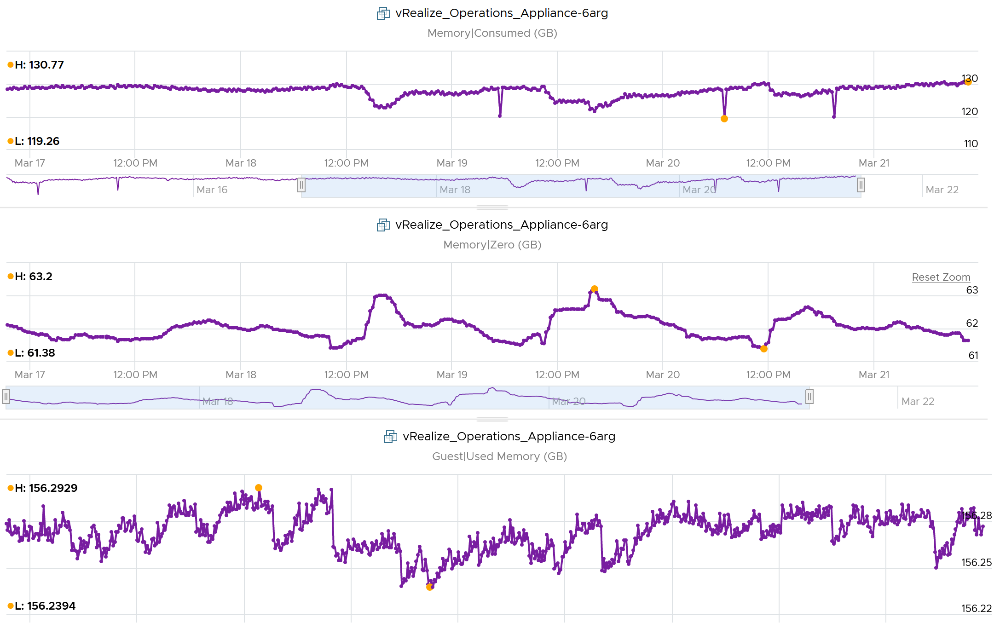

# VM Memory Zero Pages

## Meaning
- VM pages whose content is all zeroes (0x00).
- A common way to initialize memory is to write zeroes. Windows initializes pages with 0.
- The zero page is the most commonly shared page. Zero and Shared move together.
- Zero pages count in Granted but cost almost no physical RAM.

## Example
- Guest OS Used constant at about 156 GB; Consumed never above 131 GB. Zero pages about 61-63 GB explain the gap.


## Traps
- "Consumed below Guest OS Used means a data error" → check Shared and Zero pages.

## Metadata
```yaml
id: vsphere/technology/memory/metrics/virtual-motherboard/zero-pages
retriever_guide: metric-meaning
scope: vsphere
technology:
- memory
pillar:
- performance
- capacity
product:
- vsphere
object:
- VirtualMachine
layer:
- virtual-motherboard
metric_class: context
internal_derive:
- vsphere/technology/memory/concepts/page-sharing
same_name: []
same_meaning: []
related:
- vsphere/technology/memory/metrics/virtual-motherboard/shared
- vsphere/technology/memory/metrics/virtual-motherboard/granted
- vsphere/technology/memory/metrics/virtual-motherboard/consumed
images:
  - path: ../../images/vm-memory-consumed-below-guest-os-used-due-to-zero-pages.png
    product: [vsphere]
    object: [VirtualMachine]
    metric: ['VM Memory Consumed', 'VM Memory Zero Pages', 'Guest OS Memory Used']
    image_type: timeline
source:
  document: PART 3 - Counters.docx
  path: Memory > VM > Consumption Metrics > Shared > Zero; Consumed > Guest OS
corrections: []
review_notes: []
status: draft
```
