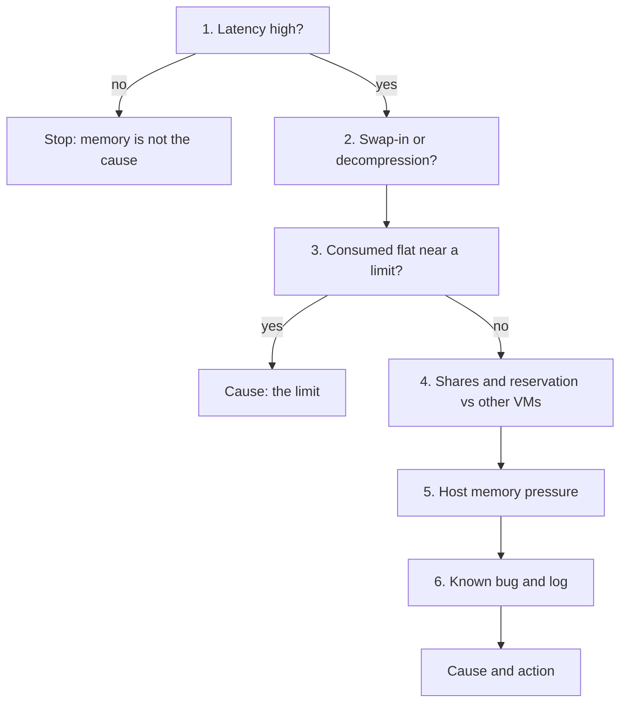

# VM memory latency (contention) is high

## Symptom
- VM memory Latency (VCF Operations: Memory Contention) is high, or the memory row of VM Performance (%) is yellow or worse.
- Entered from `sp5-framework/performance/troubleshooting/vm-slow` (step 4), a health check performance step, or an alert.

## Flow


## Checks, in order
1. Latency (VirtualMachine) (`vsphere/technology/memory/metrics/virtual-motherboard/latency`). The only counter that shows a VM waiting for memory; it excludes balloon. Low → stop. High → step 2.
2. Swap-in rate and decompression rate (VirtualMachine): the source of the wait (`vsphere/technology/memory/metrics/virtual-motherboard/swap-in-rate`). → step 3.
3. Consumption against a limit (VirtualMachine, ResourcePool). Consumed flat near a limit on the VM or on its resource pool: the limit is the cause (`vsphere/architecture/resource-controls`). → step 4.
4. Configuration (VirtualMachine). Shares and reservation compared with the other VMs; in a resource pool, whether the pool has enough for all its VMs. → step 5.
5. Host memory pressure (HostSystem). Swap out, compressed and ballooned memory on the other VMs of the host (`vsphere/technology/memory/concepts/swap-and-compression`). Swap out without swap in: past pressure, no wait yet. → step 6.
6. Known bug and log (VirtualMachine, HostSystem): `sp5-framework/performance/troubleshooting/vm-slow`, its known bug and log checks.

## Why this order
- Latency first: it is the only memory wait; ballooned, swapped and compressed memory are past reclamation, not a wait.
- The source of the wait next: swap-in and decompression say which reclamation the VM now pays for.
- A limit before shares: a limit causes the wait on a host with free memory.
- Host pressure after the VM settings: it explains why ESXi reclaimed from this VM.

## How to read the result
- Swap out without swap in: past pressure, no wait yet.
- Latency with a flat Consumed near the limit: the limit is the cause.
- Actions:
  - Put the VM swap file (vswp) on faster, lower-latency storage, such as host swap cache.
  - Raise memory shares or reservation to reduce swapping. In a resource pool, make sure the pool has enough for all its VMs.
  - Reduce assigned memory (right-size). Less to reclaim, lower risk.
  - Remove the VM limit.
  - Unswap the swapped pages. Not possible via API; possible with a manual command (article by Duncan Epping and Valentin Bondzio).
  - Reboot the VM in regular maintenance. This removes the swap file and future swap-in waits on those pages. A page can be swapped out again later.

## Misconceptions
- "Balloon is in Latency" → Latency excludes balloon.
- "The host has free memory, so the VM cannot wait for memory" → a limit, or pages swapped or compressed in the past, cause a wait on a host with free memory (`vsphere/object-types/cluster/concepts/cluster-utilization-vs-contention`).

## Metadata
```yaml
id: vsphere/technology/memory/troubleshooting/vm-memory-latency-high
retriever_guide: troubleshooting
scope: vsphere
technology:
- memory
pillar:
- performance
product:
- vsphere
- vcf-operations
object:
- VirtualMachine
internal_derive:
- vsphere/technology/memory/metrics/virtual-motherboard/latency
- vsphere/technology/memory/concepts/swap-and-compression
- vsphere/technology/memory/metrics/virtual-motherboard/swap-in-rate
- vsphere/architecture/resource-controls
- sp5-framework/performance/troubleshooting/vm-slow
related:
- vsphere/technology/memory/metrics/virtual-motherboard/swapped
- vsphere/technology/memory/metrics/virtual-motherboard/compressed
- vsphere/technology/memory/decision-tree/is-overcommit-affecting-vm
- sp5-framework/performance/performance-management
source:
  document: Private Cloud Management by Iwan Rahabok (https://isvara.io/download)
  path: Memory > VM > Contention Metrics > Latency
corrections: []
review_notes:
- 'To check: unswap article cited by the book, third-party, not read (https://www.yellow-bricks.com/2016/06/02/memory-pages-swapped-can-unswap/).'
status: draft
```
