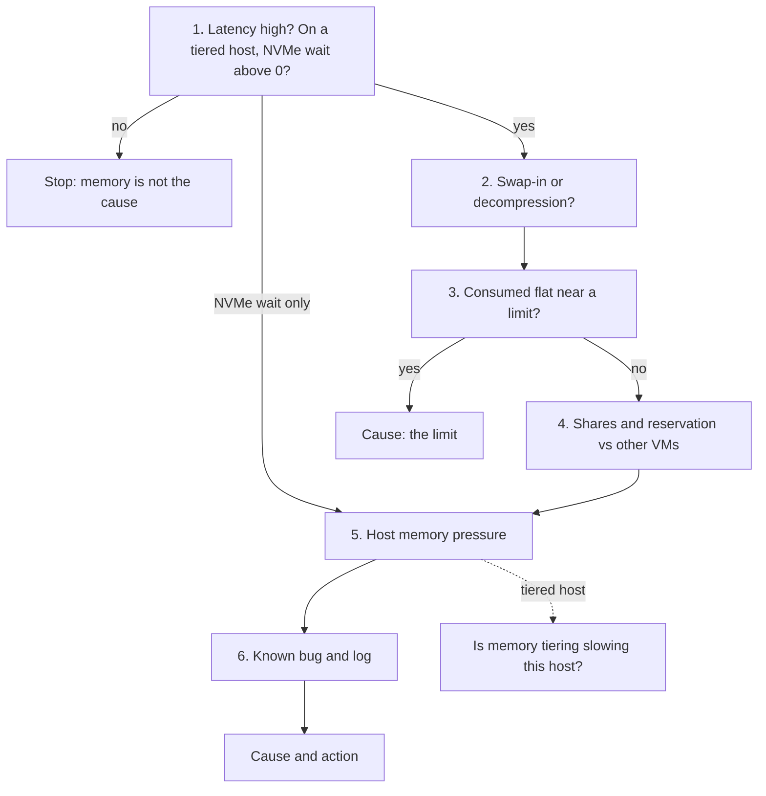

# VM memory latency (contention) is high

## Symptom
- VM memory Latency (VCF Operations: Memory Contention) is high, or the memory row of VM Performance (%) is yellow or worse.
- Entered from [`vsphere/object-types/vm/troubleshooting/vm-slow`](../../object-types/vm/troubleshooting/vm-slow.md) (step 4), a health check performance step, or an alert.

## Flow


## Checks, in order
1. Latency (VirtualMachine) ([`vsphere/technology/memory/metrics/virtual-motherboard/latency`](metrics/virtual-motherboard/latency.md)). It shows a VM waiting for reclaimed pages and excludes balloon. It is unaware of memory tiering: on a tiered host it does not count NVMe fetches. Low on a host without tiering → stop. Low on a tiered host → read the VM's NVMe read bandwidth and NVMe wait ([`vsphere/object-types/cluster/cluster-performance`](../../object-types/cluster/cluster-performance.md), section NVMe wait formula) before stopping: NVMe wait above 0 → step 5. High → step 2.
2. Swap-in rate and decompression rate (VirtualMachine): the source of the wait ([`vsphere/technology/memory/metrics/virtual-motherboard/swap-in-rate`](metrics/virtual-motherboard/swap-in-rate.md)). → step 3.
3. Consumption against a limit (VirtualMachine, ResourcePool). Consumed flat near a limit on the VM or on its resource pool: the limit is the cause ([`vsphere/architecture/resource-controls`](../../architecture/resource-controls.md)). → step 4.
4. Configuration (VirtualMachine). Shares and reservation compared with the other VMs; in a resource pool, whether the pool has enough for all its VMs. → step 5.
5. Host memory pressure (HostSystem). Swap out, compressed and ballooned memory on the other VMs of the host ([`vsphere/technology/memory/concepts/swap-and-compression`](concepts/swap-and-compression.md)). Swap out without swap in: past pressure, no wait yet. On a host with memory tiering, also the VM's NVMe read bandwidth: a fetch from NVMe is a wait that Latency may not count → [`vsphere/technology/memory/decision-tree/is-memory-tiering-slowing-host`](decision-tree/is-memory-tiering-slowing-host.md). Otherwise → step 6.
6. Known bug and log (VirtualMachine, HostSystem): [`vsphere/object-types/vm/troubleshooting/vm-slow`](../../object-types/vm/troubleshooting/vm-slow.md), its known bug and log checks.

## Order rationale
- Latency first: it is the memory wait from reclamation; ballooned, swapped and compressed memory are past reclamation, not a wait. On a tiered host, NVMe wait is the other memory wait, and Latency does not see it.
- The source of the wait next: swap-in and decompression say which reclamation the VM now pays for.
- A limit before shares: a limit causes the wait on a host with free memory.
- Host pressure after the VM settings: it explains why ESXi reclaimed from this VM.

## Interpretation
- Swap out without swap in: past pressure, no wait yet.
- Latency with a flat Consumed near the limit: the limit is the cause.
- Actions:
  - Put the VM swap file (vswp) on faster, lower-latency storage, such as host swap cache.
  - Raise memory shares or reservation to reduce swapping. In a resource pool, make sure the pool has enough for all its VMs.
  - Reduce assigned memory (right-size). Less to reclaim, lower risk.
  - Remove the VM limit.
  - Unswap the swapped pages. Not possible via API; possible with a manual command on the host, described in a third-party article, not in a vendor document.
  - Power-cycle the VM (power off, then on) in regular maintenance: power-off deletes the swap file and the future swap-in waits on those pages (vSphere 9.1 documentation, Delete Swap Files, p. 1876). A restart of the Guest OS keeps the VM running and its swap file. A page can be swapped out again later.

## Misconceptions
- "Balloon is in Latency" → Latency excludes balloon.
- "Latency is low, so memory is not the cause" → on a tiered host Latency does not count NVMe fetches; read NVMe wait first.
- "The host has free memory, so the VM cannot wait for memory" → a limit, or pages swapped or compressed in the past, cause a wait on a host with free memory ([`vsphere/object-types/cluster/concepts/cluster-utilization-vs-contention`](../../object-types/cluster/concepts/cluster-utilization-vs-contention.md)).

## Metadata
```yaml
id: vsphere/technology/memory/vm-memory-latency-high
retriever_guide: troubleshooting
scope: vsphere
technology:
- memory
pillar:
- performance
product:
- vsphere
- vcf-operations
object:
- VirtualMachine
internal_derive:
- vsphere/technology/memory/decision-tree/is-memory-tiering-slowing-host
- vsphere/technology/memory/metrics/virtual-motherboard/latency
- vsphere/technology/memory/concepts/swap-and-compression
- vsphere/technology/memory/metrics/virtual-motherboard/swap-in-rate
- vsphere/architecture/resource-controls
- vsphere/object-types/vm/troubleshooting/vm-slow
related:
- vsphere/technology/memory/metrics/virtual-motherboard/swapped
- vsphere/technology/memory/metrics/virtual-motherboard/compressed
- vsphere/technology/memory/decision-tree/is-overcommit-affecting-vm
- sp5-framework/performance/performance-management
source:
  document: Knowledge base; vSphere 9.1 documentation (PDF built 2026-11-02)
  path: Memory > VM > Contention Metrics > Latency; Resource Management, Delete Swap Files (p. 1876)
corrections: []
review_notes:
- 'To check: Section ''Interpretation'': the unswap command, from a third-party article not read (https://www.yellow-bricks.com/2016/06/02/memory-pages-swapped-can-unswap/); no vendor document found.'
status: draft
```
