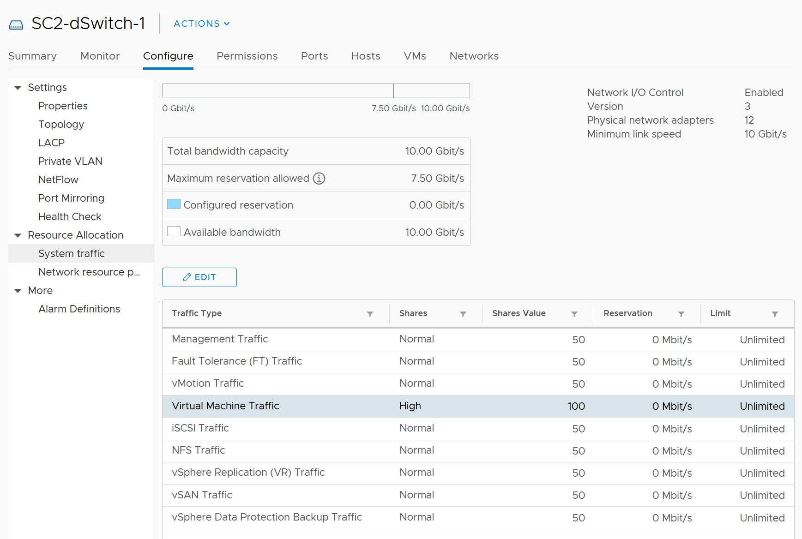

# Network vs compute and storage

## Differences
| Attribute | Compute or storage | Network |
|---|---|---|
| Nature | A node | An interconnect |
| Hardware | Single purpose | Multi-purpose |
| Location | Few places | Many places |
| Upper limit | Yes | No fixed limit per workload |
| Net resource available to VMs | Relatively high | Low |
| Resource allocation per VM | Granular | Coarse |
| Monitoring | Simpler | Harder |
| Workload types | 1 | Many (unicast, multicast, broadcast) |
| Primary unit | Byte | Bit |

## Interconnect
- A CPU, RAM or array problem usually stays local. A local network problem can become data-center-wide.
- Network connects users and servers to the Internet: multiple entry points, HA, preferably 2 ISPs.
- Many paths and routes: test connectivity from specific points.

## Hardware
- Besides switch, router and gateway, there are services such as firewall and load balancer, in hardware or software. Monitor all.
- Duplex: full duplex is 100% in each direction. A 25 Gb port handles 25 Gb transmit + 25 Gb receive.
- Blade and HCI form factors blur server and network.
- Network devices (switches, wireless access points, SD-WAN edges) sit in many locations, even employee homes.

## No fixed upper limit
- Physical capacity is shared, so each workload has a dynamic limit.
- The VM Network port group gets more bandwidth when no vMotion runs. Each VM shares the port group with other VMs.
- The limit differs per host and changes over time.
- The ESXi uplink is often not the smallest pipe: firewalls, load balancers, routers, WAN and Internet sit on the path. Each VM has its own practical limit.

## Net available resource
- What the IaaS platform uses is overhead. More ESXi kernel, NSX, vSAN and vSphere Replication traffic leaves less for business VMs.
- Compute overhead is low: around 10% even with vSAN.
- Network overhead is high: mass vMotion, Storage vMotion and cloning on IP storage, vSAN. Non-VM traffic can take most of the bandwidth.
- Example: VM traffic has 100 of 500 NIOC shares: overhead can reach 80%.


## Coarse allocation
- The link speed a VMXNET3 adapter reports to the Guest OS is a label, not a limit. It is 10 Gbps by default, whatever the speed of the vmnic behind the port group, because the virtual device has no physical link to negotiate.
- A VMXNET3 adapter moves data as fast as host CPU, virtual switch policies and the uplinks allow. Its throughput can exceed the reported speed, for example VM-to-VM traffic on one host, which never reaches a vmnic.
- From vSphere 8.0 Update 2, the VMX setting `ethernetX.linkspeed` (in Mbps, VM powered off) changes the reported speed within 10,000 to 65,000 Mbps; a value outside that range falls back to 10 Gbps. It exists for guest software that sizes itself from the detected speed, and it caps nothing.
- Setting a lower speed in the Guest OS adapter properties does not cap throughput either. 500 Mbps or 250 Mbps cannot be allocated through the vNIC speed.
- Physical bandwidth is shared and typically oversubscribed.
- A network-intensive VM can exceed 1 Gbps each way. Example: a Hadoop worker receiving more than 5 Gbps several times.
- Network I/O Control gives each VM network adapter shares, a reservation and a limit, set in the VM's adapter settings; traffic shaping is a port group policy ([`vsphere/architecture/resource-controls`](../../../architecture/resource-controls.md), section Controls per resource). Neither sets the vNIC speed the Guest OS sees.

## Contention metrics
| Metric | In vSphere |
|---|---|
| Latency | No |
| Dropped packets | Yes |
| Retransmitted packets (TCP retransmits drops) | VM traffic: no. Host VMkernel TCP: yes (vSAN Performance for Support, `net-stats`) |
| Jitter (variation of latency) | No |

- Applications can tolerate poor latency better than variable latency.
- NIOC has no metric that shows it capped bandwidth (unlike Storage I/O Control). Check logs.
- Consumption: throughput and packets per second (PPS). PPS is less used, but high PPS at low latency costs a lot of CPU, as in NSX Edge VMs.

## Workload types
- Most traffic should be unicast. Broadcast and multicast have purposes; monitor whether they happen at the wrong time on the wrong network.
- Basic services (DNS, NTP) need availability monitoring.
- Partner with network experts.

## Misconceptions
- "Each VM can use the full uplink speed" → the uplink is shared, dynamic and often oversubscribed.
- "No NIOC metric, so NIOC never capped" → no such metric exists.
- "Set the vNIC speed to 500 Mbps to cap the VM" or "the vNIC takes the uplink speed" → the VMXNET3 speed is a label, 10 Gbps by default; cap bandwidth with traffic shaping on the port group or a Network I/O Control limit on the VM network adapter.

## Metadata
```yaml
id: vsphere/technology/network/concepts/network-characteristics
retriever_guide: how-it-works
scope: vsphere
technology:
- network
pillar:
- performance
- capacity
- availability
product:
- vsphere
object:
- VirtualMachine
- HostSystem
- VmwareDistributedVirtualSwitch
internal_derive: []
related:
- vsphere/technology/network/concepts/netioc
- vsphere/technology/network/concepts/network-observability
images:
  - path: ../images/nioc-vm-traffic-100-of-500-shares.png
    product: [vsphere]
    object: [VmwareDistributedVirtualSwitch, HostSystem]
    topic: 'Network I/O Control'
    image_type: diagram
source:
  document: Knowledge base
  path: Network > Architecture > Unique Characteristics
corrections:
- '2026-11-14: VMXNET3 link speed is a label: 10 Gbps by default, settable from 10,000 to 65,000 Mbps with the VM off, and it limits nothing (Broadcom KB 368812, https://knowledge.broadcom.com/external/article/368812; KB 444078, https://knowledge.broadcom.com/external/article/444078). Section ''Coarse allocation'' follows the KB articles.'
review_notes:
- 'To check: Section ''Contention metrics'': whether vCenter 9.1 has a NIOC cap counter; states vCenter 7 has none.'
status: draft
```
