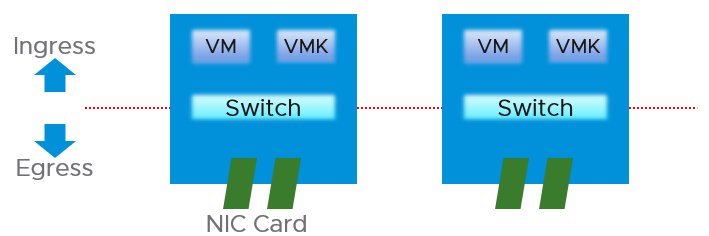
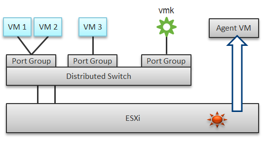
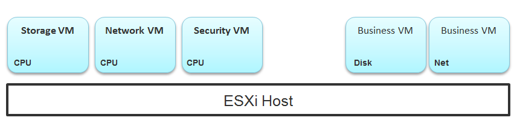
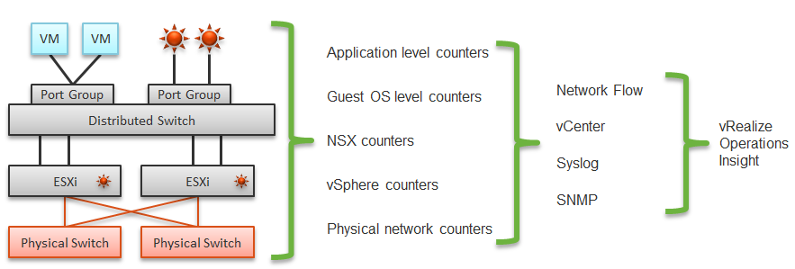
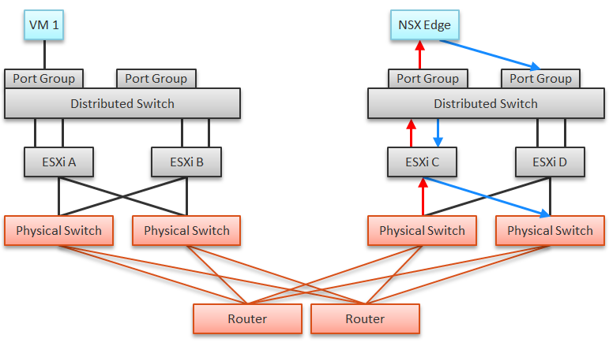
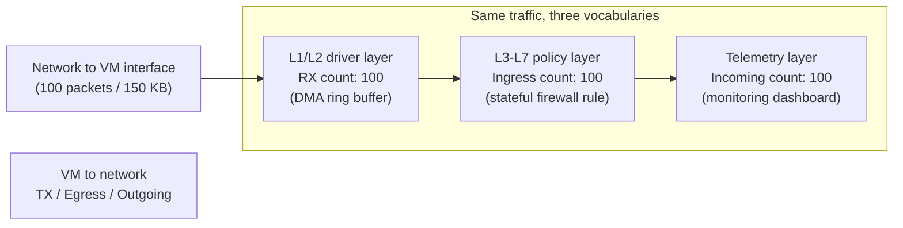
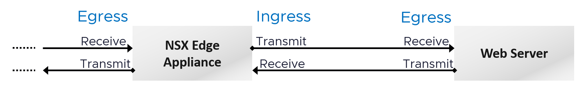
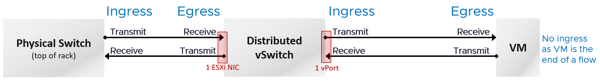

# Network layers and observability

## Two layers


| Layer | Facts |
|---|---|
| Virtual | vNICs and software switches. The top-of-rack switch now lives inside each ESXi host. |
| Virtual | Port groups are VM or kernel (vMotion, vSAN). They do not mix, for security. |
| Virtual | VM-to-VM traffic on the same host never reaches the physical network. vmnic metrics do not see it. |
| Virtual | No fixed limit while traffic stays in the host. Watch packets per second, not only throughput. |
| Physical | Physical NICs are vmnics. No per-VM or per-kernel-interface breakdown. |

## Four areas to monitor in one host

1. VM network.
2. Kernel network.
3. ESXi kernel modules: NSX Distributed Logical Router and Distributed Firewall route and filter traffic inside the host.
4. Agent VMs.

- Port group monitoring complements VM and host monitoring.
- A distributed switch carries VM and kernel traffic over shared uplinks.
- A distributed port group's data is the aggregate of all hosts using it.
- Tools unaware of in-host traffic miss VM-to-VM flows.

## Agent VMs
- One per host. No HA: usually on local datastore.
- Examples: storage service (for example Nutanix CVM), network service, security (for example Trend Micro Deep Security).
- A slow security agent VM in the data path looks like a network or storage problem to business VMs. The interception happens in the hypervisor, not on the network.


## Five data sources
- Application, Guest OS, NSX, NetFlow/sFlow/IPFIX from vDS and physical devices, and vSphere.
- VDI: application-level data is required. Example: Horizon Blast saw packet loss while Windows saw no drops; packets arrived out of order and were unusable to the protocol.
- Packet analysis: header analysis (light, broad visibility) or full packet analysis (deep, heavy).


## NSX Edge
- A VM's network problem can come from another VM on another host. Example: VM 1 reaches the outside through an NSX Edge VM on another cluster. An Edge CPU problem or its host's RAM problem slows VM 1's network.


## Guest OS vs VM
| Type | Guest OS metric | VM equivalent |
|---|---|---|
| Contention | Dropped packets | None. VM dropped packets are a different level. |
| Contention | Latency | None. vSphere has no network latency metric. |
| Utilization | Throughput, packets per second | Should match VM metrics. If not, packets are dropped. Report by traffic type (unicast, multicast, broadcast). |

## Direction terms
- Three vocabularies describe the same traffic. Each belongs to one domain; they are not synonyms.

| Terms | Domain | Used by | What it measures |
|---|---|---|---|
| Receive (RX) / Transmit (TX) | L1/L2 hardware and driver | Physical NICs, VMkernel drivers, DMA ring buffers, vNIC metrics | Frame processing at the lowest layer, whatever the payload |
| Ingress / Egress | L3-L7 policy and control plane | Routing, distributed firewall, microsegmentation | Stateful rule processing when traffic crosses a logical security or administrative boundary |
| Incoming / Outgoing | Operational telemetry | Dashboards, capacity planning, general monitoring | Directional bandwidth, without tying it to a driver or a firewall rule |

- vSphere VM and ESXi network metrics are RX and TX. A VM has receive and transmit counters; ingress and egress belong to the policy layer, not to the VM metrics.
- On a distributed switch, the ESXi physical NIC is the uplink. The ESXi host is not a hop.



- Reading the diagram: 100 packets arriving at a VM count as 100 RX at the driver, 100 ingress at the firewall, 100 incoming on a dashboard. The traffic in the other direction is TX, egress and outgoing.

### Book diagrams (superseded)
- The two book diagrams below show the earlier view that a VM has no ingress traffic. That view is wrong: use the table above.



## vCenter counters on switches and port groups
- The distributed switch has API counters at level 3: packets (all, multicast, broadcast) and drops, at switch, distributed port (DVPort) and LAG scope. See `vsphere/technology/network/metrics/distributed-switch/packets` and `vsphere/technology/network/metrics/distributed-switch/packets-dropped`.
- The distributed port group has no vCenter performance counters. Port-level data sits on the switch object, per DVPort.
- The vSphere Client shows no performance charts for either.

## Traffic type metrics
- VCF Operations has unicast, multicast and broadcast metrics at VM, ESXi, distributed port group and distributed switch level (also vSphere Pods, which are VMs).
- No aggregation at higher levels: use super metrics.
- To see which objects have a metric: open a VCF Operations policy and search the metric name.

## Packet size
- Typically 1,600 bytes with NSX, or 9,000 bytes with jumbo frames.
- Special packets (for example ping) are smaller and should be a small share.
- Track packet sizes against expectation.

## Traps
- "vmnic traffic = sum of VM traffic" → in-host VM-to-VM traffic and kernel traffic break that.
- "Distributed port group metrics are per host" → aggregated over all hosts.
- "Guest OS sees no drops, so the network is fine" → application protocols can still lose packets.

## Metadata
```yaml
id: vsphere/technology/network/concepts/network-observability
retriever_guide: how-it-works
scope: vsphere
technology:
- network
pillar:
- performance
- capacity
product:
- vsphere
- nsx
- vcf-operations
object:
- VirtualMachine
- HostSystem
- VmwareDistributedVirtualSwitch
- DistributedVirtualPortgroup
internal_derive: []
related:
- vsphere/technology/network/metrics/distributed-switch/packets
- vsphere/technology/network/metrics/distributed-switch/packets-dropped
- vsphere/technology/network/concepts/network-characteristics
- vsphere/technology/network/concepts/netioc
- vsphere/technology/network/concepts/passthrough-and-offload
images:
  - path: ../images/virtual-network-port-groups-vs-physical-vmnics.png
    product: [vsphere]
    object: [VirtualMachine, HostSystem, VmwareDistributedVirtualSwitch, DistributedVirtualPortgroup]
    topic: 'Network layers'
    image_type: diagram
  - path: ../images/esxi-network-observability-areas-vm-kernel-modules-agent-vms.png
    product: [vsphere]
    object: [HostSystem]
    topic: 'Network observability'
    image_type: diagram
  - path: ../images/esxi-agent-vms-storage-network-security.png
    product: [vsphere, vsan, nsx]
    object: [HostSystem]
    topic: 'Agent VMs'
    image_type: diagram
  - path: ../images/network-five-data-sources-and-tools.png
    product: [vsphere, nsx]
    object: [VirtualMachine, HostSystem, VmwareDistributedVirtualSwitch]
    topic: 'Network data sources'
    image_type: diagram
  - path: ../images/nsx-edge-vm-traffic-flow-across-clusters.png
    product: [nsx]
    object: [VirtualMachine]
    topic: 'NSX Edge traffic flow'
    image_type: diagram
  - path: ../images/network-ingress-egress-vs-receive-transmit.png
    product: [vsphere]
    object: [VirtualMachine, HostSystem]
    topic: 'Network direction'
    image_type: diagram
  - path: ../images/distributed-switch-ingress-egress-direction-physical-switch-to-vm.png
    product: [vsphere]
    object: [VirtualMachine, VmwareDistributedVirtualSwitch]
    topic: 'Network direction'
    image_type: diagram
source:
  document: PART 3 - Counters.docx
  path: Network > Architecture > Architecture intro; Network Observability
corrections:
- 'Section ''Direction terms'': the book diagrams and text say a VM has no ingress traffic. Superseded on 2026-11-04. Keep until the book is updated.'
review_notes:
- 'Section ''vCenter counters on switches and port groups'': from the vCenter 9.1.0 API export in repository e1-rahabok/Observability-vSphere and its README (distributed port group returns no counters), https://github.com/e1-rahabok/Observability-vSphere/blob/main/vsphere-metrics.csv.'
status: draft
```
