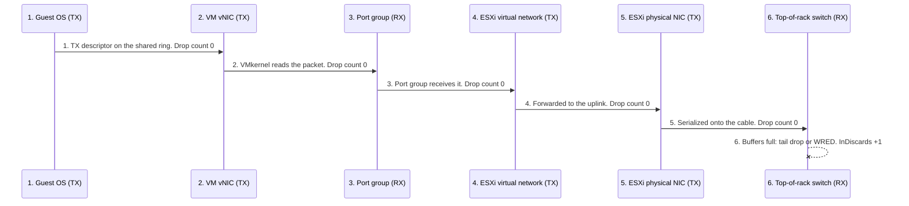

# Packet drop accounting

## Receive drop: the guest's receive ring is full
- Causes:
  - a microburst larger than the guest's receive ring buffer;
  - the guest does not empty the ring in time: CPU busy inside the guest, or the vCPU waiting on the hypervisor (Ready, Co-stop).
- When the ring has no free descriptor, the hypervisor cannot copy the frame into guest memory. The new frame is discarded: tail drop, not first in first out.
- The hypervisor-to-vNIC path is Layer 2, memory-mapped rings. It knows nothing of TCP state.

### VMXNET3 on ESXi
| Layer | Counts the drop? | Where |
|---|---|---|
| Distributed switch port | Yes | Dropped packets of the dvPort |
| VM (vNIC) | Yes | esxtop %DRPRX; vCenter `net.droppedRx.summation` |
| Guest OS | Yes | VMXNET3 shares the drop with the guest through shared memory |

- Linux: `ethtool -S` on the VMXNET3 interface shows the out-of-buffer count; the standard `rx_dropped` also rises.
- Windows: the driver maps it to inbound discards: Packets Received Discarded (Performance Monitor), ReceivedDiscardedPackets (PowerShell).
- So the drop is visible to the hypervisor and to the guest. It is caused and fixed in the guest (larger ring, CPU), which is why the Guest OS owner fixes it.

## Transmit drop: the top-of-rack switch is congested
- Ethernet does not acknowledge frames. Unless 802.3x PAUSE flow control holds it back, ESXi counts a frame as sent once the physical NIC has put it on the wire.
- A frame dropped by a congested top-of-rack switch is counted only in that switch.



- Steps 1-5 count 0: the guest, the vNIC, the port group, the virtual network and the physical NIC all completed their part.
- Step 6: the switch ASIC drops the frame and counts it as an input discard or input queue drop.
- Recovery is TCP in the guest: no acknowledgement returns, the retransmission timer expires (or duplicate acknowledgements arrive), and the guest sends the payload again in a new frame.
- vSphere metrics cannot show this drop. Evidence: TCP retransmissions in the Guest OS, and the switch's discard counters (network team).

## Misconceptions
- "The Guest OS shows no dropped packets, so the network is clean" → on transmit, a drop at the top-of-rack switch is invisible to ESXi and to the guest; look at TCP retransmissions and the switch counters.
- "A receive drop on the VM means the physical network dropped it" → a full guest receive ring drops it inside the host; check the guest's CPU, the vCPU's Ready and the ring size.
- "The hypervisor cannot see a VMXNET3 ring drop" → it counts it at the port and the VM (%DRPRX, droppedRx); the guest sees it too.

## Metadata
```yaml
id: vsphere/technology/network/concepts/packet-drop-accounting
retriever_guide: how-it-works
scope: vsphere
technology:
- network
pillar:
- performance
product:
- vsphere
object:
- VirtualMachine
- HostSystem
- DistributedVirtualPortgroup
internal_derive:
- vsphere/technology/network/metrics/virtual-motherboard/packets-dropped
related:
- vsphere/technology/network/metrics/host/packets-dropped
- vsphere/tools/esxtop/network
- sp5-framework/concepts/realms-and-layers
source:
  document: Packet Lifecycle and Metric Accounting in Virtualized Networks (2026-11-07)
  path: Scenario 1 (RX, guest buffer exhaustion); Scenario 2 (TX, top-of-rack congestion)
corrections:
- '2026-11-07: a full VMXNET3 receive ring is counted by the hypervisor (port, %DRPRX, droppedRx) and the guest. Corrects the reason given in Q070 (not visible to the hypervisor); the conclusion, fixed in the guest, stands.'
review_notes:
- 'To check: Section ''VMXNET3 on ESXi'': counter names on a host. The document names the shared counter dropOOB in UPT1_RxStats and the Linux ethtool name rx_out_of_buffer; the Linux vmxnet3 driver statistic is likely pktsRxOutOfBuf (an out-of-buffer packet count in ethtool), and rx_out_of_buffer is a Mellanox (mlx5) counter name. Exact names left out until checked. The Windows mapping to ifHCInDiscards is from the document, not verified.'
status: draft
```
