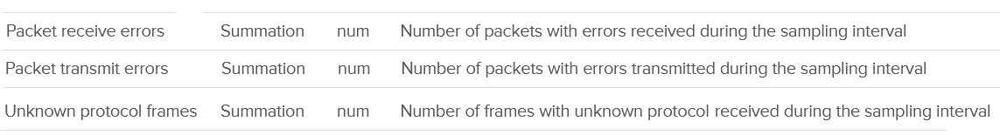

# ESXi Network Error Packets and Unknown Protocol Frames

## Meaning
- Two contention metrics besides dropped packets: error packets (receive, transmit) and unknown protocol frames.
- Unknown: ESXi cannot decode the packet, so does not know its type. Disabled by default in VCF Operations; enable it.
- Expect error, unknown and dropped packets to be 0 at all times.
- Fleet view in VCF Operations: vSphere \ ESXi Bad Network Packets.


## Host TCP retransmits
- The VMkernel TCP/IP stack carries the host's own traffic (vSAN, vMotion, NFS, iSCSI); the host counts its retransmits. VM traffic is TCP inside the Guest OS: the host does not see it.
- vSAN: Performance for Support, host, Network, TCP/IP: `tcpTxRetransmitRate`, with duplicate ACKs and receive errors.
- Any host: `net-stats`, sections `tcptx` and `tcprx`; retransmit % = rexmit ÷ packets per second × 100.
- Retransmits point to loss in the physical network (optic, cable, switch congestion), outside ESXi.

## Detail with esxcli
```text
watch esxcli network nic stats get -n vmnic#
```
- Counters are cumulative: the problem may be in the past.
- vCenter shows totals (Total receive errors and Total transmit errors: see `review_notes`).

| esxcli counter | Meaning |
|---|---|
| Total receive errors, Total transmit errors | Sum of the errors below, including checksum errors (not reported separately). |
| Checksum errors (csumerr, driver private stats) | Layer 3: hardware, typically cabling. Layer 4: encapsulated packets (VXLAN, overlay). Receive rate too high for hardware checksum: passed to ESXi, counted as error. |
| Receive length errors | Actual packet size differs from the size in the header. |
| Receive over errors | Packets discarded by the NIC hardware buffer. Includes CRC errors. |
| Receive CRC errors | CRC calculated by ESXi differs from the FCS field. |
| Receive FIFO errors, Transmit FIFO errors | NIC cannot process: ring buffer full. |
| Receive missed errors | NIC cannot store or process packets: hardware limits. |
| Receive frame errors; Transmit aborted, carrier, heartbeat, window errors | Listed without description. |

## Observations
- Hosts with receive errors spanned clusters, hardware models and ESXi builds. No correlation with other packet types.
- Receive error counters showed irregular collection, while transmit error collection was regular.

## Misconceptions
- "esxcli shows errors, so the problem is now" → counters are cumulative.

## Metadata
```yaml
id: vsphere/technology/network/metrics/host/errors
retriever_guide: metric-meaning
scope: vsphere
technology:
- network
pillar:
- performance
- availability
product:
- vsphere
- vcf-operations
object:
- HostSystem
metric_class: contention
internal_derive: []
same_name: []
same_meaning: []
related:
- vsphere/technology/network/metrics/host/packets-dropped
images:
  - path: ../../images/vcenter-esxi-network-error-counters-table.png
    product: [vsphere]
    object: [HostSystem]
    metric: ['ESXi Network Error Packets', 'ESXi Network Unknown Protocol Frames']
    image_type: table
source:
  document: Private Cloud Management by Iwan Rahabok (https://isvara.io/download)
  path: Network > ESXi > Contention Metrics > Error Metrics; esxcli
corrections: []
review_notes:
- 'To check: KB 341594, not read; the esxcli descriptions are a summary (https://knowledge.broadcom.com/external/article?articleNumber=341594).'
- 'To check: whether the vCenter error counters are esxcli Total receive errors and Total transmit errors.'
- 'Section ''Host TCP retransmits'': Broadcom KB 424515 (net-stats tcptx rexmit), KB 419500 (Performance for Support, tcpTxRetransmitRate), KB 415001 (vSAN 8.x and 9.x). To check: the chart name in the vSAN 9.x TechDocs.'
status: draft
```
