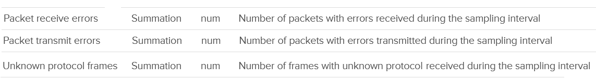

# ESXi Network Error Packets and Unknown Protocol Frames

## Meaning
- Two contention metrics besides dropped packets: error packets (receive, transmit) and unknown protocol frames.
- Unknown: ESXi cannot decode the packet, so does not know its type. Disabled by default in VCF Operations; enable it.
- Expect error, unknown and dropped packets to be 0 at all times.
- Fleet view in VCF Operations: vSphere \ ESXi Bad Network Packets.
- Relevance for operations: availability and performance troubleshooting: any error or unknown protocol frame points at hardware, cabling or the physical switch port. Reviewed across the fleet; not in the alert set ([`vsphere/object-types/esxi/esxi-alerts`](../../../../object-types/esxi/esxi-alerts.md)).


## Host TCP retransmits
- The VMkernel TCP/IP stack carries the host's own traffic (vSAN, vMotion, NFS, iSCSI); the host counts its retransmits. VM traffic is TCP inside the Guest OS: the host does not see it.
- vSAN: Performance for Support, host, Network, TCP/IP: `tcpTxRetransmitRate`, with duplicate ACKs and receive errors.
- Any host: `net-stats`, sections `tcptx` and `tcprx`; retransmit % = rexmit ÷ packets per second × 100.
- Retransmits point to loss in the physical network (optic, cable, switch congestion), outside ESXi.

## Detail with esxcli
```text
watch esxcli network nic stats get -n vmnic#
```
- Counters are cumulative: the problem may be in the past.
- vCenter shows only a receive and a transmit error total per vmnic, not the breakdown in the table below.

| esxcli counter | Meaning |
|---|---|
| Total receive errors, Total transmit errors | Sum of the error counters below, CRC errors included. Checksum errors roll into the total (not reported separately). |
| Checksum errors (csumerr, driver private stats) | Layer 3: hardware, typically cabling. Layer 4: encapsulated packets (VXLAN, overlay). Receive rate too high for hardware checksum: passed to ESXi, counted as error. |
| Receive length errors | Actual packet size differs from the size in the header. |
| Receive over errors | Packets discarded by the NIC hardware buffer. |
| Receive CRC errors | CRC calculated by ESXi differs from the FCS field; the host discards the frame. Typically a bad cable. |
| Receive FIFO errors, Transmit FIFO errors | The NIC cannot keep up with peak traffic at the current ring buffer size. |
| Receive missed errors | The NIC cannot keep up with peak incoming traffic at the current receive ring size. |
| Receive frame errors | Bad cable, mismatched speed or bad hardware. |
| Transmit carrier errors | Speed or duplex mismatch, or the physical connection. |
| Transmit aborted, heartbeat, window errors | Listed without description. |

- The NIC reports these errors only to the ESXi host. Work them with the hardware vendor, and check that the NIC driver and firmware are current (Broadcom KB 341594).
- A larger ring buffer addresses FIFO and missed errors, not CRC errors. Confirm a ring size change with the hardware vendor first.
- Record the counters before a host reboot: a reboot resets them.

## Observations
- Hosts with receive errors spanned clusters, hardware models and ESXi builds. No correlation with other packet types.
- Receive error counters showed irregular collection, while transmit error collection was regular.

## Misconceptions
- "esxcli shows errors, so the problem is now" → counters are cumulative.

## Metadata
```yaml
id: vsphere/technology/network/metrics/host/errors
retriever_guide: metric-meaning
scope: vsphere
technology:
- network
pillar:
- performance
- availability
product:
- vsphere
- vcf-operations
object:
- HostSystem
metric_class: contention
internal_derive:
- vsphere/technology/network/concepts/network-observability
same_name: []
same_meaning: []
related:
- vsphere/technology/network/metrics/host/packets-dropped
images:
  - path: ../../images/vcenter-esxi-network-error-counters-table.png
    product: [vsphere]
    object: [HostSystem]
    metric: ['ESXi Network Error Packets', 'ESXi Network Unknown Protocol Frames']
    image_type: table
source:
  document: Knowledge base; Broadcom KB 341594 (ESXi 8.x and 9.x); Broadcom KB 424515 (net-stats tcptx rexmit); Broadcom KB 419500 (Performance for Support, tcpTxRetransmitRate); Broadcom KB 415001 (vSAN 8.x and 9.x)
  path: Network > ESXi > Contention Metrics > Error Metrics; esxcli; KB 341594, Troubleshooting and understanding physical NIC receive or transmit dropped, missed and error counters in ESXi
corrections: []
review_notes:
- 'To check: Section ''Detail with esxcli'': whether the vCenter receive and transmit error counters of a vmnic equal the esxcli Total receive errors and Total transmit errors; a live host with errors.'
- 'To check: Section ''Host TCP retransmits'': the name of the vSAN Performance for Support chart that shows tcpTxRetransmitRate in vSAN 9.1; vSAN 9.1 documentation on techdocs.broadcom.com.'
status: draft
```
