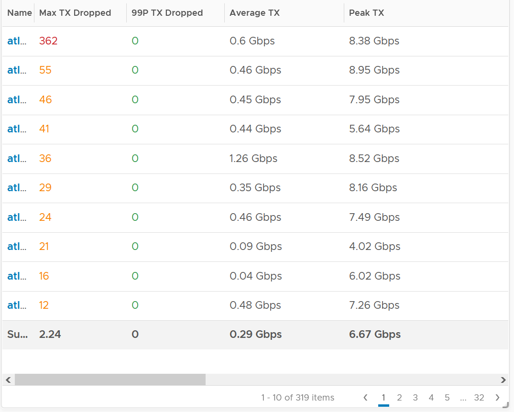
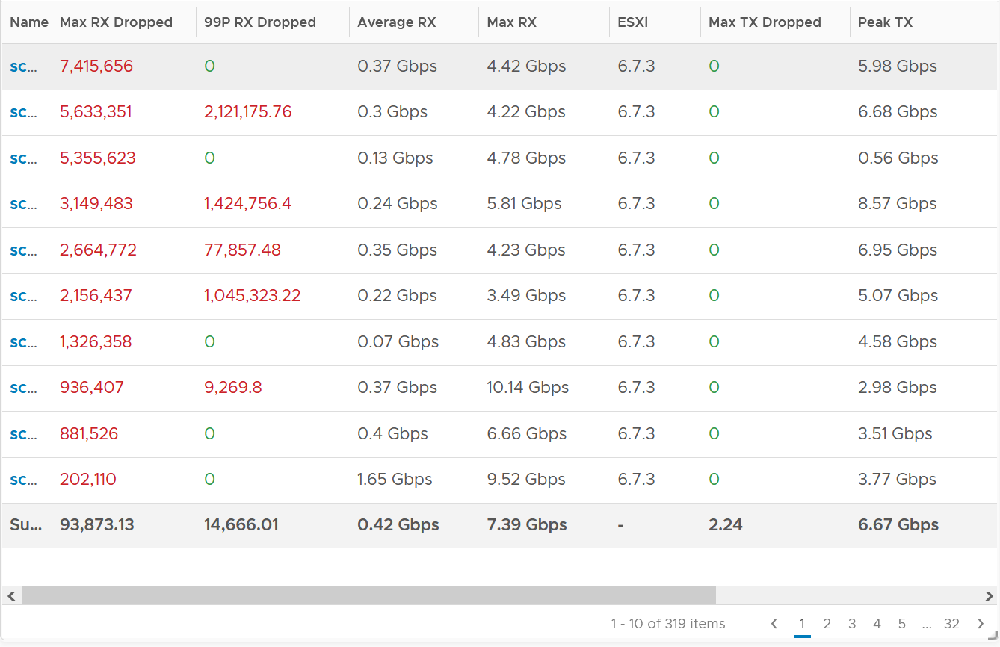

# ESXi Network Packets Dropped

## Meaning
- Packets dropped before reaching the ESXi kernel, at the physical NIC.
- Per Broadcom KB 341594, often a combination of counters in the driver private statistics (nicinfo.sh.txt in the log bundle).
- Host value is about the sum of vmnic instances.

## Observations
- Transmit: 319 hosts over 3 months: minimal. One host had 362 dropped transmit packets (average 0.6 Gbps, peak 8.38 Gbps). 99th percentile: 0.
- Another 123 hosts, 6 months: no transmit drops. A few had high receive drops, starting when load increased.
- Receive is worse than transmit, as at VM level. Some hosts dropped over 1 million packets in 5 minutes; some regularly (high 99th percentile). Highest drops matched the lowest packets received.



## Action
- Find which vmnic drops and which VMkernel interface is affected.
- A data center network should be free of drops: discuss any pattern with the network team.

## Misconceptions
- "Host transmit drops are common" → rare; 99th percentile 0.

## Metadata
```yaml
id: vsphere/technology/network/metrics/host/packets-dropped
retriever_guide: metric-meaning
scope: vsphere
technology:
- network
pillar:
- performance
product:
- vsphere
object:
- HostSystem
metric_class: contention
internal_derive: []
same_name:
- vsphere/technology/network/metrics/virtual-motherboard/packets-dropped
same_meaning: []
related:
- vsphere/technology/network/metrics/host/errors
- vsphere/technology/network/metrics/virtual-motherboard/packets-dropped
- vsphere/technology/network/troubleshooting/vnic-rx-drops
images:
  - path: ../../images/esxi-network-transmit-dropped-across-hosts.png
    product: [vsphere]
    object: [HostSystem]
    metric: ['ESXi Network Transmit Packets Dropped']
    image_type: table
    sample: '319 hosts'
  - path: ../../images/esxi-network-receive-dropped-per-host.png
    product: [vsphere]
    object: [HostSystem]
    metric: ['ESXi Network Receive Packets Dropped']
    image_type: table
source:
  document: Private Cloud Management by Iwan Rahabok (https://isvara.io/download)
  path: Network > ESXi > Contention Metrics > Dropped Packet; Received
corrections: []
review_notes: []
status: draft
```
