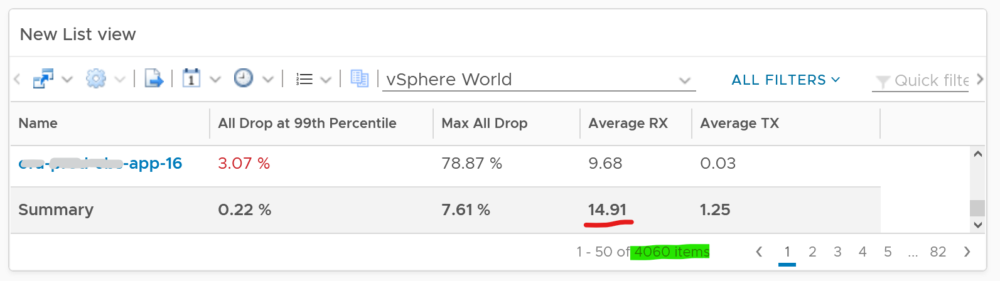
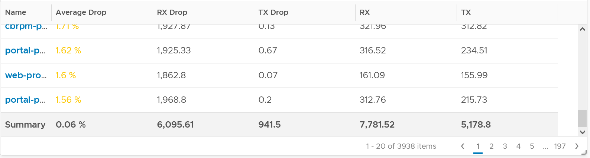
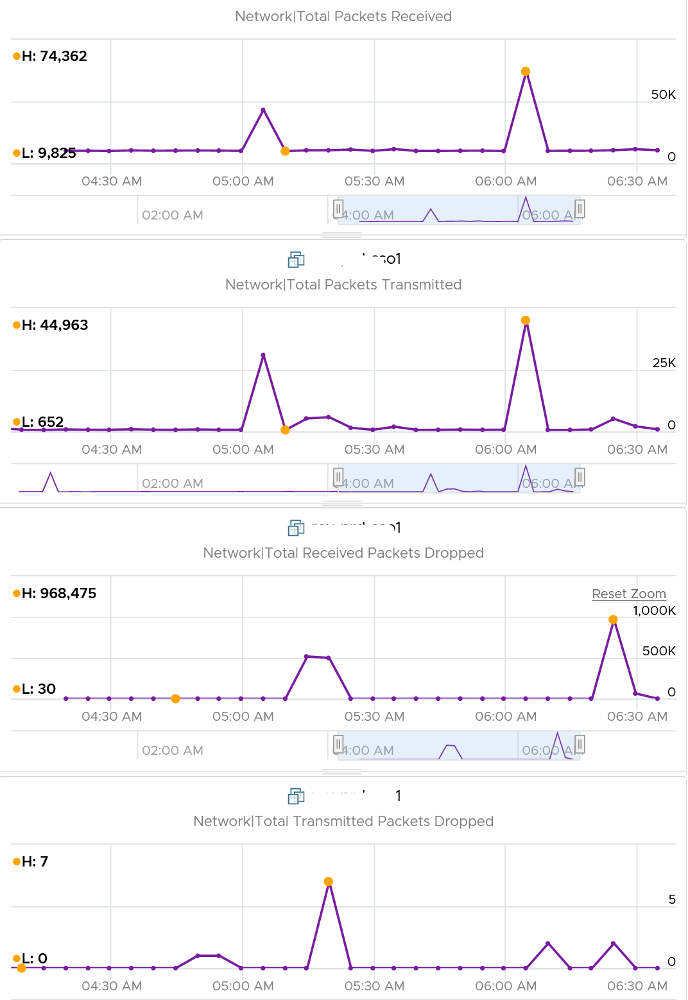
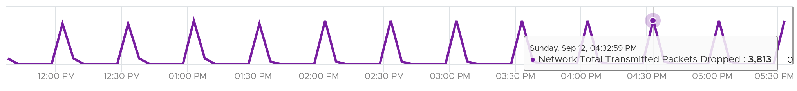
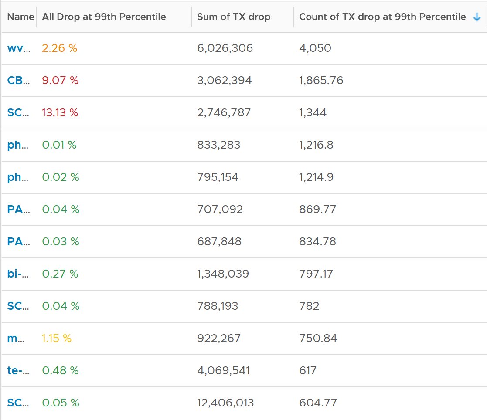

# VM Network Packets Dropped

## Meaning
- The only VM network contention metric.
- Received packets are dropped before reaching the Guest OS. Transmitted packets are dropped after leaving the Guest OS. So values do not match Guest OS counters.
- ESXi drops packets not destined for the guest or violating security settings.
- TCP retransmits dropped packets: the application sees higher latency.
- Relevance for operations: performance KPI and alerting on transmit drops: the peak transmit dropped % is a row of the VM Performance KPI and drives the VM dropped packets alert ([`vsphere/object-types/vm/vm-performance`](../../../../object-types/vm/vm-performance.md), [`vsphere/object-types/vm/vm-alerts`](../../../../object-types/vm/vm-alerts.md)). Receive drops serve troubleshooting only, because their cause is often in the Guest OS ([`vsphere/technology/network/vnic-rx-drops`](../../vnic-rx-drops.md)).

## Formula (VCF Operations)
```text
dropped   = Received Packets Dropped + Transmitted Packets Dropped
delivered = Packets Received + Packets Transmitted
Packets Dropped (%) = dropped / (dropped + delivered) × 100
```

## Behaviour
- Receive drops are far higher than transmit drops: 3,938 VMs, 1 month, about 35 million data points.
- Receive drops are left out of the VM KPI: they include packets not destined for the VM and drops in a full guest receive ring, whose cause and fix are in the Guest OS ([`vsphere/technology/network/concepts/packet-drop-accounting`](../../concepts/packet-drop-accounting.md)).
- Drops are short and spiky: the 99th percentile was 35x smaller than the maximum.

- Packets Dropped (%) can jump above 95% for under 15 minutes. Driven by low throughput and high receive drops.



## Profile transmit drops
- Columns: 99th percentile of drop %; sum of transmitted dropped packets; 99th percentile of the maximum dropped in any 300 seconds.
- Millions of transmit drops a month need investigation with the network team. Nobody complains because TCP retransmits.
- Volume: 1,000 dropped packets at about 1.5 KB each = about 1.5 MB.
- Rare huge spikes: example above 100 million packets in 5 minutes, about 333 MB/s for 300 s at 1 KB per packet.
- Regular patterns (example: about 3,800 packets every 5 minutes) are worth raising with the network team.



## Known causes
- Transmit drops from the NSX Distributed Firewall: outgoing traffic that matches no allow rule meets the default rule set to Reject, and the filter on the VM's port counts the packets as dropped. The firewall works as designed (Broadcom KB 322462); the drop is not a network fault.
- VMXNET3 packet loss in very high traffic bursts, even VM freezes: not enough receive and transmit buffer, or speed-constrained receive traffic (Broadcom KB 324556, legacy 2039495). A full receive ring is counted here (droppedRx, %DRPRX) and by the guest; the cause and the fix (a larger ring, guest CPU) are in the Guest OS, so the Guest OS owner fixes it. Which layer counts which drop: [`vsphere/technology/network/concepts/packet-drop-accounting`](../../concepts/packet-drop-accounting.md).

## Misconceptions
- "Packets Dropped (%) at 95% means an outage" → short spikes at low throughput, driven by receive drops.
- "No complaints, so transmit drops are harmless" → TCP hides them through retransmits.

## Metadata
```yaml
id: vsphere/technology/network/metrics/virtual-motherboard/packets-dropped
retriever_guide: metric-meaning
scope: vsphere
technology:
- network
pillar:
- performance
product:
- vsphere
object:
- VirtualMachine
layer:
- virtual-motherboard
metric_class: contention
internal_derive:
- vsphere/technology/network/concepts/packet-drop-accounting
- vsphere/technology/network/concepts/network-observability
same_name:
- vsphere/technology/network/metrics/distributed-switch/packets-dropped
- vsphere/technology/network/metrics/host/packets-dropped
same_meaning: []
related:
- vsphere/technology/network/metrics/vm-network-metrics
- vsphere/technology/network/metrics/virtual-motherboard/packets
images:
  - path: ../../images/vm-network-dropped-99th-percentile-vs-max-list-view.png
    product: [vcf-operations]
    object: [VirtualMachine]
    metric: ['VM Network Packets Dropped']
    image_type: table
    sample: '4,060 VMs'
  - path: ../../images/vm-network-receive-vs-transmit-dropped-across-vms.png
    product: [vsphere]
    object: [VirtualMachine]
    metric: ['VM Network Receive Packets Dropped', 'VM Network Transmit Packets Dropped']
    image_type: table
    sample: '3,938 VMs, 1 month'
  - path: ../../images/vm-network-dropped-percent-spike-at-low-throughput.png
    product: [vcf-operations]
    object: [VirtualMachine]
    metric: ['VM Network Packets Dropped (%)', 'VM Network Usage Rate']
    image_type: timeline
  - path: ../../images/vm-network-transmit-dropped-regular-spike-pattern.png
    product: [vsphere]
    object: [VirtualMachine]
    metric: ['VM Network Transmit Packets Dropped']
    image_type: timeline
    sample: '1 VM'
  - path: ../../images/vm-network-transmit-dropped-profile.png
    product: [vsphere]
    object: [VirtualMachine]
    metric: ['VM Network Transmit Packets Dropped']
    image_type: distribution
source:
  document: Knowledge base; Broadcom KB 322462 (TX packet drops reported for virtual machines on NSX segments); Broadcom KB 324556 (Packet loss in the guest OS using VMXNET3 in ESXi, legacy 2039495)
  path: Network > VM > Contention Metrics
corrections: []
review_notes: []
status: draft
```
