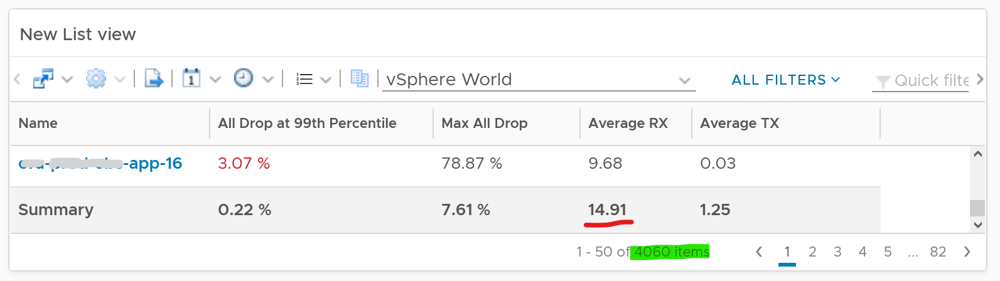
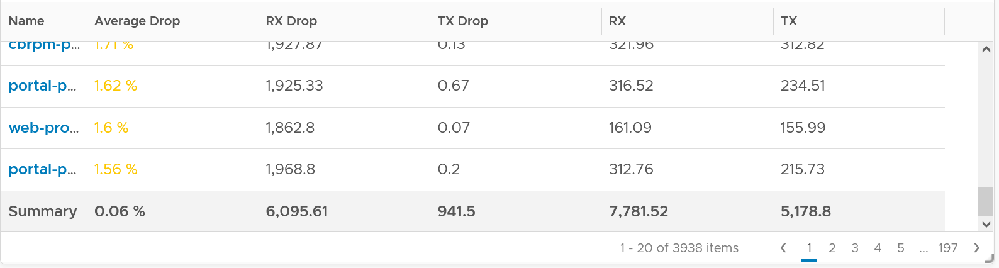
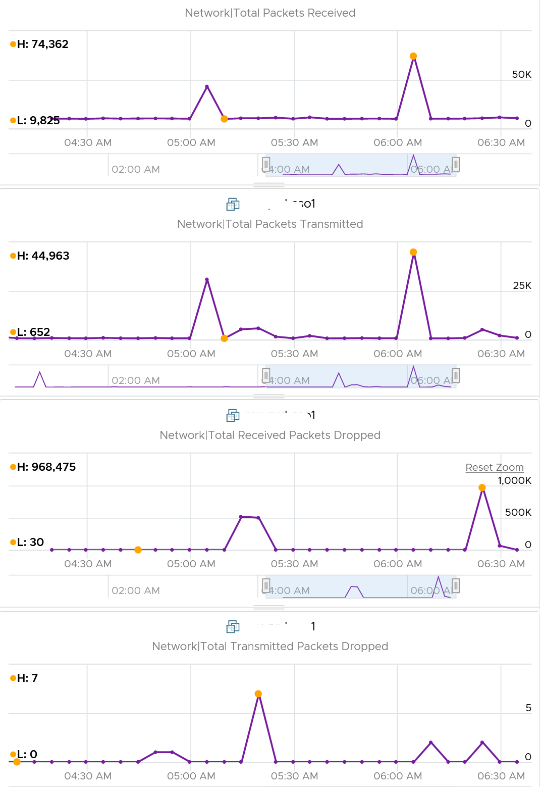
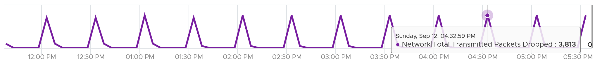
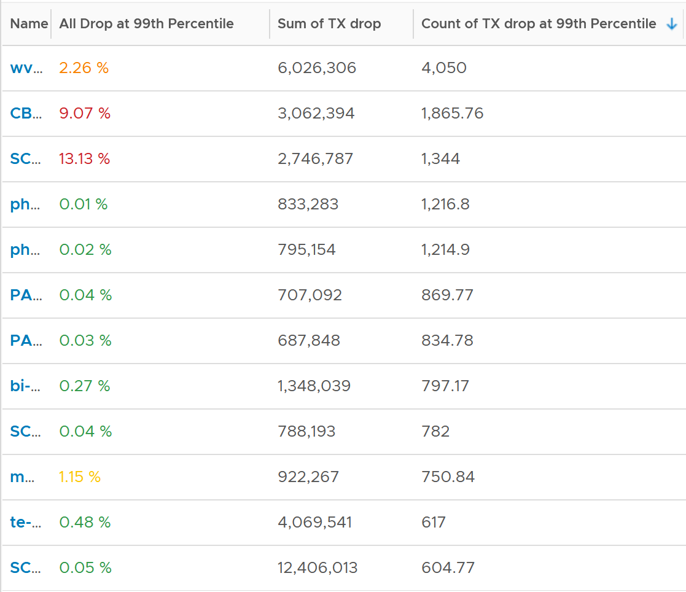

# VM Network Packets Dropped

## Meaning
- The only VM network contention metric.
- Received packets are dropped before reaching the Guest OS. Transmitted packets are dropped after leaving the Guest OS. So values do not match Guest OS counters.
- ESXi drops packets not destined for the guest or violating security settings.
- TCP retransmits dropped packets: the application sees higher latency.

## Formula (VCF Operations)
```text
dropped   = Received Packets Dropped + Transmitted Packets Dropped
delivered = Packets Received + Packets Transmitted
Packets Dropped (%) = dropped / (dropped + delivered) × 100
```

## Behaviour
- Receive drops are far higher than transmit drops: 3,938 VMs, 1 month, about 35 million data points. Receive drops are left out of the VM KPI for this reason.
- Drops are short and spiky: the 99th percentile was 35x smaller than the maximum.

- Packets Dropped (%) can jump above 95% for under 15 minutes. Driven by low throughput and high receive drops.



## Profile transmit drops
- Columns: 99th percentile of drop %; sum of transmitted dropped packets; 99th percentile of the maximum dropped in any 300 seconds.
- Millions of transmit drops a month need investigation with the network team. Nobody complains because TCP retransmits.
- Volume: 1,000 dropped packets at about 1.5 KB each = about 1.5 MB.
- Rare huge spikes: example above 100 million packets in 5 minutes, about 333 MB/s for 300 s at 1 KB per packet.
- Regular patterns (example: about 3,800 packets every 5 minutes) are worth raising with the network team.



## Known causes
- False positive transmit drops: NSX firewall rejects outgoing packets (Broadcom KB 322462).
- VMXNET3 packet loss in very high traffic bursts, even VM freezes: not enough receive and transmit buffer, or speed-constrained receive traffic (KB 2039495). A full receive ring is counted here (droppedRx, %DRPRX) and by the guest; the cause and the fix (a larger ring, guest CPU) are in the Guest OS, so the Guest OS owner fixes it. Which layer counts which drop: [`vsphere/technology/network/concepts/packet-drop-accounting`](../../concepts/packet-drop-accounting.md).

## Misconceptions
- "Packets Dropped (%) at 95% means an outage" → short spikes at low throughput, driven by receive drops.
- "No complaints, so transmit drops are harmless" → TCP hides them through retransmits.

## Metadata
```yaml
id: vsphere/technology/network/metrics/virtual-motherboard/packets-dropped
retriever_guide: metric-meaning
scope: vsphere
technology:
- network
pillar:
- performance
product:
- vsphere
object:
- VirtualMachine
layer:
- virtual-motherboard
metric_class: contention
internal_derive: []
same_name: []
same_meaning: []
related:
- vsphere/technology/network/metrics/vm-network-metrics
- vsphere/technology/network/metrics/virtual-motherboard/packets
images:
  - path: ../../images/vm-network-dropped-99th-percentile-vs-max-list-view.png
    product: [vcf-operations]
    object: [VirtualMachine]
    metric: ['VM Network Packets Dropped']
    image_type: table
    sample: '4,060 VMs'
  - path: ../../images/vm-network-receive-vs-transmit-dropped-across-vms.png
    product: [vsphere]
    object: [VirtualMachine]
    metric: ['VM Network Receive Packets Dropped', 'VM Network Transmit Packets Dropped']
    image_type: table
    sample: '3,938 VMs, 1 month'
  - path: ../../images/vm-network-dropped-percent-spike-at-low-throughput.png
    product: [vcf-operations]
    object: [VirtualMachine]
    metric: ['VM Network Packets Dropped (%)', 'VM Network Usage Rate']
    image_type: timeline
  - path: ../../images/vm-network-transmit-dropped-regular-spike-pattern.png
    product: [vsphere]
    object: [VirtualMachine]
    metric: ['VM Network Transmit Packets Dropped']
    image_type: timeline
    sample: '1 VM'
  - path: ../../images/vm-network-transmit-dropped-profile.png
    product: [vsphere]
    object: [VirtualMachine]
    metric: ['VM Network Transmit Packets Dropped']
    image_type: distribution
source:
  document: Private Cloud Management by Iwan Rahabok (https://isvara.io/download)
  path: Network > VM > Contention Metrics
corrections:
- 'Section ''Known causes'': VMXNET3 ring-buffer drops are guest-os layer, fixed in the guest (2026-11-06).'
- 'Section ''Profile transmit drops'': the book says 1 thousand dropped packets = 1,500 MB within 300 seconds. Correct: 1.5 MB (2026-11-04). Keep until the book is updated.'
review_notes:
- 'To check: KBs cited by the book, not read (https://knowledge.broadcom.com/external/article?articleNumber=322462 and https://kb.vmware.com/s/article/2039495).'
status: draft
```
