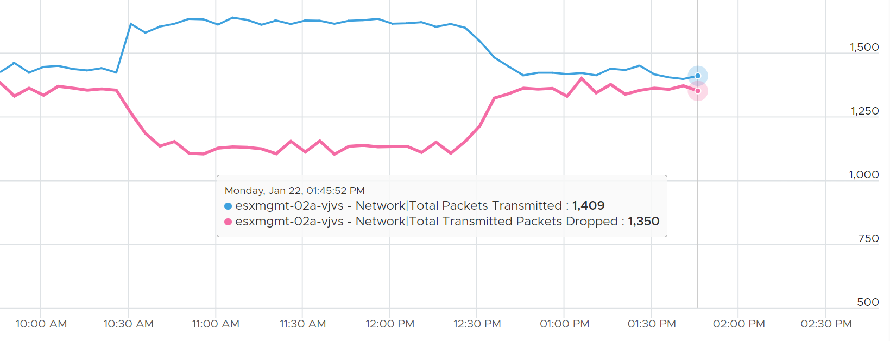

# VM Network Packets (transmitted and received)

## Meaning
- Count of packets in the sampling window, per direction.
- Packets transmitted counts only packets sent successfully. Dropped packets are excluded.
- Includes broadcast and multicast.

## Formula
```text
Packets transmitted per second = Total Packets Transmitted / 300   (VCF Operations 5-minute interval)
```

## Impact
- Each packet costs CPU. Bandwidth can remain while packets per second saturate.
- Example outage: 700,000 packets per second used only 800 Mbps. The broadcast packets were 60 bytes, not 1,500.


## Misconceptions
- "Low Mbps means low network load" → check packets per second.

## Metadata
```yaml
id: vsphere/technology/network/metrics/virtual-motherboard/packets
retriever_guide: metric-meaning
scope: vsphere
technology:
- network
pillar:
- performance
product:
- vsphere
object:
- VirtualMachine
layer:
- virtual-motherboard
metric_class: consumption
internal_derive:
- vsphere/technology/network/concepts/network-characteristics
- sp5-framework/observability/units
same_name:
- vsphere/technology/network/metrics/distributed-switch/packets
same_meaning: []
related:
- vsphere/technology/network/metrics/virtual-motherboard/throughput
- vsphere/technology/network/metrics/virtual-motherboard/packets-dropped
images:
  - path: ../../images/network-packets-transmitted-excludes-dropped.png
    product: [vsphere]
    object: [VirtualMachine]
    metric: ['VM Network Packets Transmitted', 'VM Network Transmit Packets Dropped']
    image_type: timeline
source:
  document: Private Cloud Management by Iwan Rahabok (https://isvara.io/download)
  path: Network > VM > Overview; Consumption Metrics
corrections: []
review_notes:
- 'Example outage cited by the book: https://communities.vmware.com/t5/VMware-vSphere-Discussions/Limit-on-network-packets-per-second-for-VMs/td-p/2312644 (community post).'
status: draft
```
