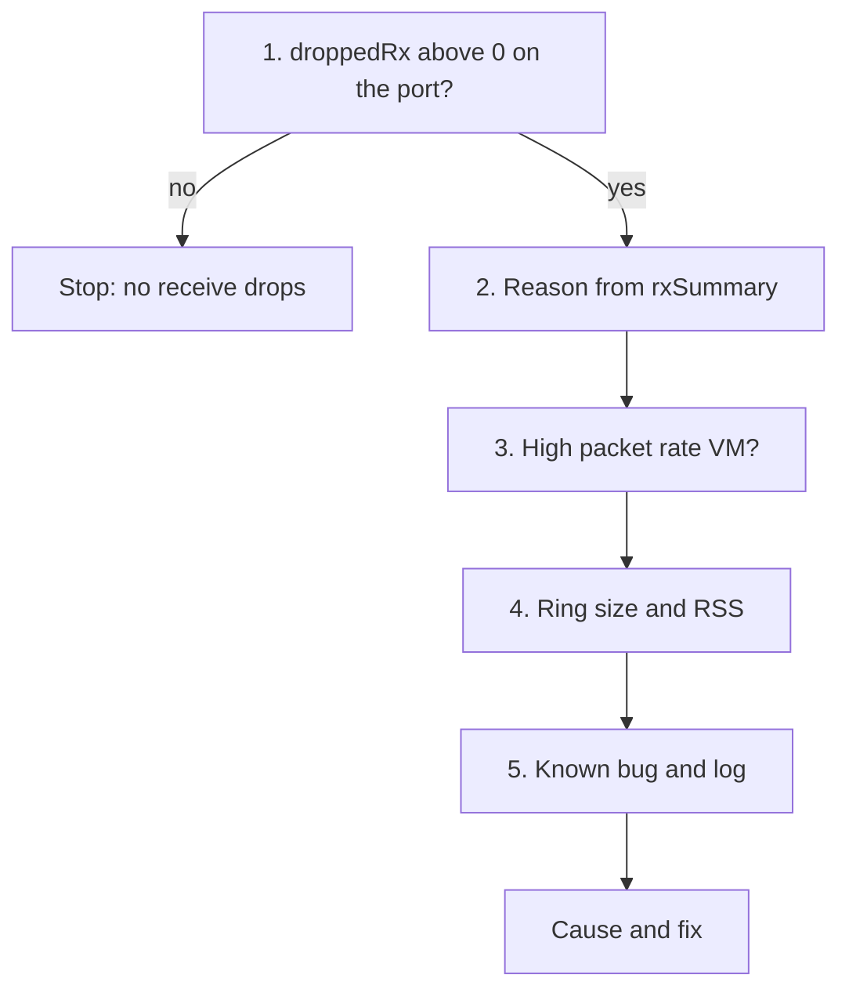

# vNIC receive drops

## Symptom
- Receive drops on a VM vNIC: droppedRx above 0 on its port, packet loss reported inside the Guest OS, or a network VM (firewall, router) losing traffic.
- The VM KPI scores transmit drops; receive drops on a VMXNET3 ring are caused and fixed in the Guest OS driver, so they are the Guest OS owner's to fix ([`sp5-framework/concepts/realms-and-layers`](../../../sp5-framework/concepts/realms-and-layers.md), section Consumer and provider metric types).

## Flow


## Checks, in order
1. Port statistics for the vNIC port (VirtualMachine, HostSystem) ([`vsphere/technology/network/metrics/virtual-motherboard/packets-dropped`](metrics/virtual-motherboard/packets-dropped.md)):
```text
vsish -e get /net/portsets/DvsPortset-0/ports/<port>/clientStats
```
   - droppedRx above 0 confirms receive drops (example: 2,620) → step 2. 0 → stop.
2. Reason, from the vmxnet3 receive queue summary (VirtualMachine):
```text
vsish -e get /net/portsets/DvsPortset-0/ports/<port>/vmxnet3/rxSummary
```
   - running out of buffers: matches the drop count (example: 2,620).
   - # of times the 1st ring is full: example 354.
   - 1st ring size and 2nd ring size: example 512 each.
   - Other reasons (fail to map, rx queue stopped, copy failures, large headers, MTU exceeded) at 0 rule them out. → step 3.
3. Consumption (VirtualMachine). Network VMs (firewalls, routers) or VMs expecting high packet rates ([`vsphere/technology/network/metrics/virtual-motherboard/packets`](metrics/virtual-motherboard/packets.md)). → step 4.
4. Configuration (VirtualMachine). Receive ring size in the Guest OS driver; whether the VM requests NetQ RSS ([`vsphere/technology/network/configuration/rss-and-interrupt-coalescing`](configuration/rss-and-interrupt-coalescing.md)). → step 5.
5. Known bug and log (VirtualMachine, HostSystem). VMXNET3 can lose packets in very high bursts when buffers run out (KB 2039495); events in the window ([`sp5-framework/performance/vm-slow`](../../../sp5-framework/performance/vm-slow.md), its known bug and log checks).

## Why this order
- Confirm the drops at the port first: Guest OS loss can come from elsewhere in the path.
- The reason before any change: only rxSummary tells a full ring from the other causes.
- Packet rate before ring size: a larger ring helps a burst, not a VM that is short of vCPU to drain it.

## How to read the result
- Drops = running out of buffers and ring full: the receive ring is too small. A ring of 2K instead of 512 is a field suggestion.
- Network VMs (firewalls, routers) or VMs expecting high packet rates: check whether the VM requests NetQ RSS.
- VMXNET3 can lose packets in very high bursts when buffers run out (KB 2039495).

## Misconceptions
- "vSphere shows the drop reason" → only vsish shows it.
- "Receive drops on the vNIC are the network team's problem" → a full VMXNET3 ring is caused and fixed in the Guest OS driver.

## Metadata
```yaml
id: vsphere/technology/network/vnic-rx-drops
retriever_guide: troubleshooting
scope: vsphere
technology:
- network
pillar:
- performance
product:
- vsphere
object:
- VirtualMachine
- HostSystem
internal_derive:
- vsphere/technology/network/metrics/virtual-motherboard/packets-dropped
- vsphere/technology/network/metrics/virtual-motherboard/packets
- vsphere/technology/network/configuration/rss-and-interrupt-coalescing
- sp5-framework/performance/vm-slow
related:
- vsphere/technology/network/metrics/host/packets-dropped
- sp5-framework/performance/performance-management
source:
  document: Private Cloud Management by Iwan Rahabok (https://isvara.io/download)
  path: Network > ESXi > Contention Metrics > Dropped Packet > vsish
corrections: []
review_notes:
- 'Section ''How to read the result'': the 2K ring size is a field suggestion from the book, not a vendor value.'
status: draft
```
