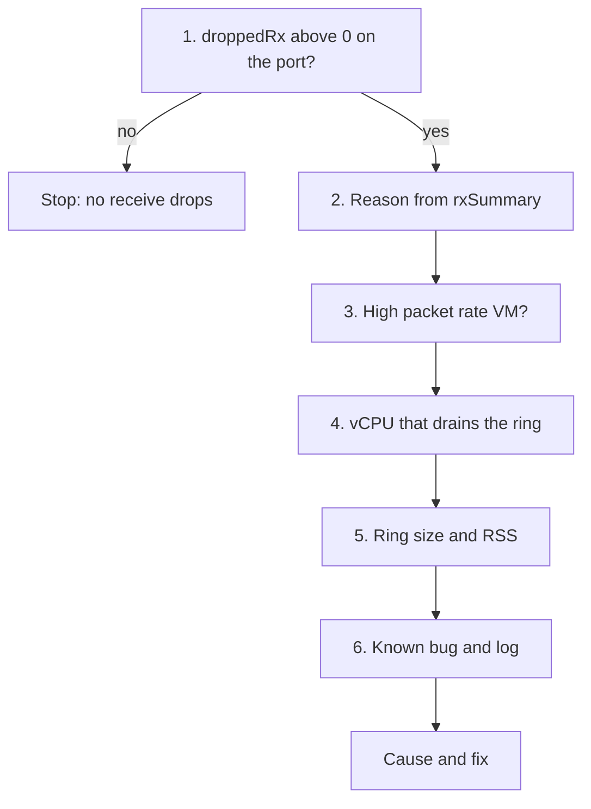

# vNIC receive drops

## Symptom
- Receive drops on a VM vNIC: droppedRx above 0 on its port, packet loss reported inside the Guest OS, or a network VM (firewall, router) losing traffic.
- The VM KPI scores transmit drops; receive drops on a VMXNET3 ring are caused and fixed in the Guest OS driver, so they are the Guest OS owner's to fix ([`sp5-framework/concepts/realms-and-layers`](../../../sp5-framework/concepts/realms-and-layers.md), section Consumer and provider metric types).

## Flow


## Checks, in order
1. Port statistics for the vNIC port (VirtualMachine, HostSystem) ([`vsphere/technology/network/metrics/virtual-motherboard/packets-dropped`](metrics/virtual-motherboard/packets-dropped.md)):
```text
vsish -e get /net/portsets/DvsPortset-0/ports/<port>/clientStats
```
   - droppedRx above 0 confirms receive drops (example: 2,620) → step 2. 0 → stop.
2. Reason, from the vmxnet3 receive queue summary (VirtualMachine):
```text
vsish -e get /net/portsets/DvsPortset-0/ports/<port>/vmxnet3/rxSummary
```
   - running out of buffers: matches the drop count (example: 2,620).
   - # of times the 1st ring is full: example 354.
   - 1st ring size and 2nd ring size: example 512 each.
   - Other reasons (fail to map, rx queue stopped, copy failures, large headers, MTU exceeded) at 0 rule them out. → step 3.
3. Consumption (VirtualMachine). Network VMs (firewalls, routers) or VMs expecting high packet rates ([`vsphere/technology/network/metrics/virtual-motherboard/packets`](metrics/virtual-motherboard/packets.md)). → step 4.
4. CPU (VirtualMachine). The vCPU that drains the receive ring: Guest OS CPU busy on that vCPU, or VM CPU Ready and Co-stop holding it back, leave the ring full ([`vsphere/technology/network/concepts/packet-drop-accounting`](concepts/packet-drop-accounting.md), section Receive drop; [`vsphere/technology/cpu/metrics/virtual-motherboard/ready`](../cpu/metrics/virtual-motherboard/ready.md); [`vsphere/technology/cpu/metrics/virtual-motherboard/co-stop`](../cpu/metrics/virtual-motherboard/co-stop.md); Broadcom KB 312565). One vCPU busy while the others idle: one receive queue (section Single receive queue). → step 5.
5. Configuration (VirtualMachine). Receive ring size in the Guest OS driver; whether the VM requests NetQ RSS ([`vsphere/technology/network/configuration/rss-and-interrupt-coalescing`](configuration/rss-and-interrupt-coalescing.md)). → step 6.
6. Known bug and log (VirtualMachine, HostSystem). VMXNET3 can lose packets in very high bursts when buffers run out (Broadcom KB 324556, legacy 2039495); events in the window ([`vsphere/object-types/vm/troubleshooting/vm-slow`](../../object-types/vm/troubleshooting/vm-slow.md), its known bug and log checks).

## Order rationale
- Confirm the drops at the port first: Guest OS loss can come from elsewhere in the path.
- The reason before any change: only rxSummary tells a full ring from the other causes.
- Packet rate and CPU before ring size: a larger ring absorbs a burst; when the vCPU that drains it is starved, a larger ring only delays the drops (Broadcom KB 312565).

## Interpretation
- Drops = running out of buffers and ring full, while the vCPU that drains the ring is not starved: the receive ring is too small for the bursts. A ring of 2K instead of 512 is a field suggestion.
- Network VMs (firewalls, routers) or VMs expecting high packet rates: check whether the VM requests NetQ RSS.
- Drops while the vCPU that drains the ring is busy in the guest, or in Ready or Co-stop: a CPU problem, not a ring size problem (Broadcom KB 312565).
- VMXNET3 can lose packets in very high bursts when buffers run out (Broadcom KB 324556, legacy 2039495).

## Single receive queue
- A VMXNET3 adapter with one receive queue has all its receive interrupts processed by one vCPU. That vCPU can saturate while the VM's other vCPUs idle, and the ring fills because it is not drained (Broadcom KB 440347).
- Symptoms of a single receive queue: running out of buffers and # of times the 1st ring is full rise in rxSummary; moving the VM to another host does not help (Broadcom KB 440347).
- Raising the VMXNET3 receive rings to their maximum does not stop drops caused by a single receive queue: a larger ring absorbs a burst, it does not drain faster (Broadcom KB 440347).
- The fix is Receive Side Scaling (RSS) in the Guest OS, with several receive queues spread over the vCPUs. Windows: VMXNET3 adapter Properties, Advanced tab, Maximum Number of RSS queues. Linux: the vmxnet3 driver parameter `num_rqs` (Broadcom KB 440347).
- The number of receive queues a VM can use is capped by its vCPU count: a 4-vCPU VM uses at most 4 (Broadcom KB 440347).
- Check the active queues on the host: `vsish -e ls /net/portsets/<switch>/ports/<port>/vmxnet3/rxqueues/` lists one directory per queue (Broadcom KB 440347).
- Guest RSS spreads receive work over vCPUs inside the VM. Host-side RSS on the physical NIC is a separate setting ([`vsphere/technology/network/configuration/rss-and-interrupt-coalescing`](configuration/rss-and-interrupt-coalescing.md)).

## Misconceptions
- "vSphere shows the drop reason" → only vsish shows it.
- "The largest receive ring fixes every receive drop" → with one receive queue, one vCPU drains the ring; turn on RSS in the guest instead.
- "Configure more receive queues than vCPUs for headroom" → the queues a VM can use are capped by its vCPU count.
- "Receive drops on the vNIC are the network team's problem" → a full VMXNET3 ring is caused and fixed in the Guest OS driver.
- "A larger receive ring stops the drops of a VM with high CPU Ready" → the ring fills because the vCPU does not drain it; a larger ring only delays the drops. Check VM CPU Ready and Co-stop and the Guest OS CPU of the vCPU that handles receive.

## Metadata
```yaml
id: vsphere/technology/network/vnic-rx-drops
retriever_guide: troubleshooting
scope: vsphere
technology:
- network
pillar:
- performance
product:
- vsphere
object:
- VirtualMachine
- HostSystem
internal_derive:
- vsphere/technology/network/metrics/virtual-motherboard/packets-dropped
- vsphere/technology/network/concepts/packet-drop-accounting
- vsphere/technology/network/metrics/virtual-motherboard/packets
- vsphere/technology/cpu/metrics/virtual-motherboard/ready
- vsphere/technology/cpu/metrics/virtual-motherboard/co-stop
- vsphere/technology/network/configuration/rss-and-interrupt-coalescing
- vsphere/object-types/vm/troubleshooting/vm-slow
related:
- vsphere/technology/network/metrics/host/packets-dropped
- sp5-framework/performance/performance-management
source:
  document: Knowledge base; Broadcom KB 440347 (Mitigating VMXNET3 adapter packet drops due to single receive queue, all ESXi versions); Broadcom KB 312565 (dropped receive packets at the virtual switch port, all ESXi versions); Broadcom KB 324556 (legacy 2039495); VMware vSphere 9.1 product documentation (PDF built 2026-11-02; the copyright page carries no revision number)
  path: 'Network > ESXi > Contention Metrics > Dropped Packet > vsish; section Single receive queue from Broadcom KB 440347; vSphere 9.1 documentation, Network Adapter Basics, VMXNET 3 multiqueue (RSS in Windows) (p. 981)'
corrections: []
review_notes: []
status: draft
```
