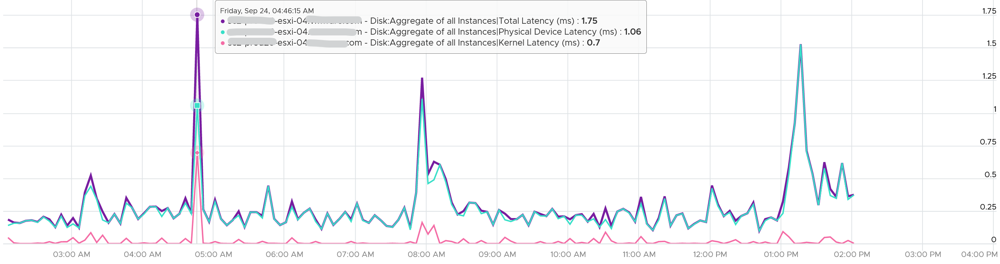

# ESXi storage latency stack

## Layers
- VM → kernel → device. The kernel is measured by KAVG and QAVG.
- The kernel cannot see between the HBA and the device: no fabric topology, no hop count.

## Counters
| Counter | Meaning | Healthy value |
|---|---|---|
| GAVG (Guest Average) | Total latency seen from the VMM. Guest means VM, not Guest OS. | - |
| KAVG (Kernel Average) | Time in the VMkernel. Derived from GAVG and DAVG. | Within 0.5 ms. |
| QAVG (Queue Average) | Time in kernel queues. Part of KAVG. | Correlates with KAVG when KAVG is healthy. |
| DAVG (Device Average) | From the ESXi HBA to the array and back. | Well within 5 ms; lower with SSD. |

```text
GAVG = KAVG + DAVG
```
- QAVG can exceed KAVG: QAVG covers VM IO and kernel IO; KAVG covers VM IO only.
- High QAVG: check queue depths at each level of the stack.
- High DAVG: the fabric or the array (front-end ports, CPU, cache, back-end ports, spindles). Array reports low latency: the fabric or HBA configuration.
- The bulk of latency should come from the device.

## NFS
- An NFS datastore has no SCSI device and no HBA. In esxtop it is an {NFS} pseudo-device: [`vsphere/tools/esxtop/storage`](../../../tools/esxtop/storage.md).

```text
DAVG (NFS) = network latency + remote NAS processing time
```
- No QAVG for NFS. QAVG is the average time an IO spends in the VMkernel storage device queue, waiting to be sent to a physical adapter (HBA, LUN).
- Block storage enforces a hard device queue depth (DQLEN), managed by the Pluggable Storage Architecture (PSA). When commands exceed DQLEN, they queue in the VMkernel: QAVG tracks that delay, then DAVG takes over.
- NFS bypasses PSA: no DQLEN, so no device queue for QAVG to measure.
- High DAVG on NFS: check the storage network (drops, MTU) and the NAS, not an HBA or a fabric.

## vSphere Client names
| Layer | Read | Write | Combined |
|---|---|---|---|
| Device | Physical device read latency | Physical device write latency | Physical device command latency |
| Kernel | Kernel read latency | Kernel write latency | Kernel command latency |
| Queue | Queue read latency | Queue write latency | Queue command latency |
| Guest | Read latency | Write latency | Command latency |

## Example
- Worst host of a set: device latency below 1.75 ms; kernel latency 0.2 ms except one spike. Kernel and device did not correlate; both were healthy.


## Misconceptions
- "Guest latency is measured inside Windows" → it starts at the VMM.
- "QAVG cannot exceed KAVG" → QAVG includes kernel IO.
- "NFS has no DAVG" → it has; for NFS, DAVG is network latency plus NAS processing time.

## Metadata
```yaml
id: vsphere/technology/storage/concepts/esxi-storage-latency-stack
retriever_guide: how-it-works
scope: vsphere
technology:
- storage
pillar:
- performance
product:
- vsphere
object:
- HostSystem
internal_derive: []
related:
- vsphere/technology/storage/metrics/host/disk
- vsphere/technology/storage/concepts/esxi-storage-io-path
- vsphere/technology/storage/troubleshooting/host-storage-latency
- vsphere/technology/storage/metrics/virtual-motherboard/disk-latency
images:
  - path: ../images/esxi-storage-kernel-latency-vs-device-latency.png
    product: [vsphere]
    object: [HostSystem]
    metric: ['ESXi Disk Kernel Latency', 'ESXi Disk Device Latency']
    image_type: timeline
source:
  document: Knowledge base
  path: Storage > ESXi > Disk or Device > Contention Metrics
corrections: []
review_notes:
- 'To check: what DAVG measures for vSAN when data is local; unconfirmed.'
status: draft
```
