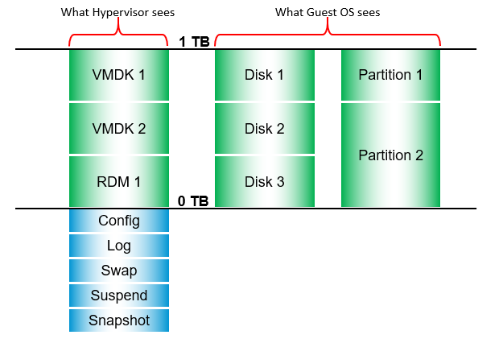

# Guest OS storage vs VM storage

## Metric mapping
| Type | Guest OS metric | VM metric |
|---|---|---|
| Contention | OS queue, driver queue | None. The VM is a motherboard, not an OS. The driver is Guest OS specific. |
| Contention | Latency | Latency. Should be similar, especially over time. |
| Utilization | IOPS, throughput | IOPS, throughput. Should match over time. If not, something is wrong. |

## Space discrepancy
- RDM or thick VMDK: the VM sees 100% used, whatever the guest uses.
- Unmapped blocks: the guest cannot see this overhead.

## VM capacity sources


| Source | Examples | Notes |
|---|---|---|
| Virtual disk | VMDK or RDM | Properties: provisioning (thin, lazy zero, eager zero), RDM type (physical or virtual). |
| Compute virtualization | Snapshots, swap files, logs | Invisible to the Guest OS. Overhead and non-overhead. |
| Storage virtualization | vSAN protection, deduplication, compression | Report separately; not applicable outside vSAN. |

## Aggregate vs per disk
- VM-level storage metrics average all virtual disks. A slow data disk can be hidden.
- Watch the disk that matters, for example the data disk of a large database.

## Traps
- "VM disk used = Guest OS disk used" → thick and RDM disks show 100%.
- "VM latency fine, so the data disk is fine" → check per virtual disk.

## Metadata
```yaml
id: vsphere/technology/storage/concepts/guest-os-vs-vm-storage
retriever_guide: how-it-works
scope: vsphere
technology:
- storage
pillar:
- performance
- capacity
product:
- vsphere
- windows
- linux
object:
- VirtualMachine
internal_derive:
- vsphere/architecture/vm-vs-guest-os
related:
- vsphere/technology/storage/concepts/storage-layers
- vsphere/technology/storage/metrics/virtual-motherboard/disk-latency
- vsphere/technology/storage/metrics/virtual-motherboard/iops
- vsphere/technology/storage/metrics/virtual-motherboard/virtual-disk
images:
  - path: ../images/vm-storage-capacity-sources-disks-and-virtualization-files.png
    product: [vsphere]
    object: [VirtualMachine]
    topic: 'VM storage capacity'
    image_type: diagram
source:
  document: PART 3 - Counters.docx
  path: Storage > Architecture > VM Layer > Metric Mapping; Capacity
corrections: []
review_notes: []
status: draft
```
